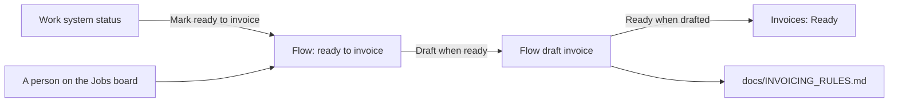

# Automations

An automation is a Flow routine that moves Flow's own records on. Each one is
on or off and has its own settings. No other system's status is part of a
Flow stage: an automation reads that status and changes the Flow stage. The
code is in `server/core/automations.js`. An organisation's choices are in the
`automations` table, and at `/api/invoicing/automations`.

The pipeline (`server/core/pipeline.js`) runs the automations that are on
after it reads the integrations and runs the matcher, every two minutes.

| Automation | Key | Shown on | Default | Does |
| --- | --- | --- | --- | --- |
| Mark ready to invoice | `mark_ready_from_work_status` | The Seazona integration page | On; statuses shipped, delivered | Marks a job in work ready to invoice when its work system status is one of the chosen statuses, in any case |
| Draft when ready | `draft_when_ready` | Settings, Invoicing | On | Drafts the invoice of each ready job that passes the invoicing rules. With no accounting integration, Flow's own records are the check |
| Ready when drafted | `ready_when_drafted` | Settings, Invoicing | On | Puts each draft that "Draft when ready" made in Ready on the Invoices page, so "Send all ready" sends it. A draft a person changed or moved back to Drafts stays with people. A draft with a problem shows in Problem |

Each automation shows on the screen of the data that triggers it (`place`).

The ready statuses are picked from a menu, not typed. The menu lists each
status the work system has reported for the lab's jobs, with the number of
jobs at each (`GET /api/invoicing/work-statuses`). Each lab's Seazona can use
its own statuses, so the menu follows the lab's data. A status picked earlier
stays in the menu when no job has it now.

## People decide first

- A person can mark a job ready, or put it back in work, at
  `POST /api/invoicing/jobs/:id/ready`. A job with an invoice cannot go back
  in work.
- When a person puts a job back in work, "Mark ready to invoice" leaves that
  job alone from then on. A person marks it ready again.
- Each change is an event on the job (`ready`, `in_work`) with its actor:
  `person:<id>` or `automation:<key>`.

## Later

Two-way stages: when a person moves a job in Flow, Flow sets the matching
status in the work system. Seazona cannot change a job's status by its API
yet, so this waits on Seazona.
