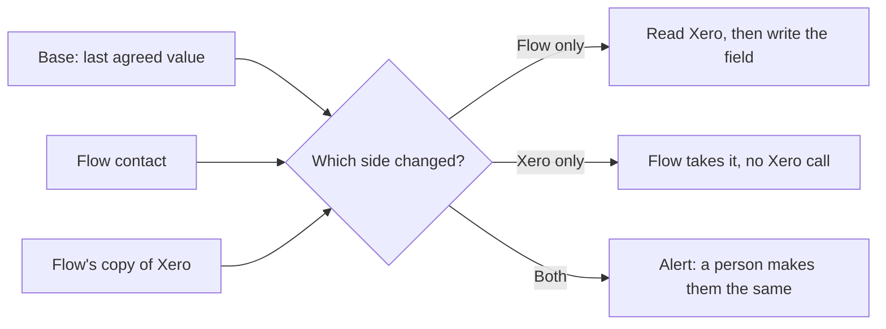

# Contacts

Contacts are Flow's own customers and suppliers. The Contacts page works
with no integration connected. Xero and Seazona read this record; they do
not replace it. A Xero contact stays in `xero_contacts`. The link between
the two is `external_links` (`docs/DATA_SPINE.md`).

Code: `server/core/contacts.js`. Screen: Contacts (`server/ui/contacts.js`).
API: `server/api/invoicing.js`. Creating the Xero contact:
`server/integrations/xero/create-contact.js`.

## The record

A contact is a customer or a supplier. One name per kind in an organisation.

| Field | What it is |
| --- | --- |
| Name | The billing name. Xero's Name. Seazona's company. 255 characters at most. |
| Kind | `customer` or `supplier`. An invoice goes to a customer. |
| First name, last name | The person on the account, when the contact is a person. |
| Email | The billing email. |
| Phone, mobile | The full number, as Xero stores it. |
| Account | The lab's account number for this contact. |
| Tax number | The tax id, such as an ABN. |
| Tax rate | Seazona's rate for the practice. Flow does not send it to Xero. |
| Address | One address: line 1, line 2, city, region, postal code, country. Xero gets it as both the postal and the street address. |
| Practitioners | People at the practice. Up to 30. The first five go to Xero as contact persons. Flow stores no patient. |
| Active | On by default. An inactive contact stays in Flow and drops out of the invoice client list. |

## New clients

A client in the work system (Seazona) that no Flow contact is named like
becomes a Flow contact, linked to that client (`imported`). It takes the
client's billing name, email, phone, account, tax rate, address and doctors
(as practitioners). A field Flow cannot keep is left out. Names compare
without case, punctuation or a company suffix (`Pty Ltd`), so an existing
contact links instead (`exact_name`). Two clients of one name stay for a
person. The automation is **Add new clients** (`add_contacts`, on by
default, on the Seazona page; `docs/AUTOMATIONS.md`). With it off, a job
whose client has no contact waits with "Client not linked".

## Xero clients

With **Add Xero clients** on (`add_xero_contacts`, off by default, on the
Xero page under Contacts), each active Xero contact that no Flow contact is
named like becomes a Flow customer, linked to it (`imported`). It takes the
name, person, email, phone, mobile, account, tax number and address from
Flow's copy of Xero. Names compare as for new clients above, so an existing
contact links instead. A contact Xero marks a supplier only stays out.

## Two-way edits

With **Two-way edits** on (`sync_contact_edits`, off by default, on the Xero
page under Contacts), Flow keeps each linked pair in step. The fields are the
name, first and last name, email, phone, mobile, account, tax number and
address. Practitioners, the tax rate and Active stay Flow's own.

- Flow keeps the base for each pair (`xero_contact_sync`). The first compare
  has none: a blank on one side takes the other side's value, and two
  different values are a clash.
- Before a write Flow reads the Xero contact. When Xero changed that field
  since the copy, Flow writes nothing and compares again next time.
- A write needs `XERO_ALLOW_LIVE_WRITES` in live mode. Until then a Flow edit
  waits; Xero's edits still come in.
- A clash is alert only. The contact page says which fields differ, and the
  Xero page counts them. Make the two the same, in Flow or in Xero; the next
  check closes it. A field Xero refused, or a value too long for Flow, is a
  clash too.
- Xero's edits arrive when Flow reads the contacts: once a day, within an
  hour of a Xero webhook, or on Sync.

## The page

Contacts sits with daily work. New asks for the name, the kind and the
email, then opens the record. The record holds the rest. Search matches
the name, email or account. The kind filter is All, Customers or
Suppliers. Everyone signed in can read. An owner or admin saves.

## Xero

Flow keeps a copy of the connected Xero organisation's contacts
(`xero_contacts`, refreshed by sync). Preparing an invoice matches the Flow
contact to that copy by the identity-map link first, then by name.

When Xero is connected, a pending invoice whose client is not in Xero, or is
in Xero twice, offers **Link**: pick the Xero client from a list, nearest
names first. Flow links the two and calls Xero nothing. Use it when Xero
knows the client by another name.

When Create missing clients is also on (the default, including when
`XERO_CREATE_CONTACTS` is unset) and writes are allowed, the invoice offers
**Create** as well. Create names any close Xero names first, so a second
client is not made by mistake. The contact page offers the same. Live mode
still needs `XERO_ALLOW_LIVE_WRITES`. With the setting off, the check stays
and the text says to link the client or add it in Xero, then sync. Staff see
the flag. Owners and admins see Link and Create.

Create (`POST /api/xero/contacts`) does this:

1. If the copy already has one match, Flow links it and calls Xero nothing.
2. If Xero has exactly one active contact of that name, Flow stores that
   copy and links it (`exact_name`).
3. Otherwise Flow creates one Xero contact from this record and links it
   (`created_by_flow`).
4. An archived-only name, or more than one active contact of that name, is
   refused. Flow does not change a Xero contact that already exists.

A second press for the same contact finds the first. The invoice is checked
again; when nothing else is wrong it is Ready.

Link (`POST /api/xero/contacts/link`) writes the `person` link. The Xero
contact must be active and not linked to another Flow contact.

`GET /api/xero/contacts/match?organisationId=…&contactId=…` answers
`matched`, `missing`, `ambiguous` or `off`, and whether Link and Create are
offered. It reads the copy and makes no Xero call.

Screen code: `server/ui/xero-contact.js` (Link and Create, on both pages).
