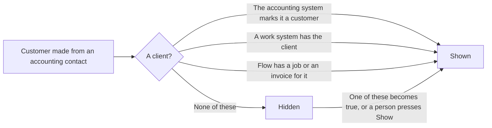
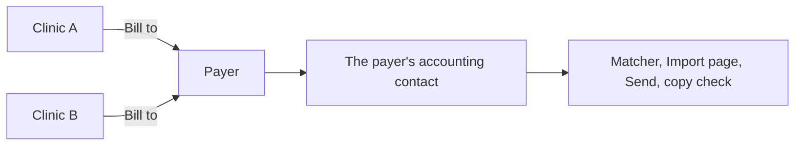
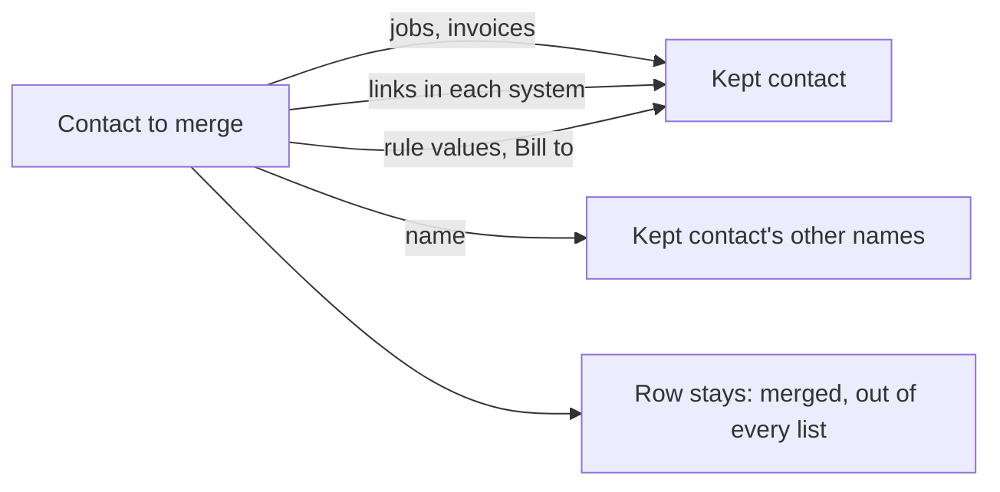
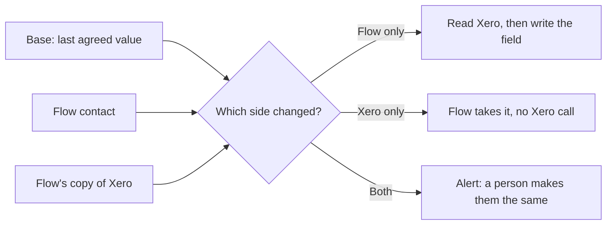

# Contacts

Contacts are Flow's own customers and suppliers. The Contacts page works
with no integration connected. Xero and Seazona read this record; they do
not replace it. A Xero contact stays in `xero_contacts`. The link between
the two is `external_links` (`docs/DATA_SPINE.md`).

Code: `server/core/contacts.js`. Screen: Contacts (`server/ui/contacts.js`).
API: `server/api/invoicing.js`. Creating the Xero contact:
`server/integrations/xero/create-contact.js`.

## The record

A contact is a customer or a supplier. One name per kind in an organisation.

| Field | What it is |
| --- | --- |
| Name | The billing name. Xero's Name. Seazona's company. 255 characters at most. |
| Kind | `customer` or `supplier`. An invoice goes to a customer. |
| First name, last name | The person on the account, when the contact is a person. |
| Email | The billing email. |
| Phone, mobile | The full number, as Xero stores it. |
| Account | The lab's account number for this contact. |
| Tax number | The tax id, such as an ABN. |
| Tax rate | Seazona's rate for the practice. Flow does not send it to Xero. |
| Address | One address: line 1, line 2, city, region, postal code, country. Xero gets it as both the postal and the street address. |
| Practitioners | People at the practice. Up to 30. The first five go to Xero as contact persons. Flow stores no patient. |
| Active | On by default. An inactive contact stays in Flow and drops out of the invoice client list. |
| Hidden | Off by default. A contact that is not a client ("Hidden contacts" below). |

## New clients

A client in the work system (Seazona) that no Flow contact is named like
becomes a Flow contact, linked to that client (`imported`). It takes the
client's billing name, email, phone, account, tax rate, address and doctors
(as practitioners). A field Flow cannot keep is left out. Names compare
without case, punctuation or a company suffix (`Pty Ltd`), so an existing
contact links instead (`exact_name`). Two clients of one name stay for a
person. The automation is **Add new clients** (`add_contacts`, on by
default, on the Seazona page; `docs/AUTOMATIONS.md`). With it off, a job
whose client has no contact waits with "Client not linked".

## Xero clients

With **Add Xero clients** on (`add_xero_contacts`, off by default, on the
Xero page under Contacts), each active Xero contact that no Flow contact is
named like becomes a Flow customer, linked to it (`imported`). It takes the
name, person, email, phone, mobile, account, tax number and address from
Flow's copy of Xero. Names compare as for new clients above, so an existing
contact links instead. Only a contact that Xero marks a customer (it has a
sales invoice in Xero) becomes one. A supplier, a staff member or a name from
a bank line stays out; it still links by name to a contact Flow has.

## Hidden contacts

Earlier versions made a Flow customer from every Xero contact that was not a
supplier only. Most of those are not clients. Flow keeps them and hides them:
a hidden contact is in no list but its own, and Flow never deletes one.

- The pipeline hides them one time for an organisation, after the accounting
  copy has contacts and, when a work system is connected, after one of its
  clients is linked. After that, only a person hides or shows a contact
  (`hidden` on `PATCH /api/invoicing/contacts/:id`).
- Each pass shows a hidden contact that became a client: the accounting
  system now marks it a customer, a work system has it, or Flow has a job,
  an invoice, the customer's own invoicing settings, or a client that bills
  to it. This also undoes a person's Hide of a contact that is a client.
- A contact a person made in Flow, one that was in Flow before its
  accounting link, and one whose accounting contact is archived there, is
  never hidden by the rule.
- New refuses a name that a hidden contact has, and says to show that one.
- To take a real client out of the lists, use Active.

Code: `hideNonClients` in `server/core/pipeline.js`. The accounting system's
mark is `customer` on `listCustomers` (`server/integrations/xero/lookup.js`).

## Bill to

Some clients do not pay their own bills: a group pays for each of its
clinics, under one accounting contact. **Bill to** on a client's page names
the payer, another Flow customer. The client keeps its own jobs and Flow
invoices; only the accounting side looks under the payer.

- The matcher looks for a client's invoices under the payer's accounting
  contact. The jobs of all the payer's clients, and the payer's own, are one
  pool, so two jobs at one price share the invoices by date.
- The Import page fits a Xero invoice of the payer to the jobs and Flow
  invoices of each client. Make Flow invoice keeps the Flow invoice with the
  job's client.
- Send gives the payer's accounting contact. When the payer has none, Send
  stops with "Payer not in Xero"; link the payer on its own page.
- An invoice under the client's own accounting contact, from before Bill
  to, still fits the client's jobs.
- Setting or clearing Bill to sends the client's unbilled jobs back to the
  matcher on its next pass.
- One level only: a payer bills to itself, and a client that others bill to
  names no payer. The payer must be a customer, and a customer in a Bill to
  cannot become a supplier until Bill to is cleared.
- `billToContactId` on `PUT /api/invoicing/contacts/:id/billing`; null clears
  it. A payer is never hidden (Hidden contacts, above).

Code: `payersOf`, `billedBy` and `billedContact` in `server/core/contacts.js`.

## Merge two contacts

One client is sometimes two Flow contacts: the work system's name and the
accounting system's longer name. **Merge** on a contact's page picks the
other contact. The page's contact stays; the other moves into it.

- Moves the jobs, Flow invoices, links to other systems, rule values
  ("Customer is" tests), open review items and Bill to rows. Each moved job
  notes the merge (`contact_merged`, with who did it). Every unbilled job of
  the kept contact, and of its clients, goes back to the matcher.
- Bill to: the kept contact bills to the payer either contact had. The merged
  contact's own settings row names no payer after the merge.
- The kept contact keeps the other's name as another name (`aliases`).
  Search finds it by that name, and a client of that name in another system
  links to it.
- The merged contact stays, read only, out of every list, and points at the
  kept one. Flow never deletes it. Its name gets "(merged …)", so the kept
  contact can take the old name. New refuses a name that is another name of a
  contact, and names that contact. A rule cannot name a merged contact, and
  the rule menu leaves it out. A contact merged earlier into the merged one
  points at the kept one.
- Refused when both contacts are linked in one system (keep one link first),
  when they are not the same kind, when one was already merged, or when the
  result would break Bill to's one level.
- Flow never merges by itself.
- `POST /api/invoicing/contacts/:id/merge {fromId}`, owner or admin. `:id`
  stays.

Code: `mergeContacts` in `server/core/merge-contacts.js`.

## Two-way edits

With **Two-way edits** on (`sync_contact_edits`, off by default, on the Xero
page under Contacts), Flow keeps each linked pair in step. The fields are the
name, first and last name, email, phone, mobile, account, tax number and
address. Practitioners, the tax rate and Active stay Flow's own.

- Flow keeps the base for each pair (`xero_contact_sync`). The first compare
  has none: a blank on one side takes the other side's value, and two
  different values are a clash.
- Before a write Flow reads the Xero contact. When Xero changed that field
  since the copy, Flow writes nothing and compares again next time.
- A write needs `XERO_ALLOW_LIVE_WRITES` in live mode. Until then a Flow edit
  waits; Xero's edits still come in.
- A clash is alert only. The contact page says which fields differ, and the
  Xero page counts them. Make the two the same, in Flow or in Xero; the next
  check closes it. A field Xero refused, or a value too long for Flow, is a
  clash too.
- Xero's edits arrive when Flow reads the contacts: once a day, within an
  hour of a Xero webhook, or on Sync.

## The page

Contacts sits with daily work. New asks for the name, the kind and the
email, then opens the record. The record holds the rest. Search matches
the name, email or account. The kind filter is All, Customers, Suppliers or
Hidden. Hidden lists the contacts that are not clients; the record of one
says so and offers Show. Everyone signed in can read. An owner or admin
saves.

## Xero

Flow keeps a copy of the connected Xero organisation's contacts
(`xero_contacts`, refreshed by sync). Preparing an invoice matches the Flow
contact to that copy by the identity-map link first, then by name.

When Xero is connected, a pending invoice whose client is not in Xero, or is
in Xero twice, offers **Link**: pick the Xero client from a list, nearest
names first. Flow links the two and calls Xero nothing. Use it when Xero
knows the client by another name.

When Create missing clients is also on (the default, including when
`XERO_CREATE_CONTACTS` is unset) and writes are allowed, the invoice offers
**Create** as well. Create names any close Xero names first, so a second
client is not made by mistake. The contact page offers the same. Live mode
still needs `XERO_ALLOW_LIVE_WRITES`. With the setting off, the check stays
and the text says to link the client or add it in Xero, then sync. Staff see
the flag. Owners and admins see Link and Create.

Create (`POST /api/xero/contacts`) does this:

1. If the copy already has one match, Flow links it and calls Xero nothing.
2. If Xero has exactly one active contact of that name, Flow stores that
   copy and links it (`exact_name`).
3. Otherwise Flow creates one Xero contact from this record and links it
   (`created_by_flow`).
4. An archived-only name, or more than one active contact of that name, is
   refused. Flow does not change a Xero contact that already exists.

A second press for the same contact finds the first. The invoice is checked
again; when nothing else is wrong it is Ready.

Link (`POST /api/xero/contacts/link`) writes the `person` link. The Xero
contact must be active and not linked to another Flow contact.

`GET /api/xero/contacts/match?organisationId=…&contactId=…` answers
`matched`, `missing`, `ambiguous` or `off`, and whether Link and Create are
offered. It reads the copy and makes no Xero call.

Screen code: `server/ui/xero-contact.js` (Link and Create, on both pages).
