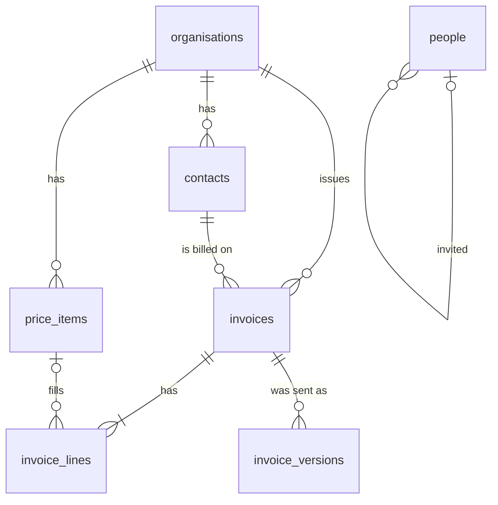

# Data model

Flow keeps its records in PostgreSQL. The schema is in
`server/db/schema.js`; migrations are in `server/db/migrations/` and run when
the server starts.

`people` lists who may sign in and their role (`owner`, `admin`, `staff`).
One installation serves one lab, so it is installation-wide.

## Rules

| Rule | Where it is held |
| --- | --- |
| Every row except in `people` belongs to one organisation. A child row points at its parent through `(organisation_id, id)`, so a row that joins two organisations is refused. | Composite foreign keys |
| Every read and write in the core takes an organisation id. | `server/core/*` |
| Money is integer cents. GST is 10%, calculated and rounded per line, half away from zero. | `server/core/money.js` |
| A draft invoice can change. Issuing gives it the organisation's next number and stores the document exactly as sent in `invoice_versions`. | `server/core/invoices.js` |
| What was sent never changes: `invoice_versions` rows cannot be updated or deleted, lines change only on a draft, a number never changes, an issued invoice is voided and never deleted, and a void invoice is final. | Triggers in `0001_records_are_append_only.sql` |
| A person's email is stored lower-case and is unique. A Clerk user links to at most one person. | Constraints on `people` |
| To change an issued invoice, revise it to a draft and issue it again. It keeps its number and gets the next version. | `reviseInvoice` |

## Change the schema

1. Edit `server/db/schema.js`.
2. Run `npm run db:generate` and commit the new migration.
3. Put rules Drizzle cannot express (triggers, functions) in a custom
   migration: `npx drizzle-kit generate --custom --name <what>`.
4. Never edit a migration that is on `main`. Add a new one.

## Tests

Tests that need PostgreSQL read `FLOW_TEST_DATABASE_URL`. Setup drops and
recreates the whole `public` schema, so point it only at a throwaway database.
Outside CI those tests skip when it is unset; CI runs them against a
PostgreSQL service.
