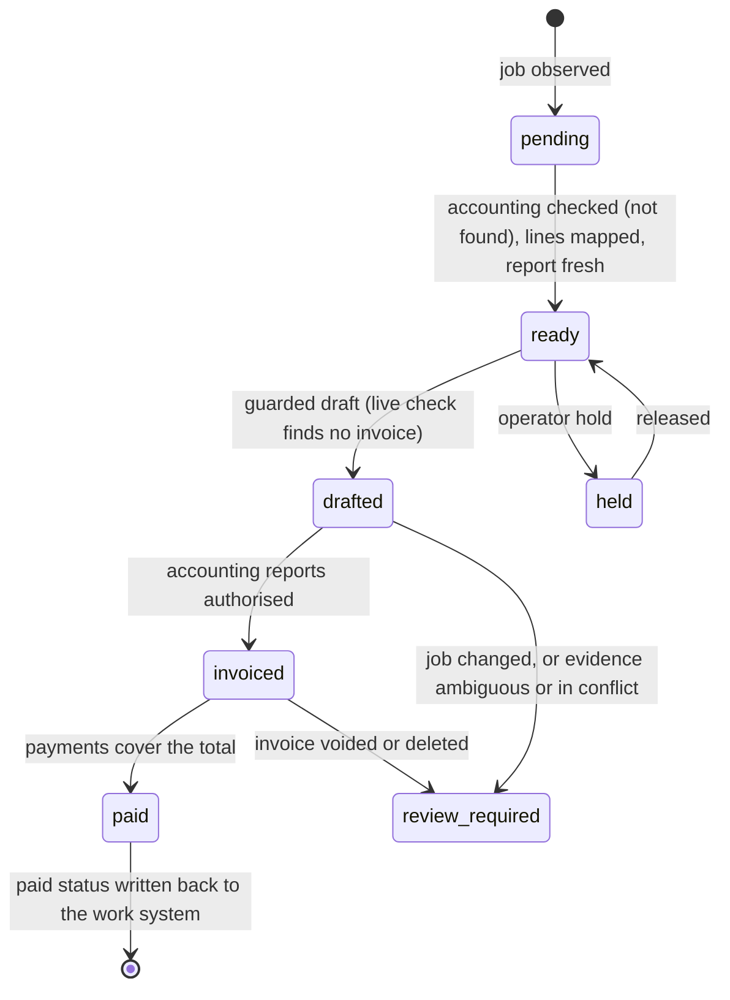

# Data model

Flow keeps its records in PostgreSQL. The schema is in
`server/db/schema.js`; migrations are in `server/db/migrations/` and run when
the server starts.

Flow's tables, the integrations' included, live in the PostgreSQL schema
`flow`, not `public` (migration `0021`). Each of Flow's connections searches
`flow, public` (`FLOW_SEARCH_PATH` in `server/db/index.js`), and the
migration sets the same default for Flow's role (and for the database when
Flow owns it), so SQL names tables without a schema. A transaction pooler
(Neon's `-pooler` hosts) does not keep a session's `SET`, but every new
session gets the role's default. The pooler's sessions from before the move
keep the old one, so the migration closes this role's idle sessions and the
pooler opens new ones (tested against PgBouncer in transaction mode). The reason is Replit: its publish compares
the workspace's `public` schema with production's and offers to make
production match, deletes included (`docs/REPLIT.md`, "The workspace
database"). The migration journals stay in `drizzle`.

```mermaid
erDiagram
  organisations ||--o{ contacts : has
  organisations ||--o{ price_items : has
  organisations ||--o{ invoices : issues
  contacts ||--o{ invoices : "is billed on"
  invoices ||--|{ invoice_lines : has
  price_items |o--o{ invoice_lines : "fills"
  invoices ||--o{ invoice_versions : "was sent as"
  people |o--o{ people : "invited"
  organisations ||--o{ billing_obligations : tracks
  contacts |o--o{ billing_obligations : "is billed for"
  billing_obligations |o--o| invoices : "is invoiced by"
  billing_obligations ||--o{ obligation_events : "is explained by"
  billing_obligations ||--o{ obligation_payments : "is paid by"
  billing_obligations ||--o{ obligation_writebacks : "reports back by"
  organisations ||--o{ external_links : "links its records by"
  organisations ||--o{ background_jobs : runs
  organisations ||--o{ outbox : "writes out through"
  organisations ||--o{ review_items : "asks a person through"
  organisations ||--o{ prior_links : "carries over from an earlier app"
  billing_obligations ||--o{ link_suggestions : "may be billed by"
  billing_obligations ||--o{ link_rejections : "is never billed by"
  organisations ||--o{ pipeline_cursors : "reads on from"
  organisations ||--o| invoicing_settings : "drafts and sends by"
  organisations ||--o{ invoice_rules : "checks ready jobs by"
  contacts ||--o| customer_billing_settings : "overrides rules by"
  organisations ||--o{ automations : "runs"
  organisations ||--o{ job_fields : "describes its jobs by"
  job_fields ||--o{ job_field_values : "holds"
  job_fields ||--o{ job_field_events : "is explained by"
  organisations ||--o| job_field_settings : "colours its field groups by"
  organisations ||--o{ captures : "stores a form photo as"
```

`external_links`, `background_jobs`, `outbox` and `review_items` are the data
spine every integration shares (`docs/DATA_SPINE.md`). `prior_links` holds
job to accounting record links from an earlier installation, one per job and
system, until the job becomes an obligation.

`link_suggestions`, `link_rejections` and `pipeline_cursors` belong to the
pipeline that links each job to its accounting invoice
(`docs/JOB_INVOICE_LINKS.md`). `billing_obligations.job_date` is the day of
the work that the matcher compares with invoice dates.

`invoicing_settings` and `customer_billing_settings` hold the invoicing rules
and send modes (`docs/INVOICING_RULES.md`). `billing_obligations.ready_at`
and `ready_by` record Flow's own "ready to invoice" stage: when, and which
person or automation. `billing_obligations.source_status` is the work
system's status. `automations` holds each organisation's choices for Flow's
routines, such as marking a job ready from that status (`docs/AUTOMATIONS.md`).
`invoice_rules` holds the checks each lab builds on a ready job: When, If,
Then (`docs/INVOICE_RULES.md`).

`job_fields`, `job_field_values` and `job_field_events` hold the lab's custom
fields for its jobs, each job's values, and who changed them
(`docs/CUSTOM_FIELDS.md`). A value is keyed by the work system's job,
`(source_system, source_job_ref)`, so a job needs no obligation to have one.
`job_field_settings` holds one row per organisation: each type group's
colour, and when Flow made the Assignee field.

`captures` is one photo of a handwritten lab form. The bytes live in the
object storage adapter. The row keeps the key, size, type and checksum, the
empty or typed proposal, and the decision (`applied` or `discarded`). A new
capture is `ready`: this slice does not call a model and does not change a
job. The photo is deleted when someone decides, and a capture with no
decision is deleted after 7 days.

`contacts` is Flow's own customer or supplier (`docs/CONTACTS.md`): name,
first and last name, email, phone, mobile, account number, tax number, tax
rate, address, practitioners (people at the practice, up to 30) and whether
the contact is active. One name per kind in an organisation. An
integration's copy of the same person stays in that integration's tables
and links through `external_links`.

`people` lists who may sign in and their role (`owner`, `admin`, `staff`).
One installation serves one lab, so it is installation-wide.

Each integration adapter owns its own tables, named after it (`seazona_…`).
They exist only once the adapter has been on at a start, and they are not in
`server/db/schema.js` (`docs/INTEGRATIONS.md`).

## Billing obligation ledger

One billable job in a work system is one `billing_obligations` row, keyed by
`(organisation_id, source_system, source_job_ref)`. It stores what the work
system reported (a case number, never patient data), what the accounting
system reported, and how that evidence matched. `server/core/ledger.js` gives
each obligation one view from that evidence only:

- Accounting evidence counts only when it matches the job exactly
  (`flow_invoice`, `source_invoice_ref` or `accounting_ref`). Any other match
  makes the obligation `ambiguous`, for a person to resolve.
- A payment counts only with an exact match and a confirmed invoice. A part
  payment shows as `part_paid`.
- When the payments cover the total, an `obligation_writebacks` row holds the
  paid status for the work system, with the evidence: the invoice link and
  each payment (date, amount, reference, reconciled or not). A failed
  write-back stays and is tried again. It never changes the accounting record.

## Invoicing API

The web UI reads and changes invoices through `/api/invoicing`
(`server/api/invoicing.js`). Every route needs a signed-in, active person.
`organisationId` (query or body) names the organisation; it may be left out
while the installation has exactly one. Money is integer cents. Answers are
`{ ok: true, … }`, or `{ ok: false, code, error }` with 400, 403, 404 or 409.

| Route | Who | What |
| --- | --- | --- |
| `GET /context` | anyone | `organisations` (`id`, `name`, `invoicePrefix`, `nextInvoiceNumber`) and `canIssue` |
| `GET /invoices?status=&q=&filter=&sort=&dir=&offset=&limit=` | anyone | One page, newest first unless sorted, each with `contactName` and its `job`; `q` matches number, reference or customer; `filter` and `sort` run over every invoice of the tab; `total`, `totalCents`, `counts` by status (`docs/INVOICE_SENDING.md`) |
| `GET /invoices/:id` | anyone | The invoice with `lines`, `contact`, `job` and issued `versions` |
| `GET /invoices/:id/pdf?version=` | anyone | The invoice as an A4 PDF drawn by Flow, with no accounting system calls. Every page carries an EXAMPLE mark. A draft shows its lines now. Once the accounting system holds the version, its number, reference and dates come from Flow's copy of it (`documentFacts`); a value nobody knows yet is a grey note that says why, never a sample value. An issued or void invoice shows its stored version; `version` picks an earlier one (`server/core/invoice-pdf.js`) |
| `POST /invoices` `{ contactId, reference?, dueDate?, lines }` | anyone | A new draft (201) |
| `PATCH /invoices/:id` `{ contactId?, reference?, dueDate?, lines? }` | anyone | Changes a draft |
| `POST /invoices/:id/issue` `{ issueDate? }` | owner or admin | Numbers it and keeps the document as sent; the date defaults to the server's today |
| `POST /invoices/:id/revise` | owner or admin | An issued invoice back to a draft; the number stays |
| `POST /invoices/:id/void` | owner or admin | Voids an invoice that was issued |
| `DELETE /invoices/:id` | owner or admin | Deletes a draft that was never issued, and frees its job. An issued invoice whose accounting copy is a draft is voided only after that draft is deleted there. With no accounting system, it answers `accounting_unavailable` (`docs/INVOICE_SENDING.md`) |
| `GET /contacts?q=&kind=&active=&limit=&offset=` | anyone | Customers by default (`kind=customer`, `active=true`). `kind=all` and `active=all` list both. `q` matches name, email or account number |
| `POST /contacts` | owner or admin | Creates one contact (201). A duplicate name for that kind is 409 |
| `GET /contacts/:id` | anyone | One contact |
| `PATCH /contacts/:id` | owner or admin | Changes the fields that were sent |
| `GET /price-items?q=` | anyone | The price list, by code |
| `GET /jobs?view=&limit=` | anyone | Billable jobs with `contactName`, `view` and `reasons`, and for a job with an invoice its `invoiceView` and `invoiceProblems`; `counts` by view |
| `GET /board` | anyone | The Jobs board: the work system's jobs from its copy in Flow (`listWork`), with their own `status`, the client name (the Flow customer once linked, else the work system's), lines, and the job's billing `obligation` or null; `statuses` for the columns |
| `GET /jobs/:id/activity` | anyone | What happened to a job, newest first: `kind`, `by` (a person, an automation or a system) and `createdAt` |
| `POST /jobs/:id/draft` | owner or admin | The job's draft invoice. With an accounting integration it is made only after a live check there (`checkInvoice`, `docs/INTEGRATIONS.md`) finds none. With none connected, Flow's own records are the check: one invoice for each job |

A line is `{ priceItemId?, description?, quantity?, unitAmountCents?,
taxCode? }`; a price item fills what the line leaves out.

## Storage

Flow has two places for data, and only two:

| Data | Where | Why |
| --- | --- | --- |
| Records: every row, setting, event and piece of evidence | PostgreSQL | One database to back up, migrate and restore. Data with a loose shape (a sent document, an integration's raw answer, evidence) is a `jsonb` column, not a second database. |
| Files: photos of lab forms, bill and invoice PDFs, exports | An object storage adapter | Files are large and never change after upload. PostgreSQL keeps the file's key, size, type and checksum; the bytes stay out of it. |

The object storage adapter has one interface (put, get, delete, signed link)
with one implementation per host (`server/core/storage.js`): a local folder
for a single machine or tests, S3-compatible storage, and Replit Object
Storage. A published Replit app keeps no files between publishes, so it never
uses the local folder; on Replit, captures stay off until `FLOW_STORAGE` is
`replit` or `s3`. The server image is read-only, so an unset `FLOW_STORAGE`
leaves captures off there too. Set `FLOW_STORAGE=local` with a writable
`FLOW_STORAGE_DIR` when the photo should live on that machine. An S3 link is a presigned GET. Replit's client has no
signed URL, so that link is a Flow link: Flow checks the signature, reads the
bytes and checks the checksum before it sends them. Logs and error reports
get a capture id and an error code, never the photo or the typed fields.

| Route | Who | What |
| --- | --- | --- |
| `POST /api/captures` | anyone signed in | The photo as the body (`image/jpeg`, `png`, `webp` or `heic`, 12 MB at most) and an `Idempotency-Key` header. `X-Flow-Capture-Source` is `phone`, `desk` or `api` (the default). 201: a capture in state `ready` with an empty proposal. The same key again is 200 and the first photo, even when the body differs |
| `GET /api/captures/:id` | anyone signed in | The capture and a fresh signed link, or no link once the photo is gone |
| `POST /api/captures/:id/proposal` | anyone signed in | Type the change (`action` of `update`, `create` or `note`, and `changes`). It does not change a job |
| `POST /api/captures/:id/decision` | anyone signed in | `{ decision: "applied" or "discarded" }`. Records who decided and deletes the photo. It does not change a job. The same decision again is safe |
| `GET /api/captures/file?token=` | the signed link | The photo. No session. The checksum is checked first. An S3 link is fetched from S3, not from this route |

Flow uses no other database: no document store, key-value store or cache
server. A change that seems to need one says why in its pull request, and
shows that PostgreSQL (`jsonb`, an index, a materialized view, `LISTEN`/
`NOTIFY`) cannot do the job. Fewer moving parts keep a self-hosted
installation low maintenance.

## Rules

| Rule | Where it is held |
| --- | --- |
| Every row except in `people` belongs to one organisation. A child row points at its parent through `(organisation_id, id)`, so a row that joins two organisations is refused. | Composite foreign keys |
| Every read and write in the core takes an organisation id. | `server/core/*` |
| Money is integer cents. GST is 10%, calculated and rounded per line, half away from zero. | `server/core/money.js` |
| A draft invoice can change. Issuing gives it the organisation's next number and stores the document exactly as sent in `invoice_versions`. Each document line keeps its price item's code (`itemCode`, null for a line typed by hand), so accounting software gets the item even after the price list changes. | `server/core/invoices.js` |
| What was sent never changes: `invoice_versions` rows cannot be updated or deleted, lines change only on a draft, a number never changes, an issued invoice is voided and never deleted, and a void invoice is final. A draft that was never issued (`issued_version` 0) can be deleted, which frees its job. With no accounting system, an issued invoice answers `accounting_unavailable`. Deleting an issued invoice whose accounting copy is a draft voids it and keeps the versions. | Triggers in `0001_records_are_append_only.sql`; `deleteDraft` in `server/core/invoices.js` |
| A person's email is stored lower-case and is unique. A Clerk user links to at most one person. | Constraints on `people` |
| One job gives one obligation. Its view comes only from stored evidence. A draft invoice is made only when the evidence allows it and a live accounting check just before the write finds no invoice; any doubt refuses it and records why. | `server/core/ledger.js` |
| `obligation_events` rows cannot be updated or deleted. | Trigger in `0004_ledger_events_append_only.sql` |
| To change an issued invoice, revise it to a draft and issue it again. It keeps its number and gets the next version. | `reviseInvoice` |
| One active link per external record and per Flow record in each system. A name match stays proposed until a person confirms it. | Partial unique indexes and a check on `external_links`; `server/core/links.js` |
| One queued or running job per kind and key; a job is finished only by the worker that holds its lease. | A partial unique index on `background_jobs`; `server/core/queue.js` |
| Every write to another system has an outbox row first, with a unique idempotency key. | `outbox`; `server/core/outbox.js` |
| One open review item per kind and record; a closed one records who chose what. | A partial unique index and a check on `review_items`; `server/core/review.js` |
| One capture per idempotency key in an organisation. The photo bytes are deleted on a decision, and a capture with no decision is deleted after 7 days. | `captures`; `server/core/captures.js` |

## Change the schema

1. Edit `server/db/schema.js`.
2. Run `npm run db:generate` and commit the new migration.
3. Put rules Drizzle cannot express (triggers, functions) in a custom
   migration: `npx drizzle-kit generate --custom --name <what>`.
4. Never edit a migration that is on `main`. Add a new one.
5. A migration only adds: no drop, no rename. `npm run db:generate` then
   guards it (`scripts/db-guard-migrations.js`): `IF NOT EXISTS` on each new
   table, column and index, and an "already exists" catch on each constraint,
   so it also runs on a database that already has them. A hand-written
   migration needs the same; `test/migrations-guarded.test.js` fails without
   it. The guard was added to migrations `0010` on and to every adapter's
   migrations after they shipped; it changes nothing for a database that ran
   them before. It is a second safety net: on Replit, if a person approves
   "Development database changes detected" by mistake, publishing adds a
   release's tables before Flow starts, and Flow still starts
   (`docs/REPLIT.md`, "The workspace database"). Removal
   is planned as expand, then contract (`docs/REPLIT.md`, "Later: removing a
   table or column").
   The guard also turns drizzle-kit's `REFERENCES "public"."t"` into
   `"flow"."t"` in core migrations from `0021` on and in every adapter's.
6. `flow-server doctor` checks a database against the build: each journal's
   applied migrations, and every table and column the latest snapshot and
   each adapter declare (`server/db/doctor.js`). `flow-server migrate`
   brings a database up to the build, adapters' tables included, without
   starting Flow.

## Tests

Tests that need PostgreSQL read `FLOW_TEST_DATABASE_URL`. Setup drops and
drops `flow` and recreates the whole `public` schema, so point it only at a throwaway database.
For the same reason `npm test` runs one test file at a time.
Outside CI those tests skip when it is unset; CI runs them against a
PostgreSQL service.
