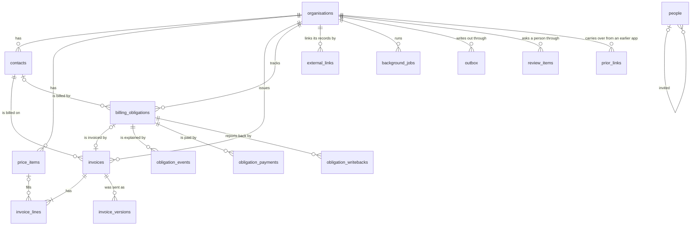
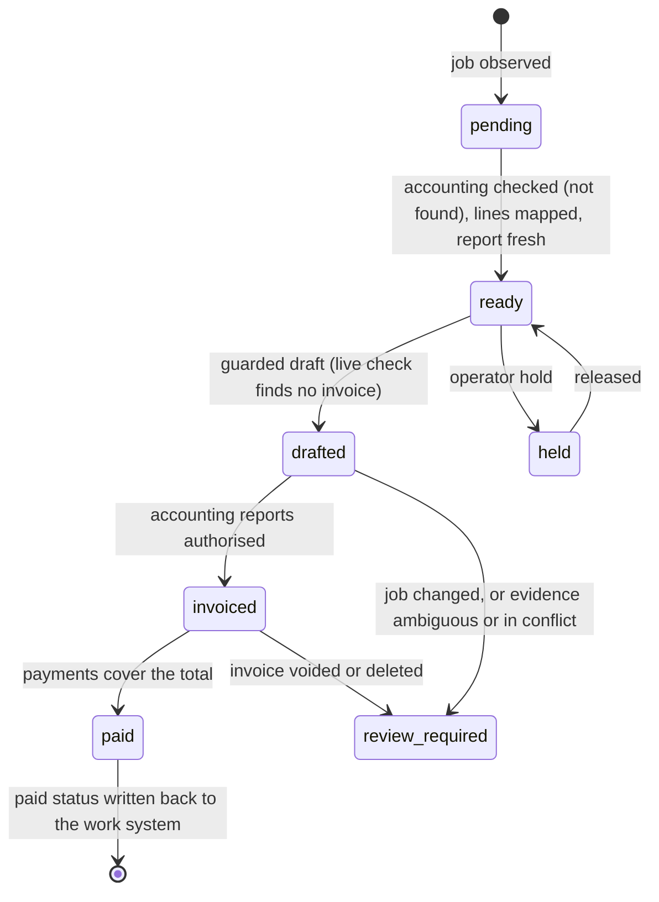

# Data model

Flow keeps its records in PostgreSQL. The schema is in
`server/db/schema.js`; migrations are in `server/db/migrations/` and run when
the server starts.

`external_links`, `background_jobs`, `outbox` and `review_items` are the data
spine every integration shares (`docs/DATA_SPINE.md`). `prior_links` holds
job to accounting record links from an earlier installation, one per job and
system, until the job becomes an obligation.

`people` lists who may sign in and their role (`owner`, `admin`, `staff`).
One installation serves one lab, so it is installation-wide.

Each integration adapter owns its own tables, named after it (`seazona_…`).
They exist only once the adapter has been on at a start, and they are not in
`server/db/schema.js` (`docs/INTEGRATIONS.md`).

## Billing obligation ledger

One billable job in a work system is one `billing_obligations` row, keyed by
`(organisation_id, source_system, source_job_ref)`. It stores what the work
system reported (a case number, never patient data), what the accounting
system reported, and how that evidence matched. `server/core/ledger.js` gives
each obligation one view from that evidence only:

- Accounting evidence counts only when it matches the job exactly
  (`flow_invoice`, `source_invoice_ref` or `accounting_ref`). Any other match
  makes the obligation `ambiguous`, for a person to resolve.
- A payment counts only with an exact match and a confirmed invoice. A part
  payment shows as `part_paid`.
- When the payments cover the total, an `obligation_writebacks` row holds the
  paid status for the work system, with the evidence: the invoice link and
  each payment (date, amount, reference, reconciled or not). A failed
  write-back stays and is tried again. It never changes the accounting record.

## Invoicing API

The web UI reads and changes invoices through `/api/invoicing`
(`server/api/invoicing.js`). Every route needs a signed-in, active person.
`organisationId` (query or body) names the organisation; it may be left out
while the installation has exactly one. Money is integer cents. Answers are
`{ ok: true, … }`, or `{ ok: false, code, error }` with 400, 403, 404 or 409.

| Route | Who | What |
| --- | --- | --- |
| `GET /context` | anyone | `organisations` (`id`, `name`, `invoicePrefix`, `nextInvoiceNumber`) and `canIssue` |
| `GET /invoices?status=&q=&limit=` | anyone | Newest first, each with `contactName` and its `job`; `q` matches number, reference or customer; `counts` by status |
| `GET /invoices/:id` | anyone | The invoice with `lines`, `contact`, `job` and issued `versions` |
| `POST /invoices` `{ contactId, reference?, dueDate?, lines }` | anyone | A new draft (201) |
| `PATCH /invoices/:id` `{ contactId?, reference?, dueDate?, lines? }` | anyone | Changes a draft |
| `POST /invoices/:id/issue` `{ issueDate? }` | owner or admin | Numbers it and keeps the document as sent; the date defaults to the server's today |
| `POST /invoices/:id/revise` | owner or admin | An issued invoice back to a draft; the number stays |
| `POST /invoices/:id/void` | owner or admin | Voids an invoice that was issued |
| `GET /contacts?q=&limit=` | anyone | Customers, by name |
| `GET /price-items?q=` | anyone | The price list, by code |
| `GET /jobs?view=&limit=` | anyone | Billable jobs with `contactName`, `view` and `reasons`; `counts` by view |
| `POST /jobs/:id/draft` | owner or admin | The job's draft invoice, made only after a live check in the accounting system (`checkInvoice`, `docs/INTEGRATIONS.md`) finds none; with no accounting integration it is refused (`live_check_unavailable`) |

A line is `{ priceItemId?, description?, quantity?, unitAmountCents?,
taxCode? }`; a price item fills what the line leaves out.

## Storage

Flow has two places for data, and only two:

| Data | Where | Why |
| --- | --- | --- |
| Records: every row, setting, event and piece of evidence | PostgreSQL | One database to back up, migrate and restore. Data with a loose shape (a sent document, an integration's raw answer, evidence) is a `jsonb` column, not a second database. |
| Files: photos of lab forms, bill and invoice PDFs, exports | An object storage adapter | Files are large and never change after upload. PostgreSQL keeps the file's key, size, type and checksum; the bytes stay out of it. |

The object storage adapter has one interface (put, get, delete, signed link)
with one implementation per host: a local folder for a single machine or
tests, S3-compatible storage, and Replit Object Storage. A published Replit
app keeps no files between publishes, so it never uses the local folder. The
first feature that stores a file adds the adapter (#42); until then Flow
stores no files.

Flow uses no other database: no document store, key-value store or cache
server. A change that seems to need one says why in its pull request, and
shows that PostgreSQL (`jsonb`, an index, a materialized view, `LISTEN`/
`NOTIFY`) cannot do the job. Fewer moving parts keep a self-hosted
installation low maintenance.

## Rules

| Rule | Where it is held |
| --- | --- |
| Every row except in `people` belongs to one organisation. A child row points at its parent through `(organisation_id, id)`, so a row that joins two organisations is refused. | Composite foreign keys |
| Every read and write in the core takes an organisation id. | `server/core/*` |
| Money is integer cents. GST is 10%, calculated and rounded per line, half away from zero. | `server/core/money.js` |
| A draft invoice can change. Issuing gives it the organisation's next number and stores the document exactly as sent in `invoice_versions`. Each document line keeps its price item's code (`itemCode`, null for a line typed by hand), so accounting software gets the item even after the price list changes. | `server/core/invoices.js` |
| What was sent never changes: `invoice_versions` rows cannot be updated or deleted, lines change only on a draft, a number never changes, an issued invoice is voided and never deleted, and a void invoice is final. | Triggers in `0001_records_are_append_only.sql` |
| A person's email is stored lower-case and is unique. A Clerk user links to at most one person. | Constraints on `people` |
| One job gives one obligation. Its view comes only from stored evidence. A draft invoice is made only when the evidence allows it and a live accounting check just before the write finds no invoice; any doubt refuses it and records why. | `server/core/ledger.js` |
| `obligation_events` rows cannot be updated or deleted. | Trigger in `0004_ledger_events_append_only.sql` |
| To change an issued invoice, revise it to a draft and issue it again. It keeps its number and gets the next version. | `reviseInvoice` |
| One active link per external record and per Flow record in each system. A name match stays proposed until a person confirms it. | Partial unique indexes and a check on `external_links`; `server/core/links.js` |
| One queued or running job per kind and key; a job is finished only by the worker that holds its lease. | A partial unique index on `background_jobs`; `server/core/queue.js` |
| Every write to another system has an outbox row first, with a unique idempotency key. | `outbox`; `server/core/outbox.js` |
| One open review item per kind and record; a closed one records who chose what. | A partial unique index and a check on `review_items`; `server/core/review.js` |

## Change the schema

1. Edit `server/db/schema.js`.
2. Run `npm run db:generate` and commit the new migration.
3. Put rules Drizzle cannot express (triggers, functions) in a custom
   migration: `npx drizzle-kit generate --custom --name <what>`.
4. Never edit a migration that is on `main`. Add a new one.

## Tests

Tests that need PostgreSQL read `FLOW_TEST_DATABASE_URL`. Setup drops and
recreates the whole `public` schema, so point it only at a throwaway database.
For the same reason `npm test` runs one test file at a time.
Outside CI those tests skip when it is unset; CI runs them against a
PostgreSQL service.
