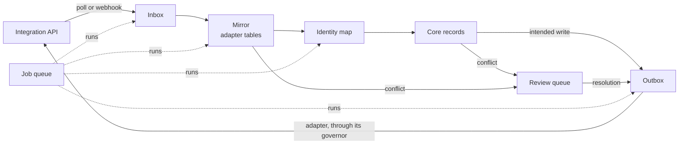

# Data spine

Status: phase 1 is built: the four tables and the core code that keeps their
rules (`server/core/links.js`, `queue.js`, `outbox.js`, `review.js`). No
integration uses them yet. Issue #56 tracks the rest.

The data spine is the set of tables and jobs that every integration uses.
Records come in from an integration, get a Flow identity, and go out from
Flow's own records. Each part works the same way for every adapter, so a new
integration adds an adapter and no new plumbing.

## What exists today

| Part | Today |
| --- | --- |
| Mirror | Seazona: orders, invoices, clients, products, users. Xero: contacts and items only. |
| Identity map | None. A Flow customer finds its accounting contact by an exact name match (`matchContact`). |
| Core | Contacts, price items, Flow invoices and their sent versions, the billing obligation ledger. |
| Outbox | `xero_invoice_pushes` (drafts) and `obligation_writebacks` (paid status). Nothing sends a write-back. |
| Review queue | States on ledger and push rows (`review_required`, `ambiguous`, `mismatch`). No single list. |
| Job queue | None. Each step is a route a person calls. The Seazona scheduler is the one background loop. |

## Phase 1: the tables

Phase 1 adds four core tables (migration `0005_data_spine`) and the core code
that keeps their rules. It changes no behaviour: no integration uses them
until phase 3 (#58). All are in `server/db/schema.js`, so every installation
creates them at start (#40).

### `external_links` (identity map, #57)

| Column | Type | Meaning |
| --- | --- | --- |
| `id` | uuid | |
| `organisation_id` | uuid | |
| `entity` | text | `contact`, `price_item`, `obligation`, `invoice`, `payment`, `credit_note` |
| `flow_id` | uuid | The Flow record |
| `system` | text | The adapter id (`xero`, `seazona`) |
| `external_id` | text | The id in that system |
| `matched_by` | text | `created_by_flow`, `exact_id`, `imported`, `name`, `person` |
| `state` | text | `active`, `proposed`, `superseded` |
| `confirmed_by`, `confirmed_at` | uuid, timestamptz | The person who confirmed a link that was not exact |
| `created_at`, `updated_at` | timestamptz | |

- One active link per `(organisation_id, system, entity, external_id)` and
  per `(organisation_id, system, entity, flow_id)`: two partial unique
  indexes `WHERE state = 'active'`.
- A link with `matched_by = 'name'` is `proposed` until a person confirms it.
  A proposed link opens a review item.
- A link is never deleted. A replaced link is `superseded`, so history stays.

### `background_jobs` (job queue, #6)

| Column | Type | Meaning |
| --- | --- | --- |
| `id` | uuid | |
| `organisation_id` | uuid | |
| `kind` | text | For example `seazona.feed`, `xero.payments`, `outbox.send` |
| `dedupe_key` | text | One queued or running job per `(organisation_id, kind, dedupe_key)` |
| `payload` | jsonb | |
| `state` | text | `queued`, `running`, `succeeded`, `failed`, `dead` |
| `run_after` | timestamptz | Not before this time |
| `attempts`, `max_attempts` | integer | |
| `locked_by`, `locked_until` | text, timestamptz | The worker and its lease |
| `result` | jsonb | What the last successful run reported |
| `last_error` | text | Never a credential or a raw response |
| `created_at`, `updated_at` | timestamptz | |

- A worker claims with `SELECT … FOR UPDATE SKIP LOCKED` ordered by
  `run_after`, and sets a lease. A lease that runs out makes the job claimable
  again, so a dead process never holds a job.
- A failed attempt waits longer each time (1 minute, doubling, at most 6
  hours). After `max_attempts` the job is `dead` and opens a review item.
- One scheduler row per recurring kind puts the next job in the queue when
  the last one ends. This replaces per-adapter loops over time; the Seazona
  scheduler moves onto it in phase 3.
- No new service: the queue is PostgreSQL only (`VISION.md`).

### `outbox` (#56)

| Column | Type | Meaning |
| --- | --- | --- |
| `id` | uuid | |
| `organisation_id` | uuid | |
| `system` | text | The adapter that sends it |
| `action` | text | For example `invoice.draft`, `payment.create` |
| `entity`, `flow_id` | text, uuid | The Flow record the write is about |
| `idempotency_key` | text | Unique. Stored before the call leaves. |
| `request` | jsonb | The exact request |
| `state` | text | `pending`, `sending`, `ambiguous`, `sent`, `failed`, `cancelled` |
| `external_id` | text | The id the system gave the new record |
| `attempts`, `last_error`, `sent_at` | | |
| `created_by` | text | Who or what asked for the write |

- A core action writes its outbox row in the same transaction as the core
  change, so a write is never lost and never made without its record.
- The adapter sends it through its governor, reads the result back, and
  records an `external_links` row with `matched_by = 'created_by_flow'`.
- An unknown outcome is `ambiguous`. The adapter settles it by a lookup
  before it sends again, as Xero draft pushes do today.
- `xero_invoice_pushes` and `obligation_writebacks` stay. In phase 4 each new
  write goes through `outbox`, and those tables keep their evidence role.

### `review_items` (review queue, #59)

| Column | Type | Meaning |
| --- | --- | --- |
| `id` | uuid | |
| `organisation_id` | uuid | |
| `kind` | text | For example `link.proposed`, `price.difference`, `invoice.duplicate`, `job.dead` |
| `entity`, `flow_id` | text, uuid | |
| `systems` | text[] | The systems involved |
| `evidence` | jsonb | Both sides, the field that differs, how Flow found it |
| `money_at_risk_cents` | bigint | Sort order |
| `state` | text | `open`, `resolved`, `dismissed` |
| `seen_count` | integer | How many times the finding was made |
| `resolution`, `resolved_by`, `resolved_at`, `note` | | A closed item must have the first three |

- One open item per `(organisation_id, kind, entity, flow_id)`: a partial
  unique index. A repeat finding updates the evidence.
- A resolution that changes another system writes an outbox row.

### What the code guarantees

| Rule | Where |
| --- | --- |
| Two callers that link the same record at once make one link; the other gets `conflict` | `linkRecord`, an advisory lock per side, and the partial unique indexes |
| A name match is never active without a person | `linkRecord`, and the check `external_links_name_needs_person` |
| A worker whose lease ran out cannot finish the job another worker took over | `completeJob` and `failJob` match the worker and the attempt |
| A job that uses every attempt, or fails with `retry: false`, is `dead` and opens a review item | `failJob`, `claimJobs` |
| A write rolls back with the Flow change it belongs to | `queueWrite` takes the caller's transaction |
| A send that did not finish is `ambiguous`, never sent again blind | `claimWrites` |
| A sent write links the Flow record to the new external record | `markSent` |
| A write moves only from the states its step allows | `move` in `outbox.js` |

Tests: `test/data-spine.test.js`, against PostgreSQL, synthetic data.

### Organisation on adapter tables (phase 2)

The Seazona tables are installation-wide today. Phase 2 adds
`organisation_id` to each, filled from the installation's one organisation,
so the identity map can join them. An adapter migration adds the column; no
row is dropped.

## Rules

- Every table above is append-friendly: a row changes state, and is never
  deleted by the spine.
- Every write to another system has an outbox row first.
- A sync cursor moves only after the page it read is stored.
- Each job kind has a share of an integration's daily call budget (#45). Low
  lanes wait first; outbox sends and people's actions wait last.
- No silent overwrite. When two systems disagree, Flow opens a review item.

## Later phases

| Phase | What | Issues |
| --- | --- | --- |
| 2 | Xero mirror of invoices, credit notes and payments; history import; seed links from an earlier installation's job ledger with exact ids | #54, #45 |
| 3 | The pipeline on the job queue, with no writes | #58 |
| 4 | Writes through the outbox, each behind its own switch | #39 |
| 5 | Screens: review queue, accounting usage, price differences, duplicates | #2, #46, #47 |
