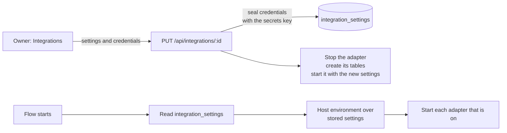
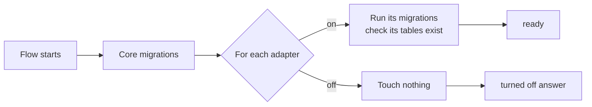

# Integrations

Everything outside the Flow core is an integration behind one contract, the
integration port (`server/integrations/port.js`). `VISION.md`, "The core and
its integrations", says why. This page says how an adapter is built, how an
installation turns it on and off, and how it owns its tables.

## An adapter

An adapter is a plain object that `defineAdapter` checks:

```js
import { fileURLToPath } from 'node:url';

export const exampleAdapter = {
  id: 'example', // lower case, letters, digits and dashes
  name: 'Example',
  bundled: false, // true: ships on in a preset
  schema: {
    migrationsFolder: fileURLToPath(new URL('./example/migrations', import.meta.url)),
    tables: ['example_cases', 'example_sync_state'],
  },
  capabilities: {
    health: async () => ({ ok: true }), // required
    pullWorkItems: async (cursor) => { /* … */ },
  },
  start: async ({ db, log }) => { /* optional */ },
  stop: async () => { /* optional */ },
};
```

The capabilities are `pullWorkItems`, `pushInvoice`, `pushBill`,
`pullPayments`, `checkInvoice`, `listCustomers`, `findInvoices`, `listWork`,
`listPriceItems`, `captureError`, `browserMonitoring` and `health`.
`listPriceItems({ organisationId })` answers the system's own price list from
the adapter's copy, never a live call: `{ kind, syncedAt, items }`, `kind`
`accounting` or `work`, each item `{ id, code, name, unitAmountCents,
taxCode, sold }` (`docs/PRICE_LIST.md`). `listWork({ organisationId })`
answers the work system's jobs for the Jobs board from the adapter's own copy,
never a live call: `{ items, statuses }`, each item with its `sourceSystem`,
`sourceJobRef`, `status`, `clientName`, `practitioner`, dates, lines and
total (Seazona: open orders and orders finished in the last 30 days, never
one deleted in Seazona). `captureError({ message,
source, error })` takes each error Flow logs, and `browserMonitoring()`
answers the public settings a browser needs; the Sentry adapter has both
(`docs/SENTRY.md`).
`listCustomers({ organisationId })` answers the system's customers as
`{ id, name }`. `findInvoices({ organisationId, invoiceIds, numbers,
flowInvoiceIds, contactId, from, to })` answers sales invoices from the
adapter's own copy, never a live call, with the copy's state (`complete`,
`fresh`, `changedAt`). The pipeline uses both (`docs/JOB_INVOICE_LINKS.md`).
`checkInvoice({ organisationId,
obligation })` answers whether the accounting system holds an invoice for a
billable job, in the ledger's evidence shape; it is the live check before
Flow drafts a job's invoice (`POST /api/invoicing/jobs/:id/draft`). An adapter declares only the ones it has, and
must declare `health`.

An adapter may also declare `routes(context)`: a function that returns an
Express router, with `context` `{ db, personAuth, log }`. Flow mounts it at
`/api/<id>` (`registry.routes` in `server/integrations/port.js`), after the
`/api` rate limit. The router is built only for an adapter that is on with
its tables in place; for one that is off, every request under `/api/<id>`
gets the turned-off answer (below) with status 503. The router does its own
sign-in checks with `personAuth`.

Two optional functions give an adapter a lifecycle:

- `start({ db, log })` runs once at server start, only while the adapter is
  on, after its tables are in place. Keep the database handle here and start
  background work (a scheduler, a poller).
- `stop()` ends that work. `registry.stop()` calls it for every adapter that
  started, newest first. Tests call it so they end cleanly.

To ship an adapter, add it to the list in `server/integrations/adapters.js`.
Core code never imports an adapter; it asks the registry.

## Turn an integration on or off

An owner turns an integration on in Flow, in **Integrations** (below). A
host can also turn one on with `FLOW_INTEGRATIONS`: the adapter ids,
separated by commas (`seazona,xero`). Unset or empty: none. An unknown id
stops boot, so a typo never leaves an integration silently off.

### Set up in Flow



- An adapter declares `setup`: the settings an owner may enter (`fields`,
  each named by its environment setting), a short guide, and `derivedKeys`.
  Xero and Seazona declare theirs in their `index.js`.
- Only an owner sees the settings (`GET /api/integrations`). A change needs
  a verified owner sign-in (`PUT /api/integrations/:id`). It applies at once:
  no restart and no host secret to edit.
- A credential is write-only. Flow seals it with AES-256-GCM under its
  secrets key, bound to the integration and the setting's name, and stores
  only the sealed value. The screen shows whether it is set, never the value.
  Every change writes an `integration_setting_events` row with the setting
  names and who changed them, never a value.
- The host's own environment wins: a setting set there shows as "Set by the
  host" and cannot be changed in Flow.
- An integration turned on in Flow that cannot start (a setting is missing)
  shows the reason and Flow keeps running. One turned on by the host stops
  boot, as before.
- `derivedKeys` (Xero's `XERO_TOKEN_KEY`) come from the secrets key, so no
  one makes them by hand.

### The secrets key

`FLOW_SECRETS_KEY` is the key: 32 bytes, as 64 hex characters or base64
(`openssl rand -hex 32`). When it is unset, Flow derives the key from
`SESSION_SECRET` when that is at least 32 characters. With neither, Flow
stores no credential and the screen says so. Changing the key, or its
source, makes stored credentials and Xero's stored sign-in unreadable: an
owner enters the credentials again and connects Xero again. A copy of the
database alone opens no credential, because the key is never stored there.

## Tables

An installation's database holds only the tables of the integrations it has
turned on (issue #13).



The rules:

- **The adapter owns its schema.** Its tables are not in
  `server/db/schema.js`. It keeps its own drizzle migrations in
  `schema.migrationsFolder` (a `meta/_journal.json` and SQL files, as
  `npx drizzle-kit generate` writes them) and its own migration journal,
  `drizzle.__drizzle_migrations_<id>`.
- **Every table starts with the adapter id**, dashes as underscores
  (`my-lab` owns `my_lab_…`). `defineAdapter` refuses any other name, so an
  adapter never touches a core table or another adapter's.
- **`schema.tables` lists every table** the migrations create. After it
  migrates, Flow checks each one exists and stops boot if one is missing.
- **Tables are created only while the adapter is on.** At start, after the
  core migrations, `registry.start(db)` runs the migrations of each enabled
  adapter, and of no other.
- **Turning an adapter on later creates its tables at the next start.**
  There is no manual step. Until that start it answers as turned off.
- **Turning an adapter off never drops its tables.** Its rows stay, and
  turning it on again finds them.
- **Removing the tables is a separate, explicit step.** It refuses while the
  integration is in `FLOW_INTEGRATIONS` and while any of its tables holds a
  row, and removes everything in one transaction:

  ```bash
  DATABASE_URL=postgres://… node server/integrations/remove-tables.js <id>
  ```

## Read an adapter's tables

Go through the registry, never straight to the tables:

```js
const result = await registry.whenEnabled('example', (adapter) => adapter.capabilities.pullWorkItems(cursor));
```

`whenEnabled` runs the function only when the adapter is on and its tables
are in place. Otherwise it returns the adapter's turned-off answer, and code
shows that answer instead of crashing:

```json
{ "ok": false, "code": "integration_off", "integration": "example", "reason": "disabled", "error": "Example is turned off on this installation." }
```

| `reason` | When |
| --- | --- |
| `disabled` | The integration is off. |
| `restart_needed` | It was turned on after Flow started. Its tables come at the next start. |
| `tables_missing` | Its tables were removed by hand. A query that finds no table gives this answer, not an error. |

`registry.with(capability)` (the core's fan-out) also returns only adapters
that are on with their tables in place. `registry.list()` gives each
adapter's `state`: `disabled`, `ready`, `restart_needed`, or `not_started`
before the first start.

## Health

`GET /health` lists every adapter under `integrations` with `enabled` and
`state`. When an adapter is ready its `health()` answer is there too, so it
must read Flow's own data and answer fast: an answer slower than 5 seconds,
or an error, shows as `{ ok: false, error }`. An integration problem never
fails Flow's own health check (`server/integrations/health.js`).

## Tests

`test/integration-schema.test.js` proves the rules against PostgreSQL with a
synthetic adapter (`test/fixtures/sample-adapter/`): a start with it off
creates none of its tables, a start with it on creates all of them, turning
it off keeps them and their rows, and removal refuses while a table holds a
row. An adapter's own tests follow the same pattern: boot it off and assert
none of its tables exist, boot it on and assert all of them do.
