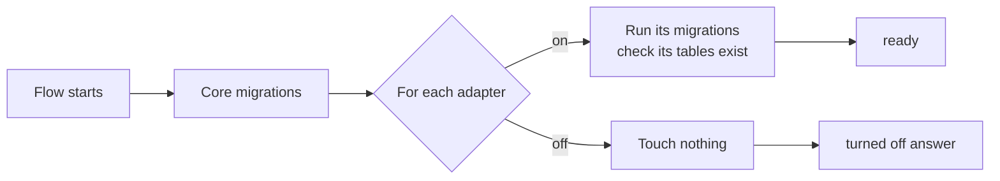

# Integrations

Everything outside the Flow core is an integration behind one contract, the
integration port (`server/integrations/port.js`). `VISION.md`, "The core and
its integrations", says why. This page says how an adapter is built, how an
installation turns it on and off, and how it owns its tables.

## An adapter

An adapter is a plain object that `defineAdapter` checks:

```js
import { fileURLToPath } from 'node:url';

export const exampleAdapter = {
  id: 'example', // lower case, letters, digits and dashes
  name: 'Example',
  bundled: false, // true: ships on in a preset
  schema: {
    migrationsFolder: fileURLToPath(new URL('./example/migrations', import.meta.url)),
    tables: ['example_cases', 'example_sync_state'],
  },
  capabilities: {
    health: async () => ({ ok: true }), // required
    pullWorkItems: async (cursor) => { /* … */ },
  },
  start: async ({ db, log }) => { /* optional */ },
  stop: async () => { /* optional */ },
};
```

The capabilities are `pullWorkItems`, `pushInvoice`, `pushBill`,
`pullPayments` and `health`. An adapter declares only the ones it has, and
must declare `health`.

An adapter may also declare `routes(context)`: a function that returns an
Express router, with `context` `{ db, personAuth, log }`. Flow mounts it at
`/api/<id>` (`registry.routes` in `server/integrations/port.js`), after the
`/api` rate limit. The router is built only for an adapter that is on with
its tables in place; for one that is off, every request under `/api/<id>`
gets the turned-off answer (below) with status 503. The router does its own
sign-in checks with `personAuth`.

Two optional functions give an adapter a lifecycle:

- `start({ db, log })` runs once at server start, only while the adapter is
  on, after its tables are in place. Keep the database handle here and start
  background work (a scheduler, a poller).
- `stop()` ends that work. `registry.stop()` calls it for every adapter that
  started, newest first. Tests call it so they end cleanly.

To ship an adapter, add it to the list in `server/integrations/adapters.js`.
Core code never imports an adapter; it asks the registry.

## Turn an integration on or off

`FLOW_INTEGRATIONS` lists the adapter ids that are on, separated by commas
(`seazona,xero`). Unset or empty: none. An unknown id stops boot, so a typo
never leaves an integration silently off. Flow reads it once, at start.

## Tables

An installation's database holds only the tables of the integrations it has
turned on (issue #13).



The rules:

- **The adapter owns its schema.** Its tables are not in
  `server/db/schema.js`. It keeps its own drizzle migrations in
  `schema.migrationsFolder` (a `meta/_journal.json` and SQL files, as
  `npx drizzle-kit generate` writes them) and its own migration journal,
  `drizzle.__drizzle_migrations_<id>`.
- **Every table starts with the adapter id**, dashes as underscores
  (`my-lab` owns `my_lab_…`). `defineAdapter` refuses any other name, so an
  adapter never touches a core table or another adapter's.
- **`schema.tables` lists every table** the migrations create. After it
  migrates, Flow checks each one exists and stops boot if one is missing.
- **Tables are created only while the adapter is on.** At start, after the
  core migrations, `registry.start(db)` runs the migrations of each enabled
  adapter, and of no other.
- **Turning an adapter on later creates its tables at the next start.**
  There is no manual step. Until that start it answers as turned off.
- **Turning an adapter off never drops its tables.** Its rows stay, and
  turning it on again finds them.
- **Removing the tables is a separate, explicit step.** It refuses while the
  integration is in `FLOW_INTEGRATIONS` and while any of its tables holds a
  row, and removes everything in one transaction:

  ```bash
  DATABASE_URL=postgres://… node server/integrations/remove-tables.js <id>
  ```

## Read an adapter's tables

Go through the registry, never straight to the tables:

```js
const result = await registry.whenEnabled('example', (adapter) => adapter.capabilities.pullWorkItems(cursor));
```

`whenEnabled` runs the function only when the adapter is on and its tables
are in place. Otherwise it returns the adapter's turned-off answer, and code
shows that answer instead of crashing:

```json
{ "ok": false, "code": "integration_off", "integration": "example", "reason": "disabled", "error": "Example is turned off on this installation." }
```

| `reason` | When |
| --- | --- |
| `disabled` | The integration is off. |
| `restart_needed` | It was turned on after Flow started. Its tables come at the next start. |
| `tables_missing` | Its tables were removed by hand. A query that finds no table gives this answer, not an error. |

`registry.with(capability)` (the core's fan-out) also returns only adapters
that are on with their tables in place. `registry.list()` gives each
adapter's `state`: `disabled`, `ready`, `restart_needed`, or `not_started`
before the first start.

## Tests

`test/integration-schema.test.js` proves the rules against PostgreSQL with a
synthetic adapter (`test/fixtures/sample-adapter/`): a start with it off
creates none of its tables, a start with it on creates all of them, turning
it off keeps them and their rows, and removal refuses while a table holds a
row. An adapter's own tests follow the same pattern: boot it off and assert
none of its tables exist, boot it on and assert all of them do.
