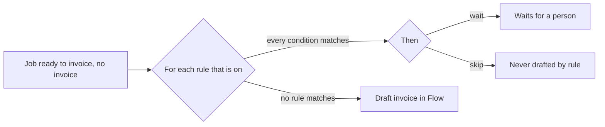

# Invoice rules

An invoice rule is a check that a lab builds on a job before Flow drafts its
invoice. Each rule is When, If and Then. A lab owner or admin builds it from
menus under Settings, Invoicing, Rules. No lab's checks are fixed in Flow's
code. The rules read only Flow's own records, so they work with or without
an accounting integration. The code is in `server/core/invoice-rules.js`.

## Parts of a rule

| Part | Values |
| --- | --- |
| When | `job_ready`: the job is ready to invoice and has no invoice |
| If | 1 to 10 conditions. All must match |
| Then | `wait`: the job waits for a person. `skip`: rules never draft it |

A person can still draft a waiting job from the Jobs board. The job lists
each rule that stops it, for example `rule "Old job": waits for a person`.

## Fields

| Field | Kind | Reads | Tests |
| --- | --- | --- | --- |
| `job_age_days` | number | Days from the job date to now | more than, at most, is, is not, is empty |
| `job_total` | money (dollars) | The job's total | more than, at most, is, is not |
| `job_status` | menu of the work system's statuses | The job's status there | is, is not, is one of, is empty |
| `practitioner` | text | The job's practitioner, else the customer's default | is, is not, is empty, is not empty |
| `customer` | menu of customers | The job's customer | is, is not, is one of, is empty |
| `customer_billable` | yes or no | The customer's `billable` setting | is |
| `line_item` | menu of price items | The item codes on the job's lines | has, does not have |
| `line_share` | price item and percent | That item's lines as a share of the other lines, to within 1 cent | is, is not |

Text and menu values match in any case and with spaces trimmed. A value that
Flow knows is picked from a menu, never typed: `GET /api/invoicing/rule-fields`
answers the fields, their tests, and the menus (statuses, customers, price
items).

## Starter rules

On the first read, Flow makes starter rules from the earlier fixed settings,
once for each organisation (`invoicing_settings.rules_seeded`). The list is in
`docs/INVOICING_RULES.md`. A lab can change, turn off or delete each one. A
deleted starter rule does not come back.

## API

| Route | Who | Does |
| --- | --- | --- |
| `GET /api/invoicing/rules` | everyone | The rules, in order |
| `GET /api/invoicing/rule-fields` | everyone | Fields, tests and menus |
| `POST /api/invoicing/rules` | owner, admin | A new rule `{ name, enabled, conditions, action }` |
| `PUT /api/invoicing/rules/:id` | owner, admin | Change some of a rule; the result must be a whole valid rule |
| `DELETE /api/invoicing/rules/:id` | owner, admin | Delete a rule |

An organisation has 100 rules at most. The table is `invoice_rules`
(migration `0011_invoice_rules.sql`, add only).

## Next

- Formula lines: a rule that adds a line to the draft, such as a rush charge
  of 20% of the other lines. It shows as an option in the invoice editor.
- More triggers than `job_ready`.
