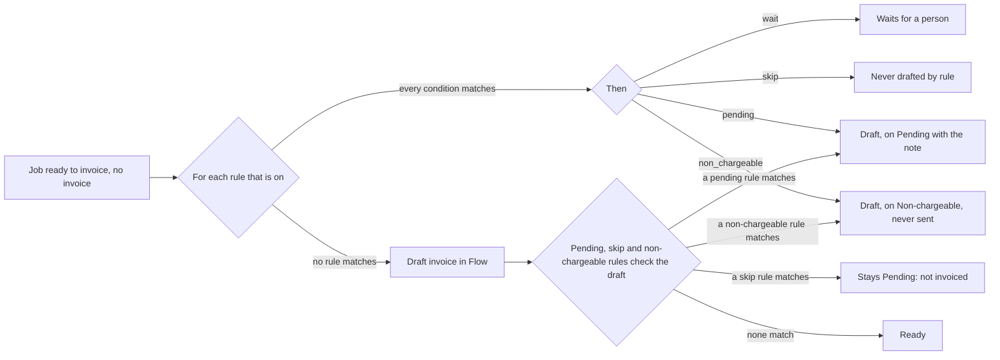

# Invoice rules

An invoice rule is a check that a lab builds on a job before Flow drafts its
invoice. Each rule is When, If and Then. A lab owner or admin builds it from
menus under Settings, Rules, Invoices. No lab's checks are fixed in Flow's
code. The rules read only Flow's own records, so they work with or without
an accounting integration. The code is in `server/core/invoice-rules.js`.

## Parts of a rule

| Part | Values |
| --- | --- |
| When | `job_ready`: the job is ready to invoice and has no invoice |
| If | 1 to 10 conditions. All must match |
| Then | `wait`: the job waits for a person. `skip`: rules never draft it, and Send holds a draft that already matches. `pending`: Flow drafts it, and the draft is on the Pending tab with the rule's note. `non_chargeable`: Flow drafts it, and the draft is on the Non-chargeable tab |

A person can still draft a waiting job from the Jobs board. The job lists
each rule that stops it, for example `rule "Old job": waits for a person`.

## Pending rules

A pending rule never stops a draft. Flow checks each draft from a job
against it, as it checks the draft's lines (`server/core/sending.js`). When
every condition matches, the draft is on the Pending tab. The list shows the
rule's name. The invoice page shows the note: 1 to 200 characters that tell
a person what to fix. Send all ready never sends it.

Send is a gate, like a CI check. At each press of Send, Send all ready or
Approve, Flow runs every check again, pending rules included. A draft that
someone edited, or whose job changed, and that now fails a check is not sent.
It stays on the Pending tab with its problem. The other ticked drafts go, and
the message counts the ones held. Approve on one invoice refuses a draft that
fails a pending rule.

Send also holds a draft whose job matches an enabled skip rule. That includes
a draft made by hand, and a draft made before the rule existed. The draft
stays on Pending. The list shows the rule's name. The note is
`Rule "<name>": not invoiced. Void this draft or change the rule.`

The draft goes to Ready when the cause is fixed:

- A rule on `practitioner` reads the job. Fix the practitioner in the work
  system. The next sync changes the job, and Flow writes the Reference again.
- A rule on `reference` reads the draft. Edit the Reference on the invoice
  page, or fix the job.
- Turn off or change the rule.

Example: the work system writes "Not Listed" when a practice gives no
practitioner, so a Reference reads `Not Listed - Ann - 13909`.

| Name | If | Then |
| --- | --- | --- |
| Practitioner not known | Practitioner is one of `Not Listed`, `Unknown` | Pending: "Put the practitioner in the job." |
| Practitioner not on file | Customer is Example Practice, and Practitioner is not one of its practitioners | Pending: "Check the practitioner with the practice." |
| Bare name | Practitioner is one word | Pending: "Use the practitioner's full name." |
| Number in Reference | Reference has a number beside words | Pending: "Keep the patient's name or the client's reference number, not both." |

A client may send its own reference number in place of the patient's name,
so `Dr Ann Lee - 21764` is a good Reference. "Has a number beside words"
reads each part between ` - ` and finds a number only next to words, as in
`Coral Smith (OIQ-9902)`.

## Non-chargeable rules

Non-chargeable work is work the lab does but never bills, for example work
for its own clinics. The word is Xero's: Xero Projects calls such work
non-chargeable. Xero has no invoice for it.

A non-chargeable rule never stops a draft. Flow drafts the job with its
lines and prices, so the lab keeps the value of its work. The draft is on
the Non-chargeable tab, never on Pending or Ready. Send, Send all ready and
Approve never send it: `Not sent: Rule "<name>": non-chargeable. Flow keeps
it and never sends it.` A draft made before the rule moves to the tab by
itself. Turn the rule off, and its drafts are checked as usual again.

| Name | If | Then |
| --- | --- | --- |
| Own clinics | Customer contains `Example Group` | Non-chargeable |

## Fields

| Field | Kind | Reads | Tests |
| --- | --- | --- | --- |
| `job_age_days` | number | Days from the job date to now | more than, at most, is, is not, is empty |
| `job_total` | money (dollars) | The job's total | more than, at most, is, is not |
| `job_status` | menu of the work system's statuses | The job's status there | is, is not, is one of, is empty |
| `practitioner` | text, with a menu of the practitioners on jobs | The job's practitioner, else the customer's default | is, is not, is one of, is not one of, contains, does not contain, starts with, does not start with, has a number, has a number beside words, is one word, is empty, is not empty |
| `reference` | text | The draft's Reference. Pending rules only | the same tests as `practitioner` |
| `customer` | menu of customers | The job's customer. Contains and does not contain read the customer's name | is, is not, is one of, contains, does not contain, is empty |
| `customer_billable` | yes or no | The customer's `billable` setting | is |
| `line_item` | menu of price items | The item codes on the job's lines | has, does not have |
| `line_share` | price item and percent | That item's lines as a share of the other lines, to within 1 cent | is, is not |

Text and menu values match in any case and with spaces trimmed. A value that
Flow knows is picked from a menu, never typed: `GET /api/invoicing/rule-fields`
answers the fields, their tests, and the menus (statuses, customers, price
items, and the practitioners on jobs with their counts). Contains and starts
with take typed text. On Customer, contains and does not contain take typed
text and read the customer's name. An empty text matches only is empty, is
not and is not empty.

## Starter rules

On the first read, Flow makes starter rules from the earlier fixed settings,
once for each organisation (`invoicing_settings.rules_seeded`). The list is in
`docs/INVOICING_RULES.md`. A lab can change, turn off or delete each one. A
deleted starter rule does not come back.

## API

| Route | Who | Does |
| --- | --- | --- |
| `GET /api/invoicing/rules` | everyone | The rules, in order |
| `GET /api/invoicing/rule-fields` | everyone | Fields, tests and menus |
| `POST /api/invoicing/rules` | owner, admin | A new rule `{ name, enabled, conditions, action }`. A pending rule's action is `{ kind: 'pending', note }` |
| `PUT /api/invoicing/rules/:id` | owner, admin | Change some of a rule; the result must be a whole valid rule |
| `DELETE /api/invoicing/rules/:id` | owner, admin | Delete a rule |

An organisation has 100 rules at most. The table is `invoice_rules`
(migration `0011_invoice_rules.sql`, add only).

## Next

- Formula lines: a rule that adds a line to the draft, such as a rush charge
  of 20% of the other lines. It shows as an option in the invoice editor.
- More triggers than `job_ready`.
