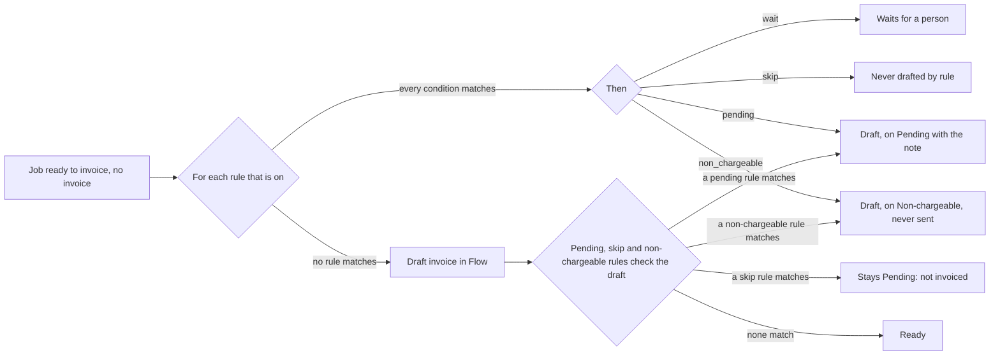

# Invoice rules

An invoice rule is a check that a lab builds on a job before Flow drafts its
invoice. Each rule is When, If and Then. A lab owner or admin builds it from
menus under Settings, Rules, Invoices. No lab's checks are fixed in Flow's
code. The rules read only Flow's own records, so they work with or without
an accounting integration. The code is in `server/core/invoice-rules.js`.

## Parts of a rule

| Part | Values |
| --- | --- |
| When | `job_ready`: the job is ready to invoice and has no invoice |
| If | 1 to 10 conditions. All must match |
| Icon | Optional. Any Lucide icon name, picked in New rule or Edit rule. The card on Rules shows it. With none, the card shows the mark of Then: `flag` pending, `clock` wait, `ban` skip |
| Then | `wait`: the job waits for a person. `skip`: rules never draft it, and Send holds a draft that already matches. `pending`: Flow drafts it, and the draft is on the Pending tab with the rule's note. `non_chargeable`: Flow drafts it, and the draft is on the Non-chargeable tab |

A person can still draft a waiting job from the Jobs board. The job lists
each rule that stops it, for example `rule "Old job": waits for a person`.

## Pending rules

A pending rule never stops a draft. Flow checks each draft from a job
against it, as it checks the draft's lines (`server/core/sending.js`). When
every condition matches, the draft is on the Pending tab. The list shows the
rule's name. The invoice page shows the note: 1 to 200 characters that tell
a person what to fix. Send all ready never sends it.

Send is a gate, like a CI check. At each press of Send, Send all ready or
Approve, Flow runs every check again, pending rules included. A draft that
someone edited, or whose job changed, and that now fails a check is not sent.
It stays on the Pending tab with its problem. The other ticked drafts go, and
the message counts the ones held. Approve on one invoice refuses a draft that
fails a pending rule.

Send also holds a draft whose job matches an enabled skip rule. That includes
a draft made by hand, and a draft made before the rule existed. The draft
stays on Pending. The list shows the rule's name. The note is
`Rule "<name>": not invoiced. Void this draft or change the rule.`

The draft goes to Ready when the cause is fixed:

- A rule on `practitioner` reads the job. Fix the practitioner in the work
  system. The next sync changes the job, and Flow writes the Reference again.
- A rule on `reference` reads the draft. Edit the Reference on the invoice
  page, or fix the job.
- Turn off or change the rule.

Example: the work system writes "Not Listed" when a practice gives no
practitioner, so a Reference reads `Not Listed - Ann - 13909`.

| Name | If | Then |
| --- | --- | --- |
| Practitioner not known | Practitioner is one of `Not Listed`, `Unknown` | Pending: "Put the practitioner in the job." |
| Practitioner not on file | Customer is Example Practice, and Practitioner is not one of its practitioners | Pending: "Check the practitioner with the practice." |
| Bare name | Practitioner is one word | Pending: "Use the practitioner's full name." |
| Number in Reference | Reference has a number beside words | Pending: "Keep the patient's name or the client's reference number, not both." |

A client may send its own reference number in place of the patient's name,
so `Dr Ann Lee - 21764` is a good Reference. "Has a number beside words"
reads each part between ` - ` and finds a number only next to words, as in
`Coral Smith (OIQ-9902)`.

### An item to add, and exceptions

A pending rule can name a price item to add: `{ kind: 'pending', note,
addItem: 'S/H' }`. Use it for a rule such as "every job has shipping": the
condition is `line_item` `has_not` `S/H`.

- On the invoice page the problem has two buttons. **Add S/H** puts one line
  of that item on the draft, at the price list's price. A second press adds
  nothing. The rule then matches no more.
- **Skip** asks for a reason (1 to 200 characters) and records an exception:
  this rule leaves this job alone. Only a pending rule with an item takes an
  exception. The rule's summary counts its exceptions, and
  `GET /api/invoicing/rules/:id/exceptions` lists them with the reason, who,
  when, and `current`. The job's history records each one given or taken
  back, and the invoice page lists them. Delete an exception and the rule
  applies again.
- An exception holds while the job's lines and the rule's item stay as they
  were. When the work system changes the job, or the rule names another
  item, the exception ends (`current: false`) and a person looks again.
- The item counts only on a charged line. A rule line edited to $0 does not
  satisfy the rule: use Skip, with a reason.
- A job with no draft yet can have its exception too, through the API
  (`POST /api/invoicing/jobs/:id/rules/:ruleId/exception`).
- The rule's item must be on the price list and not archived, when the rule
  is saved and when Add runs. Add reads the draft's lines under its lock, so
  two presses, or an edit at the same time, add one line and lose nothing.
- The work system must have the item too, because the lab prints from it.
  Flow cannot write lines there. So a job card shows a yellow
  "<system> needs S/H" while the job in the work system lacks it and has no
  exception. The invoice page shows "Not in <system>." with the lines that
  are on Flow's invoice only, and a link to the job there.

Exceptions are in `invoice_rule_exceptions` (migration
`0027_high_doctor_strange.sql`, and `0028_sharp_power_pack.sql` for the item and the job's lines it was given for; add only), one for each rule and job.

## Non-chargeable rules

Non-chargeable work is work the lab does but never bills, for example work
for its own clinics. The word is Xero's: Xero Projects calls such work
non-chargeable. Xero has no invoice for it.

A non-chargeable rule never stops a draft. Flow drafts the job with its
lines and prices, so the lab keeps the value of its work. The draft is on
the Non-chargeable tab, never on Pending or Ready. Send, Send all ready and
Approve never send it: `Not sent: Rule "<name>": non-chargeable. Flow keeps
it and never sends it.` A draft made before the rule moves to the tab by
itself. Turn the rule off, and its drafts are checked as usual again.

A non-chargeable rule that matches a job wins over every wait rule, so a $0
remake is not stopped by a "No amount" rule. It also wins over the skip rules
below it in the list. A skip rule above it still stops the job.

Flow's own draft checks do not stop such a job either, because its draft is
never sent: a line with no price item, a line with unknown tax, Seazona totals
that differ from the lines, and an old Seazona report. Flow does not read the
report again first. The hold, the customer and the accounting checks still
apply: a job that Xero already bills waits for a person.

| Name | If | Then |
| --- | --- | --- |
| Own clinics | Customer contains `Example Group` | Non-chargeable |
| Remake | Remake is yes | Non-chargeable |

A non-chargeable rule can give a reason, one of the lab's No Charge reasons
(below): `{ kind: 'non_chargeable', reason: 'Remake' }`. The Non-chargeable tab
shows it and filters by it, for the lab's reports.

Old held jobs settle by rule too. The history import holds each job it adds
(`history_import`). When the accounting matcher finds no invoice for such a
job (`not_found`; with no accounting system connected, also `unknown`), and a
non-chargeable rule matches it, the draft step releases it (actor
`rule:<id>`) and drafts it on the Non-chargeable tab. A job that the
accounting system has invoiced stays held. The step's run summary counts the
released jobs (`settle_history`).

## No Charge

No Charge is the lab's word for non-chargeable work. A rule marks a whole
class of work; a person marks one job. Flow does not read the line notes in
the work system to decide this: a note is free text, and it is not reliable
enough to stop a bill.

- **By rule.** A non-chargeable rule, with an optional reason (above).
- **By a person.** An owner or admin presses **No Charge** on the job or on
  its draft invoice and picks a reason. The same button changes the reason,
  or **Charge it again** takes the No Charge off when it was a mistake. The
  job's history records each change (`no_charge`, from and to).
- **Made free in the work system.** The field `made_free` (below) is yes when
  a priced item was set to $0 on the job, or a discount took the job to $0.
  Use it in a pending rule, so a person looks and picks the reason. An item
  that is $0 on the price list (a placeholder, such as Models) is not "made
  free": the "No amount" rule holds it until the work system has the real
  work.

A person's No Charge wins over every wait, skip and pending rule. It releases a
held job and marks it ready, so the draft step drafts it on the Non-chargeable
tab. When no accounting check has run, or the check found no single bill, it
records that no bill exists (`not_found`), because the person said so. It is
refused when the job is billed in the accounting system (unlink it first) or
its invoice was sent (void it first).

The reasons are a list in Settings, Invoicing ("No Charge reasons"): 1 to 20
different names of 40 characters at most. The first list is Promotion,
Internal, Remake, Rework, Warranty and Goodwill. A rename
(`POST /api/invoicing/no-charge-reasons/rename { from, to }`) changes the list,
every job with that reason (each records a `no_charge` event with
`renamed: true`) and every rule that gives it, in one step.

| Route | Who | Does |
| --- | --- | --- |
| `POST /api/invoicing/jobs/:id/no-charge` | owner, admin | `{ reason }`: one of the lab's reasons, or `null` to charge the job again |
| `POST /api/invoicing/no-charge-reasons/rename` | owner, admin | `{ from, to }`: rename a reason everywhere |

The job keeps `no_charge_reason`, `no_charge_by` and `no_charge_at`
(`billing_obligations`); the list is `invoicing_settings.no_charge_reasons`
(migration `0033_no_charge_reason.sql`, add only).

## Fields

| Field | Kind | Reads | Tests |
| --- | --- | --- | --- |
| `job_age_days` | number | Days from the job date to now | more than, at most, is, is not, is empty |
| `job_total` | money (dollars) | The job's total | more than, at most, is, is not |
| `job_status` | menu of the work system's statuses | The job's status there | is, is not, is one of, is not one of, is empty |
| `practitioner` | text, with a menu of the practitioners on jobs | The job's practitioner, else the customer's default | is, is not, is one of, is not one of, contains, does not contain, starts with, does not start with, has a number, has a number beside words, is one word, is empty, is not empty |
| `reference` | text | The draft's Reference. Pending rules only | the same tests as `practitioner` |
| `customer` | menu of customers | The job's customer. Contains and does not contain read the customer's name | is, is not, is one of, is not one of, contains, does not contain, is empty |
| `remake` | yes or no | The work system marks the job a remake (Seazona: the order's `isRemake`) | is |
| `customer_billable` | yes or no | The customer's `billable` setting | is |
| `line_item` | menu of price items | The item codes on the job's lines | has, does not have |
| `line_share` | price item and percent | That item's lines as a share of the other lines, to within 1 cent | is, is not |
| `made_free` | yes or no | A line whose item has a price on the price list is $0 on the job, or the job's discount lines take it to $0. The reason names the lines. Read only when an enabled rule uses it | is |
| `accounting_item` | yes or no | Every line with a price item sends as an item the accounting system sells (Xero: the linked item, else the item with the same code). A line booked to an account does not count. No value while no accounting system is connected or its item list was never read, so no rule on it matches then. The reason names the codes that do not send | is |

A lab that must never invoice an item its accounting system does not hold
adds a rule "Every item is in accounting is no", Then wait (or Pending, with a
note such as "Link the item in Price list"). The send check still refuses such
a line; the rule stops the job before its draft.

Text and menu values match in any case and with spaces trimmed. A value that
Flow knows is picked from a menu, never typed: `GET /api/invoicing/rule-fields`
answers the fields, their tests, and the menus (statuses, customers, price
items, and the practitioners on jobs with their counts). Contains and starts
with take typed text. On Customer, contains and does not contain take typed
text and read the customer's name. An empty text matches only is empty, is
not and is not empty.

## Starter rules

On the first read, Flow makes starter rules from the earlier fixed settings,
once for each organisation (`invoicing_settings.rules_seeded`). The list is in
`docs/INVOICING_RULES.md`. A lab can change, turn off or delete each one. A
deleted starter rule does not come back.

## API

| Route | Who | Does |
| --- | --- | --- |
| `GET /api/invoicing/rules` | everyone | The rules, in order |
| `GET /api/invoicing/rule-fields` | everyone | Fields, tests and menus |
| `POST /api/invoicing/rules` | owner, admin | A new rule `{ name, icon, enabled, conditions, action }`. A pending rule's action is `{ kind: 'pending', note }` |
| `PUT /api/invoicing/rules/:id` | owner, admin | Change some of a rule; the result must be a whole valid rule |
| `DELETE /api/invoicing/rules/:id` | owner, admin | Delete a rule |
| `GET /api/invoicing/rules/:id/exceptions` | everyone | The rule's exceptions |
| `DELETE /api/invoicing/rules/:id/exceptions/:exceptionId` | owner, admin | Take an exception back |
| `POST /api/invoicing/invoices/:id/rules/:ruleId/add-item` | owner, admin | Add the rule's item to the draft |
| `POST /api/invoicing/invoices/:id/rules/:ruleId/exception` | owner, admin | `{ reason }`: skip the rule for this invoice's job |
| `POST /api/invoicing/jobs/:id/rules/:ruleId/exception` | owner, admin | `{ reason }`: skip the rule for a job with no draft yet |

An organisation has 100 rules at most. The table is `invoice_rules`
(migration `0011_invoice_rules.sql`, add only; `icon` from `0024_rule_icon.sql`).

## Next

- Formula lines: a rule that adds a line to the draft, such as a rush charge
  of 20% of the other lines. It shows as an option in the invoice editor.
- More triggers than `job_ready`.
