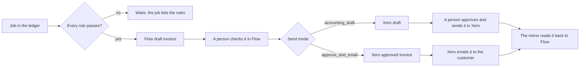

# Invoicing rules

Flow drafts the invoice of each billable job by rules, and sends checked
invoices to the accounting system (Xero) in one of two ways. This page
describes the rules and the send modes. The code is in
`server/core/invoicing-rules.js`. The settings are in Flow under Settings,
Invoicing, and at `/api/invoicing/settings`.

## From job to customer

1. **Draft.** The pipeline (`docs/JOB_INVOICE_LINKS.md`) runs every two
   minutes. After the matcher, it drafts the invoice of each job that has no
   invoice and passes every rule. The draft waits in Flow. Nothing goes to
   Xero by itself.
2. **Check.** A person checks the draft in Flow and issues it. Issuing gives
   it its number and keeps the document as sent.
3. **Send.** A person sends the issued invoice to Xero. The customer's send
   mode decides what Xero gets (below).
4. **Read back.** The mirror (`docs/XERO.md`, "The mirror") copies Xero's
   status. The matcher links the Xero invoice to the job by the Flow invoice
   that made it (`flow_invoice`). Approval, payment, void and credit notes
   then show on the job.

## The rules

The ledger's own checks guard every draft (`server/core/ledger.js`): the job
is not held, every line maps to a price item, it has a customer, the
accounting copy holds no invoice for it, and the work system's report is less
than a day old. These rules come on top.

| Rule | Setting | Default | The job waits when |
| --- | --- | --- | --- |
| Ready status | `readyStatuses` | shipped, delivered | Its work system status holds none of these, as whole words |
| Billable customer | customer `billable` | billable | The customer is not billable |
| Total | | | The total is zero or less |
| Practitioner | `requirePractitioner` | off | It names no practitioner, and the customer has no default one |
| Rush charge | `rushItemCode`, `rushPercent` | no rule, 20% | The rush line is not that share of the other lines, to the cent |
| Old jobs | `staleDays` | 90 | Its date is more than that many days ago |

The earlier lab app held these rules in its code. In Flow they are settings.
`GET /api/invoicing/jobs` lists the rules each job without an invoice waits
on (`waitingFor`).

A draft gets the invoice date when it is issued, and a due date
`paymentTermsDays` after the day Flow drafted it (default 30).

`autoDraft` turns the drafts on or off. It is on by default. With no
integrations on, the pipeline does not run, so nothing is drafted.

### The duplicate check

The earlier app asked Xero for each job before it drafted. Flow does not. It
drafts only when its own copy of Xero is complete, was read in the last day,
and changed no later than the matcher's last check of the job, and holds no
invoice with the job's own invoice number. When Flow sends an invoice it
drafted that way, it skips Xero's live reference check too. An invoice a
person made by hand in Flow still gets the live check.

## Send modes

| Mode | In Flow | In Xero | Xero emails the customer |
| --- | --- | --- | --- |
| `accounting_draft` (default) | A person checks and sends | A draft. A person approves and sends it | When the person sends it in Xero |
| `approve_and_email` | A person approves (issues) and sends | Approved (`AUTHORISED`) | Yes, at once, with the Xero template |

`approve_and_email` needs an email address on the Xero contact. The preview
says so when it has none.

Xero's email action is not idempotent: a repeat sends a second email. Flow
records the email as `sending` before it calls. It records `sent`, `failed`
(Xero refused) or `unknown` (no clear answer). Sending the invoice again
retries a `failed` email only. After `unknown` a person checks the invoice in
Xero.

## Customer settings

Each customer can override some settings at
`/api/invoicing/contacts/:id/billing`. A null value takes the organisation's
setting.

| Setting | Meaning |
| --- | --- |
| `billable` | Rules never draft an invoice for a customer that is not billable |
| `defaultPractitioner` | The practitioner for jobs that name none |
| `autoDraft` | Drafts on or off for this customer |
| `sendMode` | The send mode for this customer |
| `paymentTermsDays` | The customer's payment terms |
