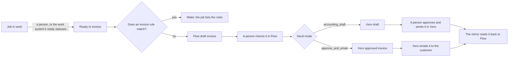

# Invoicing rules

Flow drafts the invoice of each billable job that is ready to invoice, by
rules, and sends checked invoices to the accounting system (Xero) in one of
two ways. Invoicing is part of Flow and needs no integration. With no
accounting system connected, Flow's own records are the only check: each job
gets at most one invoice. The send mode is on the Xero integration page. This page
describes the rules and the send modes. The code is in
`server/core/invoicing-rules.js`. The settings are in Flow under Settings,
Invoicing, and at `/api/invoicing/settings`.

## From job to customer

1. **Ready.** A job is in work until it is ready to invoice. Ready is Flow's
   own stage, not a work system status. A person marks a job ready on the
   Jobs board, or an automation does it from the work system's status
   (`docs/AUTOMATIONS.md`).
2. **Draft.** The pipeline (`docs/JOB_INVOICE_LINKS.md`) runs every two
   minutes. The automation "Draft when ready" drafts the invoice of each
   ready job that has no invoice and that no invoice rule stops. The draft waits in
   Flow. Nothing goes to Xero by itself.
3. **Check.** A person checks the draft in Flow and issues it. Issuing gives
   it its number and keeps the document as sent.
4. **Send.** A person sends the issued invoice to Xero. The customer's send
   mode decides what Xero gets (below).
5. **Read back.** The mirror (`docs/XERO.md`, "The mirror") copies Xero's
   status. The matcher links the Xero invoice to the job by the Flow invoice
   that made it (`flow_invoice`). Approval, payment, void and credit notes
   then show on the job.

## The rules

The ledger's own checks guard every draft (`server/core/ledger.js`): the job
is not held, every line maps to a price item, it has a customer, the
accounting copy holds no invoice for it, and the work system's report is less
than a day old. Then the job must be marked ready to invoice.

Every other check is an invoice rule that the lab builds: When, If, Then
(`docs/INVOICE_RULES.md`). Flow makes starter rules from the earlier settings
once, for each organisation:

| Starter rule | If | Then | From the setting |
| --- | --- | --- | --- |
| Customer not billable | Customer is billable is no | Never draft | customer `billable` |
| No amount | Job total is at most 0 | Wait for a person | |
| Old job | Job age (days) is more than 90 | Wait for a person | `staleDays` |
| Practitioner required | Practitioner is empty | Wait for a person (off until turned on) | `requirePractitioner` |
| Rush charge share | Rush line share is not 20% | Wait for a person | `rushItemCode`, `rushPercent` (only when a code is set) |

The earlier lab app held these checks in its code. In Flow they are rows the
lab edits under Settings, Invoicing, Rules. `GET /api/invoicing/jobs` lists the
rules each job without an invoice waits on (`waitingFor`).

`staleDays` still sets the matcher's hold on an old job that has no
accounting invoice (`docs/JOB_INVOICE_LINKS.md`). The settings
`requirePractitioner`, `rushItemCode` and `rushPercent` only seed the starter
rules.

A draft gets the invoice date when it is issued, and a due date
`paymentTermsDays` after the day Flow drafted it (default 30).

The automation "Draft when ready" turns the drafts on or off. It is on by
default. A customer's `autoDraft` turns them off for that customer. It runs
with or without an accounting integration. With no integrations on at all,
the pipeline does not run, and a person drafts from the Jobs board.

### The duplicate check

The earlier app asked Xero for each job before it drafted. Flow does not. It
drafts only when its own copy of Xero is complete, was read in the last day,
and changed no later than the matcher's last check of the job, and holds no
invoice with the job's own invoice number. When Flow sends an invoice it
drafted that way, it skips Xero's live reference check too. An invoice a
person made by hand in Flow still gets the live check.

## Send modes

| Mode | In Flow | In Xero | Xero emails the customer |
| --- | --- | --- | --- |
| `accounting_draft` (default) | A person checks and sends | A draft. A person approves and sends it | When the person sends it in Xero |
| `approve_and_email` | A person approves (issues) and sends | Approved (`AUTHORISED`) | Yes, at once, with the Xero template |

`approve_and_email` needs an email address on the Xero contact. The preview
says so when it has none.

Xero's email action is not idempotent: a repeat sends a second email. Flow
records the email as `sending` before it calls. It records `sent`, `failed`
(Xero refused) or `unknown` (no clear answer). Sending the invoice again
retries a `failed` email only. After `unknown` a person checks the invoice in
Xero.

## Customer settings

Each customer can override some settings at
`/api/invoicing/contacts/:id/billing`. A null value takes the organisation's
setting.

| Setting | Meaning |
| --- | --- |
| `billable` | Rules never draft an invoice for a customer that is not billable |
| `defaultPractitioner` | The practitioner for jobs that name none |
| `autoDraft` | Drafts on or off for this customer |
| `sendMode` | The send mode for this customer |
| `paymentTermsDays` | The customer's payment terms |
