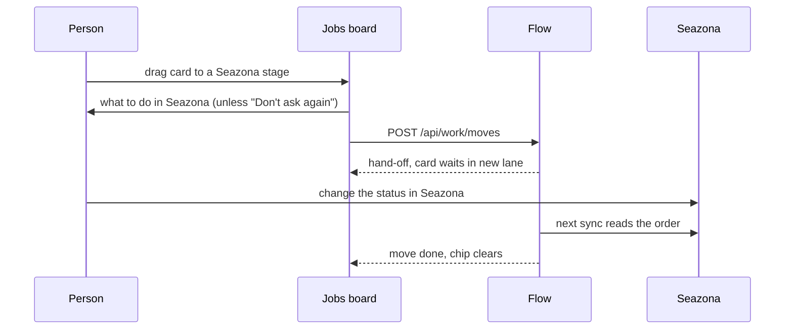

# Job board moves

A person moves a job on the Jobs board by dragging its card to another lane
with a mouse or pen (`server/ui/jobs.js`). What the move changes depends on
what the board is grouped by. A lane that takes the card lights up while the
card is over it; Escape stops the drag. On a phone, touch keeps scrolling the
board, so the job's panel has the same moves: its Fields section sets each
custom field, and its stage section has "Move to…" and, for a waiting move,
"Open in Seazona" and "Take back". The panel also serves a keyboard.

| Grouped by | A move changes | Where it is written |
| --- | --- | --- |
| Lane (the default) | Nothing yet: Flow's rules place each card (see Lanes) | — |
| A Flow custom field (dropdown, person, checkbox) | The job's value for that field | Flow only (`docs/CUSTOM_FIELDS.md`) |
| Status (the work system's stage, Seazona) | The job's stage in that system | The work system, through its adapter's `moveWork` |
| Invoice stage, client, practitioner | Nothing: cards cannot be dropped | — |

## Lanes

The board's default group is Lane (`server/ui/job-board.js`, `flowLaneOf`).
The first lanes copy the work system's statuses, in its order. Flow's own
lanes follow: Invoiced, Paid and Done. A rule puts each job in one lane, the
first match from the top:

| Rule | Lane |
| --- | --- |
| The work system says Shipped or Delivered, and the invoice is Paid or No charge | Done |
| The invoice is Paid | Paid |
| The invoice is Awaiting payment (also part paid) | Invoiced |
| Else | The lane with the name of the work system status |

The invoice status is the one on the job card (`invoiceStatusOf`): the
Invoices page tab of Flow's invoice, or the accounting system's state of an
invoice made outside Flow. A Xero draft keeps the job in its status lane.
Group: Status shows the work system's statuses alone, as before, and keeps
the stage moves below.

Any lane, in any group, folds to a thin column with its name and count (the
fold button in the lane head; a click on the column opens it). **Fold empty**
in the board's foot folds every open lane with no card. Folded lanes are saved with
the view (`folded`, lane labels). Done starts folded. A folded lane draws no
cards; an open lane draws 50 cards and the next 50 as its foot scrolls into
view. The filter "Lane is not Done" hides the Done lane. A view saved before
lanes, grouped by Status, moves to Lane once.

Not yet: a person's own move to another lane (a drag that changes only the
Flow lane, never the work system), and loading the Done lane page by page
from the server.

Group by a custom field is saved with the person's view as `field:<id>`
(`server/ui/job-view.js`). Its lanes are "Not set" first, then the options
in their order (people A to Z for a person field; No and Yes for a
checkbox). An archived option that a job still has gets its own lane, which
takes no cards.

## Custom field moves

`PUT /api/custom-fields/values` with `expectedUpdatedAt`. A move never
writes to Seazona or Xero. When someone changed the value since the person
saw it, nothing changes and the board shows the current value (409), with
a short note.

## Stage moves

`POST /api/work/moves { sourceSystem, sourceJobRef, toStatus }`. The
adapter answers what happens. Seazona's API cannot change a stage, so the
Seazona adapter answers a hand-off: Flow records the move, the person makes
it in Seazona, and the card shows "Waiting for Seazona" until the sync reads
the new status, or a day passes (`docs/SEAZONA.md`, "Stage moves"). A card
dropped back in its own Seazona lane takes the waiting move back.
`POST /api/work/moves/cancel` takes a waiting move back. VISION.md: where
the case system cannot take a change through its API, the change becomes a
short checklist for a person.

Before a stage move, the board shows what to do in Seazona. Its first step
links to the order in Seazona's web app: the order itself when the Seazona
"Order address" is set, else the lab's Seazona home page
(`docs/SEAZONA.md`, `SEAZONA_ORDER_URL`). The job's panel has the same
link. A person can
tick "Don't ask again". That is their own setting inside the Seazona
integration ("Ask before stage moves", `GET` and `PUT /api/work/my-settings`),
shown under Your settings on the Seazona integration screen.

