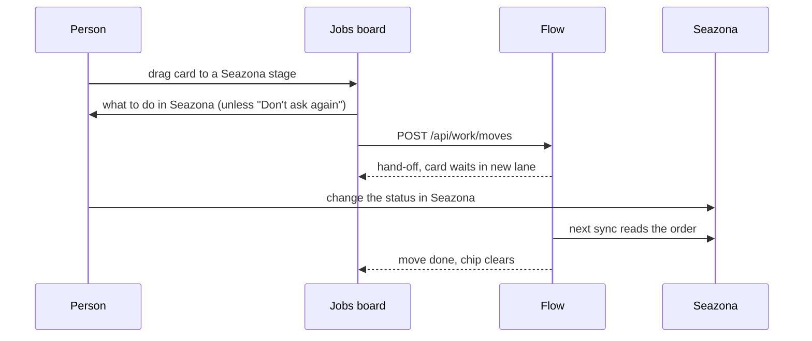

# Job board moves

A person moves a job on the Jobs board by dragging its card to another lane.
What the move changes depends on what the board is grouped by.

| Grouped by | A move changes | Where it is written |
| --- | --- | --- |
| A Flow custom field | The job's value for that field | Flow only (`docs/CUSTOM_FIELDS.md`) |
| A work system's stage (Seazona) | The job's stage in that system | The work system, through its adapter's `moveWork` |

## Custom field moves

`PUT /api/custom-fields/values` with `expectedUpdatedAt`. A move never
writes to Seazona or Xero. When someone changed the value since the person
saw it, nothing changes and the board shows the current value (409).

## Stage moves

`POST /api/work/moves { sourceSystem, sourceJobRef, toStatus }`. The
adapter answers what happens. Seazona's API cannot change a stage, so the
Seazona adapter answers a hand-off: Flow records the move, the person makes
it in Seazona, and the card shows "Waiting for Seazona" until the sync reads
the new status, or a day passes (`docs/SEAZONA.md`, "Stage moves").
`POST /api/work/moves/cancel` takes a waiting move back. VISION.md: where
the case system cannot take a change through its API, the change becomes a
short checklist for a person.

Before a stage move, the board shows what to do in Seazona. A person can
tick "Don't ask again". That is their own setting inside the Seazona
integration ("Ask before stage moves", `GET` and `PUT /api/work/my-settings`),
shown under Your settings on the Seazona integration screen.

