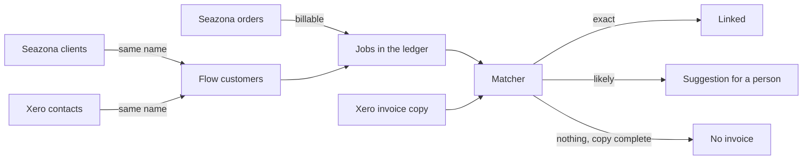

# Job and invoice links

Flow keeps its own record of each job from the work system (Seazona) and of
the accounting invoice (Xero) that bills it. This page describes how Flow
makes that link. The code is in `server/core/pipeline.js`. Issue #58 tracks
the pipeline.

The pipeline reads only Flow's own copies of the two systems. It never writes
to Seazona or Xero. Matching many years of history costs no API calls.

## The run

A background worker runs the pipeline every two minutes. It runs as a
`pipeline.run` job on the job queue, so two Flow processes never run it at
the same time. It does work only while an integration that feeds it is on.
`FLOW_PIPELINE=off` stops it.

Each run has three steps, and then runs the automations that are on
(`docs/AUTOMATIONS.md`): they mark jobs ready to invoice and draft them by
rule (`docs/INVOICING_RULES.md`).

1. **Customers.** A Seazona client and a Xero contact link to the Flow
   customer with the same name. Case, spacing, punctuation and a "Pty Ltd"
   end do not count. The link is made only when exactly one record on each
   side has the name (`exact_name`). Other customers wait for a person.
2. **Work.** Each billable Seazona order becomes or updates its job in the
   billing ledger (`server/core/ledger.js`). The job gets the Flow customer
   that its client links to. A new customer link reads all jobs again, so
   older jobs get their customer too. An order deleted in Seazona sends its
   job to review.
3. **Matching.** The matcher compares each job with the sales invoices in the
   Xero copy (`docs/XERO.md`, "The mirror").

The Xero adapter reads contacts and items once a day, so that customers can
link without a person.

## The matcher

The matcher checks a job when the job is new, when Seazona changed it, or
when the Xero copy changed. Only exact evidence links a job by itself.

| Step | Evidence | Outcome |
| --- | --- | --- |
| 1 | The job is linked already | Flow follows the invoice: void, delete and paid change the job |
| 2 | Flow sent the job's invoice to Xero | Linked, `flow_invoice` |
| 3 | The earlier installation linked the order (`prior_links`), and the invoice is in the copy with an amount that fits, or a person made that link | Linked, `prior_link` |
| 4 | One Xero invoice of the customer has the Seazona invoice number (a trailing R does not count) | Linked, `source_invoice_ref` |
| 5 | The customer's invoices from 7 days before to 45 days after the job date | Scored |

The job date is the Seazona invoice date. When there is none, it is the
order's due date, then its order date.

### The score

| Signal | Weight | Meaning |
| --- | --- | --- |
| `total` | 6 | The invoice total equals the job total |
| `total_gst` | 5 | The invoice total equals the job subtotal, or the subtotal plus 10% |
| `items_same` | 3 | Both have the same item codes |
| `items_overlap` | 1 | They share some item codes |
| `date_close` | 2 | The dates are 3 days apart or less |
| `date_near` | 1 | The dates are 14 days apart or less |
| `prior_link` | 4 | The earlier installation linked this pair, at another amount |
| `not_live` | -3 | The invoice is voided or deleted |
| `closer_job` | -4 | Another unlinked job of the customer, at an amount that fits, is closer in date |

A candidate counts only with a total signal or `prior_link`. An invoice for
the same customer at another amount is other work.

| Result | Rule | The job |
| --- | --- | --- |
| Suggested | The top score is 8 or more, and 3 or more above the next | `ambiguous`, with the suggestion first |
| Unsure | Any other candidates | `ambiguous`, with up to 5 suggestions |
| No invoice | No candidate, and the copy is complete and was read in the last day | `not_found` |
| Wait | No candidate, and the copy is not complete or not fresh, or the job has no date | No change |
| No contact | The customer has no Xero contact link | No change |

A job whose `accounting_state` is `non_chargeable` is left out of this match. Its work is recorded in Flow and is not billed, so the matcher does not write `not_found` over it (`docs/INVOICE_RULES.md`).

Each suggestion is a row in `link_suggestions`, with its score and its
signals, so a person can see why. A later run marks a suggestion that it does
not make again `stale`. A person's decision (`accepted`, `rejected`) stays.

A row in `link_rejections` is a person's "not this one". The matcher never
offers that pair again.

The amount of an invoice that linked jobs already account for is taken. An
invoice whose whole total is taken is not a candidate for another job.

### A person settles it

A job with no invoice whose evidence is `ambiguous` shows a warning icon and
"Needs invoice" on its panel, one line, "This job has no invoice.", and two
buttons.

| Button | What Flow does |
| --- | --- |
| Make invoice | Rejects every open suggestion, records the job as `not_found` (by a person), then drafts its invoice. The live check before the draft still runs. |
| Reconcile | Opens the Reconcile page at this job. |

### Reconcile

The Reconcile page (`/reconcile`, under Work) matches Flow's own records:
Flow jobs against Flow invoices. It calls no integration. Whether a Flow
invoice matches an invoice in an accounting system is that integration's own
work, on its own page.

It is laid out like Jobs and Invoices. `/reconcile` lists every gap, oldest
first, jobs and invoices together:

| Gap | A gap is |
| --- | --- |
| Job with no invoice | A job marked ready, with no Flow invoice, not held, and not tied to an accounting invoice by the matcher. |
| Invoice with no job | A Flow invoice, not void, that no job is linked to. |

The Filter chip is the one Jobs uses (`server/ui/view-bar.js`): groups of
rows of field, operator and value, joined by And / Or, as on ClickUp. The
fields are Type (Job or Invoice), Status, Client, Practitioner, Date, Total,
Match (has a possible match, or none) and the lab's custom fields. Status
is the job's status from the lab system, or the invoice's stage.
Practitioner and custom fields belong to jobs, so a row on them never hides
an invoice. The rows are kept for each viewer in the browser.

The Invoices list has the same chip at the right of its tabs. Its fields
are Client, Number, Reference, Date, Total and Problem; the tabs stay the
status. It filters the rows of the tab shown, and is kept in the browser. The search icon at the right
of the toolbar opens a box that finds a client, practitioner, invoice number
or amount. Jobs and Invoices use the same icon (`findBox` in
`server/ui/view-bar.js`); the sidebar search (Ctrl+K) stays the way to find
anything in Flow. Ticked jobs get draft invoices from
the bulk bar ("Make invoices"); a ticked job with a possible invoice is left
for a person to check.

A row opens that gap at `/reconcile/:id` (`?kind=invoice` for an invoice),
as an invoice opens from Invoices: the pager on top ("← Back" to the list,
"n of N" of the list as it was filtered, previous and next), then the gap.
The search icon for another invoice (or job) sits at the right of the
toolbar over the compare table.

For one gap the page shows the record beside its possible other side, best
first: the same client within 60 days, ranked by total, lines, Reference and
date. The search icon finds any other: Flow invoices by number, client,
Reference or amount; jobs by client, practitioner or case. Each fact has a
mark against the record's: ✓ same, ≠ different, none when one side does not
know.

| Fact | Compared |
| --- | --- |
| Client | The same contact. |
| Reference | The Reference Flow would give the job's invoice, against the invoice's. |
| Date | Days between the job date and the invoice date. ✓ within 3 days. |
| Lines | Price items and amounts before tax, in any order. |
| Total | Equal. |
| Other jobs | Jobs already linked to the invoice. |
| Status | The invoice's status, or the job's stage. No mark. |

"Link this invoice" (or "Link this job") sets the job's Flow invoice. Every
open matcher suggestion for the job is rejected, and a job held on an unclear
accounting match is settled. "Make invoice" drafts the job's Flow invoice;
for an unclear job it first records "no invoice" (`confirmNoInvoice`). After
either, the next gap opens. Skip changes nothing. A phone shows one card per
candidate instead of the table.

API: `GET /api/invoicing/reconcile` (both queues), `GET
/api/invoicing/jobs/:id/reconcile` and `GET
/api/invoicing/invoices/:id/reconcile` (one record and its candidates; `?q=`
searches), `POST /api/invoicing/jobs/:id/no-invoice` and `POST
/api/invoicing/jobs/:id/link` (`{ invoiceId }`, a Flow invoice). The two POSTs
need an owner or admin. Code: `listReconcile`, `jobMatchDetail` and
`invoiceMatchDetail` in `server/core/job-match.js`; `confirmNoInvoice` and
`linkJobToInvoice` in `server/core/ledger.js`.

### Old jobs

A job with no invoice whose job date is more than 90 days ago is held, once,
with the reason. It may be work billed some other way. A person who releases
it has decided, and the matcher does not hold it again.

## What comes next

- Find an invoice by hand in the linking tool, beyond the suggestions.
- Credit notes and payments on the linked job (step 3).
- Draft rules and send modes are built: `docs/INVOICING_RULES.md`.
