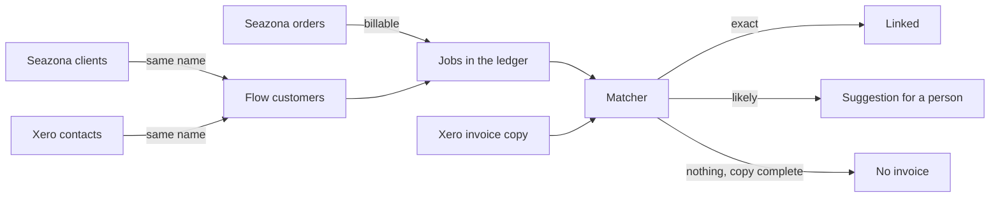

# Job and invoice links

Flow keeps its own record of each job from the work system (Seazona) and of
the accounting invoice (Xero) that bills it. This page describes how Flow
makes that link. The code is in `server/core/pipeline.js`. Issue #58 tracks
the pipeline.

The pipeline reads only Flow's own copies of the two systems. It never writes
to Seazona or Xero. Matching many years of history costs no API calls.

## The run

A background worker runs the pipeline every two minutes. It runs as a
`pipeline.run` job on the job queue, so two Flow processes never run it at
the same time. It does work only while an integration that feeds it is on.
`FLOW_PIPELINE=off` stops it.

Each run has three steps, and then drafts invoices by rule
(`docs/INVOICING_RULES.md`).

1. **Customers.** A Seazona client and a Xero contact link to the Flow
   customer with the same name. Case, spacing, punctuation and a "Pty Ltd"
   end do not count. The link is made only when exactly one record on each
   side has the name (`exact_name`). Other customers wait for a person.
2. **Work.** Each billable Seazona order becomes or updates its job in the
   billing ledger (`server/core/ledger.js`). The job gets the Flow customer
   that its client links to. A new customer link reads all jobs again, so
   older jobs get their customer too. An order deleted in Seazona sends its
   job to review.
3. **Matching.** The matcher compares each job with the sales invoices in the
   Xero copy (`docs/XERO.md`, "The mirror").

The Xero adapter reads contacts and items once a day, so that customers can
link without a person.

## The matcher

The matcher checks a job when the job is new, when Seazona changed it, or
when the Xero copy changed. Only exact evidence links a job by itself.

| Step | Evidence | Outcome |
| --- | --- | --- |
| 1 | The job is linked already | Flow follows the invoice: void, delete and paid change the job |
| 2 | Flow sent the job's invoice to Xero | Linked, `flow_invoice` |
| 3 | The earlier installation linked the order (`prior_links`), and the invoice is in the copy with an amount that fits, or a person made that link | Linked, `prior_link` |
| 4 | One Xero invoice of the customer has the Seazona invoice number (a trailing R does not count) | Linked, `source_invoice_ref` |
| 5 | The customer's invoices from 7 days before to 45 days after the job date | Scored |

The job date is the Seazona invoice date. When there is none, it is the
order's due date, then its order date.

### The score

| Signal | Weight | Meaning |
| --- | --- | --- |
| `total` | 6 | The invoice total equals the job total |
| `total_gst` | 5 | The invoice total equals the job subtotal, or the subtotal plus 10% |
| `items_same` | 3 | Both have the same item codes |
| `items_overlap` | 1 | They share some item codes |
| `date_close` | 2 | The dates are 3 days apart or less |
| `date_near` | 1 | The dates are 14 days apart or less |
| `prior_link` | 4 | The earlier installation linked this pair, at another amount |
| `not_live` | -3 | The invoice is voided or deleted |
| `closer_job` | -4 | Another unlinked job of the customer, at an amount that fits, is closer in date |

A candidate counts only with a total signal or `prior_link`. An invoice for
the same customer at another amount is other work.

| Result | Rule | The job |
| --- | --- | --- |
| Suggested | The top score is 8 or more, and 3 or more above the next | `ambiguous`, with the suggestion first |
| Unsure | Any other candidates | `ambiguous`, with up to 5 suggestions |
| No invoice | No candidate, and the copy is complete and was read in the last day | `not_found` |
| Wait | No candidate, and the copy is not complete or not fresh, or the job has no date | No change |
| No contact | The customer has no Xero contact link | No change |

Each suggestion is a row in `link_suggestions`, with its score and its
signals, so a person can see why. A later run marks a suggestion that it does
not make again `stale`. A person's decision (`accepted`, `rejected`) stays.

A row in `link_rejections` is a person's "not this one". The matcher never
offers that pair again.

The amount of an invoice that linked jobs already account for is taken. An
invoice whose whole total is taken is not a candidate for another job.

### Old jobs

A job with no invoice whose job date is more than 90 days ago is held, once,
with the reason. It may be work billed some other way. A person who releases
it has decided, and the matcher does not hold it again.

## What comes next

- A screen and an API to accept a suggestion, reject one, and find an invoice
  by hand (step 2 of the plan).
- Credit notes and payments on the linked job (step 3).
- Draft rules and send modes are built: `docs/INVOICING_RULES.md`.
