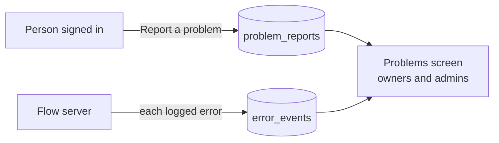

# Problems: reports and the error log

Issue #78.

Each Flow installation keeps its own problem reports and its own error log in
its own PostgreSQL database. Nothing is sent to the Flow maintainers or to any
other service. The people who run the installation decide who else sees them.

## Reporting a problem

The flag button at the foot of the sidebar opens a short form on every view.
Anyone signed in can send a report. Flow adds:

- the page the person was on;
- who they are (their person record and email);
- their browser (the `User-Agent` header);
- the running build (the release, else the commit; `server/deployed-build.js`).

A report holds up to 4,000 characters. Each person can send 10 reports a
minute.

## The error log

From the start of the server, each line Flow logs as an error is also kept in
`error_events` (`createErrorRecorder` in `server/core/problems.js`). This
covers the HTTP app, the integrations and the pipeline. A server fault that no
route answers is logged as `[http]` and answered with no detail.

- **One row per kind of error.** Errors that differ only in ids, numbers or
  quoted values share a fingerprint. A repeat adds one to `count` and moves
  `last_seen_at`. A closed error that comes back is new again.
- **Source.** A line's leading `[tag]` (such as `[seazona]`) is its source;
  other lines are `server`.
- **No credentials.** Bearer tokens, `sk_`/`pk_` keys, passwords in URLs,
  `key=`/`token=`/`secret=`/`password=`/`dsn=` values and long opaque tokens
  are replaced with `[redacted]` before a row is written.
- **A storm cannot flood the database.** At most 60 errors are stored each
  minute; the host's own log still has every line. A failed write is logged
  as a warning, never stored.

## The Problems screen

Settings, Problems (`/problems`) is open to owners and admins. It has two
tabs, Reports and Errors, newest first, filtered by status: new, seen or
closed. Each row's status is set there.

API, mounted at `/api/problems` (`server/api/problems.js`):

| Route | Who | What |
| --- | --- | --- |
| `POST /reports` | anyone signed in | `{ message, page }` |
| `GET /reports?status=` | owner, admin | the reports, with counts by status |
| `PATCH /reports/:id` | owner, admin | `{ status: new \| seen \| closed }` |
| `GET /errors?status=` | owner, admin | the error log, with counts by status |
| `PATCH /errors/:id` | owner, admin | `{ status }` |

## Giving someone else access

The installation's owner decides. To let a support person read reports and
errors, an owner invites them on the People screen with the admin role, and
removes them when the work is done.

## Later

- An optional error service of the installation's own (`SENTRY_DSN`, set by
  the operator). Flow will ship no DSN of its own.
- Optional forwarding of each new report to an email address or a webhook the
  owner sets.
- Screenshots, once the object storage port exists (`VISION.md`).
