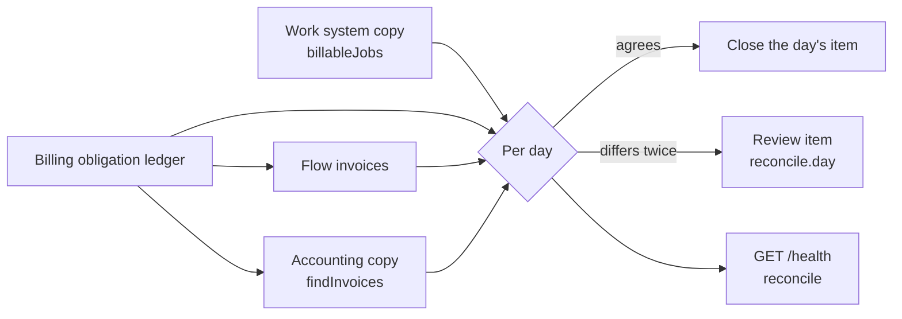

# Daily reconcile

Status: built (issue #129). Code: `server/core/reconcile.js`.

Flow checks each record as it moves. Once a day it also checks the whole, so
a missed change, a stuck lane or a skipped job shows before a person finds a
missing invoice. The reconcile reads Flow's own tables only. It makes no call
to any other system, and it never changes a record: a difference is an alert.

## What it counts

For each of the last 60 days, by the job's day (the ledger's `job_date`):

| Place | Counts | Totals |
| --- | --- | --- |
| Work system copy | billable jobs; `unpriced` = jobs with a line that has no amount | subtotal of the priced jobs |
| Ledger | obligations | subtotal and total |
| Flow invoices | obligations with a Flow invoice | the invoices' totals |
| Accounting copy | `linked` = obligations linked to an invoice that exists; `found` = those in the copy | the copies' totals |

A job that only a history import reported is left out. The import keeps its
own reconciliation record (`docs/SEAZONA.md`, "History import").

## What is a difference

| Difference | Meaning |
| --- | --- |
| `missingInLedger` | A billable job in the work system's copy has no obligation. |
| `missingInWork` | An obligation's job is not billable in the copy now (gone, deleted, or its status moved back). |
| `missingInAccounting` | A linked invoice is not in the accounting copy. |
| `accountingTotalDiffers` | The accounting copy's total is not the Flow invoice's total (an invoice Flow issued), or not the job's total with or without GST (an invoice Flow only matched). |

Totals between the copy and the ledger, and between the ledger and a Flow
invoice, are shown but not compared: line mapping can price a line from the
price list, and a person or a rule can change a draft.

## Review items

- A day with a difference opens one review item, kind `reconcile.day`, entity
  `day`. Its evidence holds the counts, the totals and, for each difference,
  its count and up to 20 record ids (work system job refs, ledger obligation
  ids).
- A difference first seen opens no item. The reconcile runs again an hour
  later, and opens the item only when the difference is still there. A job
  the pipeline has not reached yet is not a difference.
- A later run refreshes the open item. The item closes by itself
  (`resolved_by` `system:reconcile`) when a run finds the day agrees. An open
  item older than 60 days is still checked, so it can close.

## Running

- The worker (`createReconcileWorker`, started in `server/index.js`) asks every
  10 minutes whether a run is due: once a day, or an hour after a run that saw
  a new difference. It runs on the job queue (kind `reconcile.daily`), so two
  Flow processes never run it at once. A run that gives up opens a `job.dead`
  review item and waits a day or a restart.
- It runs only while an integration with `billableJobs` or `findInvoices` is
  on.

## GET /health

`reconcile` shows the last run, counts only: `lastRunAt`, `state`, `agrees`,
`daysChecked`, `daysDifferent`, `openItems`, and `late` (no run for more than
a day). A difference never fails the health check.
