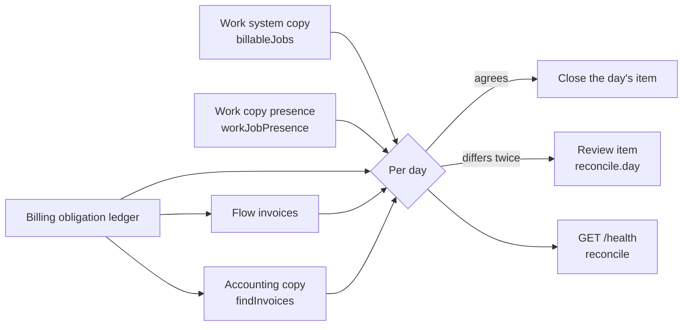

# Daily reconcile

Status: built (issue #129). Code: `server/core/reconcile.js`.

Flow checks each record as it moves. Once a day it also checks the whole, so
a missed change, a stuck lane or a skipped job shows before a person finds a
missing invoice. The reconcile reads Flow's own tables only. It makes no call
to any other system, and it never changes a record: a difference is an alert.

## What it counts

For each of the last 60 days, by the job's day (the ledger's `job_date`):

| Place | Counts | Totals |
| --- | --- | --- |
| Work system copy | billable jobs; `unpriced` = jobs with a line that has no amount | subtotal of the priced jobs |
| Ledger | obligations | subtotal and total |
| Flow invoices | obligations with a Flow invoice | the invoices' totals |
| Accounting copy | `linked` = obligations linked to an invoice that exists; `found` = those in the copy | the copies' totals |

A job that only a history import reported is left out. The import keeps its
own reconciliation record (`docs/SEAZONA.md`, "History import").

## What is a difference

| Difference | Meaning |
| --- | --- |
| `missingInLedger` | A billable job in the work system's copy has no obligation. |
| `missingInWork` | An obligation's job is absent or deleted in the work copy. |
| `missingInAccounting` | A linked invoice is not in the accounting copy. |
| `accountingTotalDiffers` | The accounting copy's total is not the Flow invoice's total (an invoice Flow issued), or not the job's total with or without GST (an invoice Flow only matched). |
| `readyNotInvoiced` | A job ready for more than 3 days, with no hold, has no Flow invoice and no accounting invoice linked. |

The reconcile checks source presence separately from billable eligibility.
`workJobPresence` checks ledger refs without status, date or line filters. A
job that returns to an open status is not missing. Deleted jobs remain
missing. An adapter without this capability keeps the billable-feed comparison.
Billable counts and ledger totals do not change.

Totals between the copy and the ledger, and between the ledger and a Flow
invoice, are shown but not compared: line mapping can price a line from the
price list, and a person or a rule can change a draft.

## Review items

- A day with a difference opens one review item, kind `reconcile.day`, entity
  `day`. Its evidence holds the counts, the totals and, for each difference,
  its count and up to 20 record ids (work system job refs, ledger obligation
  ids).
- A difference first seen opens no item. The reconcile runs again an hour
  later, and opens the item only when the difference is still there. A job
  the pipeline has not reached yet is not a difference.
- A later run refreshes the open item. The item closes by itself
  (`resolved_by` `system:reconcile`) when a run finds the day agrees. An open
  item older than 60 days is still checked, so it can close.

## Overrides

An invoice an owner or admin sent with a warning (`docs/INVOICE_SENDING.md`,
"Override") is one open review item, kind `send.override`, entity
`send_override`. Its evidence holds the invoice, the version, the document
hash, each warning's code and line, the reason and the person. It holds no
note and no customer name. Money at risk is the amount of the lines with a
warning.

On the Reconcile page each open override is a row of the type **Override**.
The Type filter finds them. The row opens the override: Flow's value beside
the Xero item's for each line, who sent it, when and why.

The item closes in one of three ways. Each close adds a
`send.override.closed` event to the job.

| Way | Trigger | Resolution |
| --- | --- | --- |
| The cause is gone | **Recheck** on the override. The adapter's draft check (Flow's copy of Xero, no call) no longer finds the recorded warning. | `agrees`, by `system:send-override` |
| The invoice is gone | The invoice is void, or a later version went with no override. Void checks at once; Recheck checks too. | `invoice_void` or `replaced` |
| A person accepts it | **Accept**, by an owner or admin, with a note. An assistant key cannot. | `accepted`, by the person |

## Running

- The worker (`createReconcileWorker`, started in `server/index.js`) asks every
  10 minutes whether a run is due: once a day, or an hour after a run that saw
  a new difference. It runs on the job queue (kind `reconcile.daily`), so two
  Flow processes never run it at once. A run that gives up opens a `job.dead`
  review item and waits a day or a restart.
- It runs only while an integration with `billableJobs` or `findInvoices` is
  on.

## GET /health

`reconcile` shows the last run, counts only: `lastRunAt`, `state`, `agrees`,
`daysChecked`, `daysDifferent`, `openItems`, and `late` (no run for more than
a day). A difference never fails the health check.
