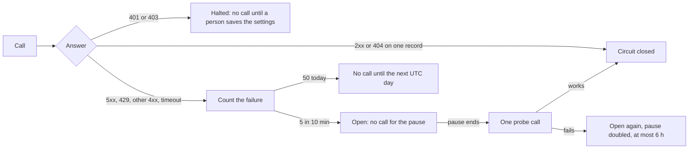
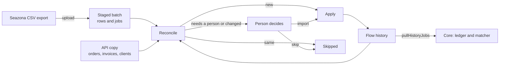

# Seazona adapter

Seazona is the lab's case system. The Seazona adapter reads what billing
needs through the Seazona REST API: invoices, orders, clients, products and
users. It never writes to Seazona, and it never drives a browser. The code is
in `server/integrations/seazona/`. Core code never imports it
(`CONTRIBUTING.md`).

Status: the adapter is on the integration port. It keeps Seazona's invoices,
orders, clients, products and users in step and gives invoice preparation a
billing feed. Invoice preparation itself is not built yet.

## Turn it on

In Flow, an owner opens **Integrations**, then Seazona: choose the mode,
paste the API address, client id and client secret, and press **Save and
turn Seazona on**. Seazona starts at once; live mode starts the background
sync. The secret is stored sealed (`docs/INTEGRATIONS.md`, "Set up in
Flow").

A host can instead turn it on with environment settings:

1. Add `seazona` to `FLOW_INTEGRATIONS` (`docs/INTEGRATIONS.md`). Its tables
   are created at the next start.
2. Set `SEAZONA_MODE` and the settings for that mode (below). With Seazona on
   and no mode, or a malformed setting, Flow does not start: the adapter never
   guesses which account it acts on.
3. Start Flow. The log says `[seazona] mode live; background sync on`.
4. Check `GET /health`: `integrations` lists Seazona with its mode, each lane
   and the rate governor.

In `sandbox` or `replay`, sync when you choose:

```bash
DATABASE_URL=postgres://… FLOW_INTEGRATIONS=seazona SEAZONA_MODE=sandbox … \
  node server/integrations/seazona/sync-once.js [lane …]
```

It runs the named lanes (all when none is named) once, through the rate
governor, and prints what each did.

## Modes

The mode says which environment the adapter acts on (issue #10). It comes
from `SEAZONA_MODE` only. There is no default: with no mode the adapter does
nothing.

| Mode | Acts on | Background sync | Network |
| --- | --- | --- | --- |
| `live` | The installation's real Seazona account | Yes | Seazona API |
| `sandbox` | A Seazona test account | Never; runs only when asked | Seazona API |
| `replay` | A file of recorded, synthetic responses | Never | None |

Development and CI use `replay` or `sandbox`. Never give a development
workspace live credentials.

## Settings

| Setting | Meaning |
| --- | --- |
| `SEAZONA_MODE` | `live`, `sandbox` or `replay`. Required. |
| `SEAZONA_API_BASE_URL` | The API root of the account, `https://…`, with or without `/v1`. Required in `live` and `sandbox`. |
| `SEAZONA_API_CLIENT_ID`, `SEAZONA_API_CLIENT_SECRET` | The API client. Secrets: keep them in the platform's secret store. Required in `live` and `sandbox`. |
| `SEAZONA_REPLAY_FILE` | The replay file. Required in `replay`. |
| `SEAZONA_API_REQUESTS_PER_MINUTE` | Default and maximum 30. A value can only lower it. |
| `SEAZONA_API_MAX_RETRIES` | Retries after a 429 or 5xx answer. Default 2. |
| `SEAZONA_API_TIMEOUT_MS` | Time limit for one request. Default 30000. |
| `SEAZONA_API_MAX_WAIT_MS` | How long a request may wait for a free slot. Default 120000. |
| `SEAZONA_API_TELEMETRY_RETENTION_DAYS` | How long request telemetry is kept. Default 35, so last month's question from Seazona can be answered. Maximum 90. |
| `SEAZONA_KEEP_PATIENT_REFERENCE` | `on` keeps Seazona's patient field on orders and invoices as the patient reference an invoice prints. Default off: no patient field is stored. |
| `SEAZONA_INVOICE_CADENCE_MS`, `SEAZONA_ORDER_CADENCE_MS`, `SEAZONA_ACTIVE_ORDER_CADENCE_MS`, `SEAZONA_CLIENT_CADENCE_MS`, `SEAZONA_REFERENCE_CADENCE_MS` | How often each lane runs in live mode. Defaults below. |
| `SEAZONA_ORDER_LOOKBACK_DAYS` | How far back the recent-order lane reads. Default 30. |
| `SEAZONA_ORDER_DAYS_PER_RUN` | Days the recent-order lane reads per run. Default 6. |
| `SEAZONA_INVOICE_LOOKBACK_DAYS` | Days before today the first invoice run reads. Default 0. |
| `SEAZONA_ACTIVE_ORDERS_PER_RUN` | Open orders the active-order lane re-reads per run. Default 25. |
| `SEAZONA_LIST_CAP` | A list exactly this long may be cut off, so its lane holds. Default 50. |
| `SEAZONA_ORDER_QUARANTINE_FAILURES`, `SEAZONA_ORDER_QUARANTINE_MS` | Failed reads in a row before an order, an invoice or a client is quarantined, and for how long. Defaults 3 and 1 day. |
| `SEAZONA_CIRCUIT_FAILURES`, `SEAZONA_CIRCUIT_WINDOW_MS` | Failed calls inside the window that open the circuit. Defaults 5 and 10 minutes. |
| `SEAZONA_CIRCUIT_PAUSE_MS` | The first pause when the circuit opens. It doubles after each failed probe, to at most 6 hours. Default 5 minutes. |
| `SEAZONA_DAILY_FAILURE_BUDGET` | Failed calls allowed in one UTC day. When they are spent, calls stop until the next day. Default 50. |
| `SEAZONA_HISTORY_CALLS_PER_RUN`, `SEAZONA_HISTORY_CADENCE_MS`, `SEAZONA_HISTORY_PAGE_SIZE` | Calls the history backfill makes per run, how often it runs, and orders per list page. Defaults 10, 2 minutes and 500. It calls Seazona only while a person has started one. |

The code holds no Seazona host or account. Every address and credential is
configuration.

## Rate governor

Seazona publishes a limit of 60 requests a minute for each API client. Flow
stays at 30, and counts every process that shares the database as one client,
because Seazona does (`server/integrations/seazona/governor.js`):

- A request waits until fewer than 30 requests went out in the last minute,
  and at least 2 seconds have passed since the last one.
- A 429 answer with `Retry-After` holds every process for that long (at most
  60 seconds).
- A 429 or 5xx answer is retried at most `SEAZONA_API_MAX_RETRIES` times, with
  a growing wait. Each retry counts against the limit.
- A request that waits longer than `SEAZONA_API_MAX_WAIT_MS` gives up with
  `seazona_api_governor_timeout`.
- In `live` and `sandbox` the client refuses to start without the governor,
  so no code path can call Seazona ungoverned.

### Failed calls (issue #101)

Seazona can cut off an account's API access when it sees many failed calls,
even inside the rate limit. So the governor also stops calls. A stopped call
fails at once with `SeazonaCallsStopped` and makes no request.



| Failure | What Flow does | Starts again |
| --- | --- | --- |
| 401 or 403 | Halts every call. Every lane is `stopped`. | A person saves the Seazona settings or turns Seazona on. New credentials are a new client, so a new start. |
| 400 or 404 on a list | Stops that lane. | A restart (for example a new release), or a person saving the settings. |
| 404 on one record | Marks the order deleted (issue #12). Not a failure. | |
| 429 | Waits for `Retry-After`, as before. Counts as a failure. | |
| 5xx, timeout, network | Retries, then the lane backs off. Counts as a failure. | |
| The same record fails 3 times | Quarantines the order, invoice or client for a day. The lane skips it and its cursor moves on. | The quarantine ends. |
| 5 failures in 10 minutes | Opens the circuit. | After the pause, one probe. |
| 50 failures in a UTC day | Stops calls. | The next UTC day. |

Each held failure is reported once to the error services that are on
(`log.error`, docs/SENTRY.md): a lane that starts failing or changes its
failure code, a stopped lane, an open circuit, a spent budget, and records
newly quarantined. A repeat of the same failure is a warning in the host log
only. The report text names the lane and the code, never a record, a host or
a credential, so the error service groups repeats. With no error service on,
the host log has the same lines.

Each request leaves one row in `seazona_api_requests`: when it went, the
request path (for example `/v1/orders/<order id>`), the status or failure
kind, the time it took and whether it was a retry. The row never holds the
host, the query, a credential or a response. `governor.summarise({ from, to })`
gives the totals for a period and each failing path with its count, which
answers a question such as "why did this account make thousands of failed
reads last month?".

## The background sync

Only `live` mode starts it (`server/integrations/seazona/scheduler.js`). It
first runs 5 seconds after start, runs every lane that is due, then sleeps
until the next lane is due (at least 15 seconds, at most 30 minutes). One run
at a time; a lane that another process is running is skipped.

## Sync lanes

Each lane keeps one kind of record fresh, on its own cadence
(`server/integrations/seazona/lanes.js`). One failing lane never stops
another.

| Lane | Reads | Cadence |
| --- | --- | --- |
| `invoices` | `GET invoices/?lastModified=` since the cursor (less 5 minutes), then each changed invoice's detail | 2 minutes |
| `orders_recent` | `GET orders/?ordered=` for each day of the last 30 (6 days a run), then each new or changed order's detail | 5 minutes |
| `orders_active` | Each open order Flow already knows, oldest first, 25 a run. "Complete" stays open until Seazona says it shipped. | 5 minutes |
| `clients` | The whole list the first time, then changes since the cursor, then each changed client's detail | 30 minutes |
| `products`, `users` | The whole list | Daily |
| `history` | Past orders, one UTC day at a time, a few calls a run (History import, below) | Every 2 minutes, only while a backfill runs |

A list row whose list fields did not change costs no detail read. Seazona
documents no paging, so a list exactly `SEAZONA_LIST_CAP` long may be cut off:
the lane holds (`held`), keeps its cursor and tries again in an hour.

A failed lane waits 1 minute, doubling to at most 6 hours, or as long as a 429
asked. A lane that says it is running for more than 20 minutes is taken to
have died, and another run may claim it.

### Bad orders (issue #12)

Every order read follows these rules:

- **A 404 marks the order deleted in Seazona.** Its row and history stay and
  its sync time is refreshed, so it never comes first again. It reads as
  "Deleted in Seazona", leaves the active-order rotation and is out of
  billing. If it shows up in an order list again it is read, and a successful
  read clears the mark.
- **Each other failure is recorded per order** (`seazona_order_read_failures`):
  the HTTP status or the kind (`empty_response`, `timeout`, `invalid_json`,
  `network`). A failed order moves to the back of the rotation.
- **An empty answer is a failure**, never a success.
- **After 3 failures in a row an order is quarantined for 1 day**, then gets
  one more read. A failure then quarantines it again; a success clears it.
- **A lane fails only when most of its reads fail.** A few bad orders never
  push every other order into the lane's backoff.
- **A 429, or a request that waits too long for a slot, stops the lane**
  without counting against any order: it is about Seazona, not the order.
- **Errors name each failing order.** A failed lane's error lists up to 10 as
  `ORD-1 (HTTP 500), ORD-2 (timeout)`. The lane's failure details hold up to
  25, with the quarantined orders. `readSeazonaSyncHealth()` returns them for
  /health. None of it holds patient data.

### What is kept

The mirror keeps what billing needs, in integer cents as Seazona reported
them: order and invoice numbers, practice and dentist, status, dates, lines
(description, code, amount, taxable) and totals; client account, email,
phone, address and dentist names; product prices; user names. It keeps no
notes, files, settings, staff email or dentist phone, and no patient field
unless `SEAZONA_KEEP_PATIENT_REFERENCE` is on.

## Billing feed

The adapter's `pullWorkItems(cursor)` capability is what invoice preparation
reads (`server/integrations/seazona/feed.js`). Each call returns the orders
that changed since the cursor, oldest change first, up to 200:

- `items`: complete and shipped orders. Each has the order (`sourceId`,
  `invoiceNumber`, `status`, `shipped`, practice, dentist, `orderedOn`,
  `dueOn`, `lines`, `subtotalCents`, `patientReference`), the Seazona invoice
  that carries it (`invoice`, or null) and the practice's account and email
  (`client`).
- `withdrawn`: every other changed order, with `reason`
  `deleted_in_seazona` or `not_billable`, so work already held for it can be
  dropped. An order deleted in Seazona is never an item, from any cursor.
- `cursor`: pass it to the next call. `more` is true when the page was full.

Each item also carries `ledgerJob` and each withdrawn entry `ledgerHold`,
shaped for the billing obligation ledger (below).

A change to an order or to its Seazona invoice puts the order at the end of
the feed again. Call `registry.whenEnabled('seazona', …)` to reach it, so a
turned-off adapter answers as turned off (`docs/INTEGRATIONS.md`).

## Billing ledger

The feed is shaped for the billing obligation ledger (`server/core/ledger.js`,
issue #3). One Seazona order is one billable job
(`server/integrations/seazona/ledger.js`):

```js
for (const item of page.items) {
  await observeJob(db, organisationId, { ...item.ledgerJob, contactId: contactFor(item.client) });
}
for (const { ledgerHold } of page.withdrawn) {
  if (ledgerHold) await setHold(db, organisationId, obligationIdFor(ledgerHold), { ...ledgerHold, actor });
}
```

| Ledger field | From Seazona |
| --- | --- |
| `sourceSystem`, `sourceJobRef` | `seazona` and the order id |
| `sourceInvoiceRef` | The Seazona invoice number |
| `caseRef` | The order id, which is the case number. Never patient data. |
| `practitioner` | The dentist on the order |
| `shippedOn` | Always null: the API gives a shipped status, not a date |
| `lines` | The Seazona invoice's lines, discounts included, when that invoice carries this order and no other (`linesFrom: 'invoice'`); otherwise the order's lines (`linesFrom: 'order'`), so an invoice is never split or billed twice. Each line has quantity 1, the line's `code` as `itemCode`, and its amount. An unknown amount or tax treatment is left for the price item with the same code. |
| `observedAt` | The last successful read from Seazona, so the ledger's out-of-date check is real |
| `contactId` | Not set: the core resolves the Flow contact from `item.client` |

Amounts are tax-exclusive, as Seazona reports them, and the ledger adds GST
per line. An order deleted in Seazona sends its obligation to review
(`ledgerHold`); a person decides what happens to any invoice already made.
The ledger's "paid" write-back to Seazona is not built: this adapter only
reads.

## History import

The API sync reads forward from the day it started. The history import brings
in the years before that, so Flow holds the lab's full job history. It has
two sources, and both end in the same batches, reconciliation and history
table:

- **The API backfill** (the main source, below). It reads every past order
  from the Seazona API. Each order it reads is a batch row: the record of
  what the API confirmed.
- **A CSV export** (parked). Seazona's help pages document no export
  format, so this path is only for a file a person has. It is not built
  out further unless the API backfill cannot do the job.

The earlier app's own links from orders to Xero invoices are already in
`prior_links` (imported at start); the matcher uses them as evidence for
each history job (`docs/JOB_INVOICE_LINKS.md`). The earlier app read only
30 days of orders, so its archive is not a full history.

### The API backfill

An owner or admin starts it: `POST /api/seazona/history/backfill` with
`{ "from": "2019-01-01" }` (and `through`, by default the day before the
recent-order lane's window). The `history` lane then:

1. lists orders from the next day (`GET orders/?ordered=<day>`, with `page`
   and `pageSize` up to 500). Seazona's guide says the list answers the
   orders placed on or after that time, oldest first, in stable pages; the
   recent-order lane was built when it answered one day. The walk works
   either way: a full page goes on to the next page, a short page to the
   next day, and an order placed after `through` ends the walk unread;
2. leaves out the orders the live copy already holds;
3. reads each other order (`GET orders/<id>`), maps it as the live lanes do,
   and stages it as job `case:<order id>` in the backfill's batch;
4. reconciles each staged job at once, and writes a new one to Flow's
   history; a job that needs a person waits in the batch.

It makes at most `SEAZONA_HISTORY_CALLS_PER_RUN` calls a run (default 10,
at most 25), every `SEAZONA_HISTORY_CADENCE_MS` (default 2 minutes), through
the same rate governor, circuit and failed-call budget as the live lanes.
At the default, about 300 calls an hour. A 404 means the order is gone and
is skipped. Other failed reads are retried later in the walk and quarantined
after `SEAZONA_ORDER_QUARANTINE_FAILURES`. A refused or halted call stops
the lane as it stops the others. The lane keeps its place (day, page and
orders still to read) in its cursor, so it resumes after a restart. When
the last day is done, the batch waits like an upload for a person to decide
what is left. `POST /api/seazona/history/backfill/stop` ends it early.
`GET /api/seazona/history` shows `backfill`: the next day, days done, the
latest order day reached, orders read and orders still to read.

### CSV upload

The code is in `server/integrations/seazona/history/`; the routes are under
`/api/seazona/history` (`routes.js`). There is no screen yet.



1. **Upload.** An owner or admin posts the file
   (`POST /history/batches`, a `text/csv` body with `?fileName=`, or JSON
   `{ csv, fileName, columns }`, at most 25 MB and 200,000 rows). Flow
   guesses each column from its header (below); `columns` corrects a guess
   (`{ "doctorName": "Client Name" }`). A file without a practice, an item,
   an amount and a date is refused, and the answer lists the headers it has.
   The same file uploaded again answers its first batch.
2. **Read.** Each row is read into Flow fields. A row with a bad or missing
   date, practice, item or amount joins no job and is listed with its
   problems. Columns Flow does not know are listed by name; their values are
   never stored. The patient column groups rows into jobs and is stored only
   when `SEAZONA_KEEP_PATIENT_REFERENCE` is on.
3. **Group.** Rows with the same invoice number are one job; with no invoice
   number, the same case number; with neither, the same date, practice,
   doctor and patient, as the earlier app grouped them. A job with no number
   is keyed by its content without the patient, so no patient value or hash
   is kept.
4. **Reconcile.** Each job is compared with what Flow holds. It reads Flow's
   database only.
5. **Decide.** A person settles each job that waits:
   `POST /history/batches/:id/decisions` with
   `{ decisions: [{ jobKey, decision: "import" | "skip" | null, clientId? }] }`.
6. **Apply.** `POST /history/batches/:id/apply` reconciles once more, then
   writes each new job and each job a person chose to import into
   `seazona_history_jobs`. A batch is applied once. Nothing in the API copy
   changes.

| Finding | Blocks | Meaning |
| --- | --- | --- |
| `mixed_company`, `mixed_doctorName` | Yes | One invoice number carries two practices or doctors |
| `conflicting_totals` | Yes | The job's rows give different invoice totals |
| `total_differs_from_lines` | No | The total is not the lines, with or without GST |
| `differs_from_api_copy` | No | The API copy holds the same invoice or order at another amount |
| `invoice_has_several_orders` | No | The API copy has more than one order on the invoice |
| `api_copy_ambiguous` | Yes | With no number, more than one order in the API copy fits |
| `client_unknown` | No | No Seazona client has the practice name; the job imports without one |
| `client_ambiguous` | Yes | More than one Seazona client has the name; the person picks `clientId` |
| `differs_from_earlier_import` | Yes | An applied batch holds the same job with other values (outcome `changed`) |

Outcomes: `new` (apply writes it), `same` (already in Flow's history,
skipped), `changed` and `needs_person` (wait for a decision). A difference
is a finding, never a silent change.

The headers Flow reads (`GET /history/columns`). They compare without case,
spaces or punctuation:

| Field | Headers |
| --- | --- |
| Invoice number | Invoice #, Invoice Number, Invoice No |
| Case number | Case #, Case Number, Order #, Order Number, Order ID |
| Dates | Invoice Date or Date; Due Date; Ship Date or Date Shipped |
| Practice | Company Name, Company, Practice, Account Name |
| Account number | Account #, Account Number |
| Doctor | Doctor Name, Doctor, Dentist, Practitioner |
| Patient | Patient, Patient Name |
| Status | Status, Case Status |
| Line | Item, Product, Description, Service; Item Code or Code; Qty or Quantity; Tooth |
| Line amount | Item Amount, Amount, Line Amount, Line Total, Price |
| Line taxable | Item Taxable, Taxable (Yes/No) |
| Invoice total | Total, Invoice Total |

"Client Name" is not guessed: in Seazona it can mean the doctor or the
practice, so map it with `columns`.

`pullHistoryJobs(cursor)` gives the applied jobs as ledger jobs marked
`historical`, oldest change first. A job the API copy also holds uses the
same order id as `sourceJobRef`, so the two are one job; others use the case
number, else `history:<job key>`. `health()` shows `history`: jobs held,
how many the API copy also has, the first and last job date, and open
batches.

### History jobs in the ledger

The pipeline reads `pullHistoryJobs` after the live feed
(`server/core/pipeline.js`, `ingestHistory`; `server/core/history.js`):

| Case | What happens |
| --- | --- |
| The ledger has no job with that order id | The job is made and held: `hold_state` `held`, reason `history_import`, actor `import:seazona_history`. A held job never drafts. |
| The live feed made the job first | Nothing changes: not its lines, hold, ready mark or invoice. |
| History made the job, then the live feed reads it | The live read updates its lines. The hold stays. |
| A later import changes a job only history has reported | The job takes the new lines and stays held. |

The matcher runs on held jobs too, so each history job gets its accounting
state. `GET /api/seazona/history/ledger` lists the held history jobs by that
state; `?state=needs_person` gives `not_found`, `ambiguous` and `conflict`.
A matched job stays held: it is history and already invoiced. Only a
person's release (`POST /api/seazona/history/ledger/:obligationId/release`)
moves a job into drafting. The Jobs board and `GET /api/invoicing/jobs`
leave held history jobs out; `/jobs?history=include` shows them, and its
`counts.history` gives how many there are.

### Issues on job cards

A history job a person must decide (outcome `needs_person`, or `changed`
with no decision) is an issue on the card of the job it belongs to: the
order with that id on the Jobs board. The adapter's `jobIssues` gives each
issue as one short phrase (for example "Seazona client is unclear") and a
link to the Seazona integration's reconciliation,
`/integrations/seazona?batch=<id>&job=<job key>`. A person's decision there
clears the issue: the board reads issues again each time. `health()` shows
`history.waitingForPerson`, the count for the integration's card.

## Health

`health()` reads Flow's database only; it never calls Seazona. `GET /health`
shows it under `integrations`:

- `mode`, `scheduled` and the request limit;
- `governor`: requests in the last minute, any 429 cooldown, the last
  day's requests, failures, 429s and retries, the circuit (`closed`, `open`,
  `half_open`, `halted`) with `circuitOpenUntil` and `haltedReason`, and
  `failedToday` against `dailyFailureBudget`;
- `lanes`: for each lane its status (`ok`, `failed`, `held`, `stopped`,
  `processing`, `never_run`), whether it is fresh, its last success and
  error, and the failing orders by id and status; `orders_active` also lists
  the quarantined orders, and `invoices` and `clients` show
  `quarantinedRecords`;
- `deletedOrders`: how many orders are marked deleted in Seazona.

`ok` is false while a lane is failed, held or stopped. An integration problem never
fails Flow's own health check. None of it holds a host, a credential or
patient data.

## Replay files

A replay file is JSON with a `responses` list. Each entry answers one
request:

```json
{
  "responses": [
    { "path": "invoices/", "query": { "lastModified": "*" }, "status": 200, "body": [] },
    { "path": "orders/ORD-1001", "status": 404 },
    { "path": "orders/ORD-1002", "sequence": [{ "status": 500 }, { "status": 200, "body": { "id": "ORD-1002" } }] },
    { "path": "orders/ORD-1003", "rawBody": "" },
    { "path": "orders/ORD-1004", "error": "timeout" }
  ]
}
```

- `path` is relative to the API root.
- `query` is optional. Each key it lists must match, and `"*"` matches any
  value.
- The first matching entry answers. A `sequence` answers in order, then
  repeats its last answer.
- A request that no entry matches fails with the kind `replay_miss`.

A replay file holds synthetic data only: no real lab, practice, dentist or
patient (`CONTRIBUTING.md`).

## Tables

The adapter owns its tables (issue #13). They are created only while the
adapter is turned on, from its own migrations in
`server/integrations/seazona/migrations/`, and are not part of the core
schema. One installation talks to one Seazona account, so they are
installation-wide.

| Table | What it holds |
| --- | --- |
| `seazona_api_governor` | For each API client: when the next request may go, any 429 cooldown, the circuit, and a halt that waits for a person |
| `seazona_api_requests` | One row per request sent: the rate limit counts these, and they are the telemetry |
| `seazona_orders` | Orders: status, lines, totals, the deleted-in-Seazona mark |
| `seazona_invoices` | Seazona invoices, by invoice number, with lines and totals |
| `seazona_clients` | Practices: account, contact, address, dentists |
| `seazona_reference` | Products and users |
| `seazona_lane_state` | Each lane's cursor, next run, status and last failure |
| `seazona_order_read_failures` | Failed reads per order, and quarantine |
| `seazona_record_read_failures` | Failed detail reads per invoice or client, and quarantine (issue #101) |
| `seazona_history_batches` | Each uploaded CSV export: its columns, status and counts |
| `seazona_history_rows` | Each row of an upload as Flow read it, and its problems |
| `seazona_history_batch_jobs` | Each job of an upload: what reconciliation found and what a person decided |
| `seazona_history_jobs` | Flow's own record of past work from applied uploads |

To change them, edit `server/integrations/seazona/schema.js` and run:

```bash
npx drizzle-kit generate --config server/integrations/seazona/drizzle.config.js
```
