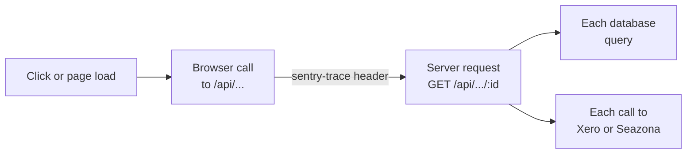

# Sentry

Issue #82. The Sentry adapter sends an installation's errors and problem reports to that
installation's own Sentry project. Flow ships no DSN. Each installation
enters its own, so its reports never reach the Flow maintainers or another
installation.

```mermaid
flowchart LR
  server[Flow server] -- "each logged error" --> log[Monitored log]
  log -- captureError --> sdk[@sentry/node]
  browser[Browser] -- "GET /api/monitoring" --> config[DSN, environment,<br/>release, Report a problem]
  browser -- "errors and<br/>Report a problem" --> project[(The installation's<br/>Sentry project)]
  sdk --> project
  project -- "Sentry's own integrations" --> tracker[Issue tracker, alerts]
```

## Turn it on

1. In the organisation's own Sentry account, create a project (platform
   Express).
2. Copy its DSN from the project's Settings, Client Keys (DSN).
3. In Flow, open **Integrations, Sentry**, paste the DSN and turn Sentry on.
   A host can instead set `SENTRY_DSN` (on Replit, as a Secret) and turn it on
   in Flow or with `FLOW_INTEGRATIONS=sentry`. The host's setting wins.

| Setting | What it does | Default |
| --- | --- | --- |
| `SENTRY_DSN` | The project's DSN. Browsers see it, so it is not a secret. | none: Sentry cannot start |
| `SENTRY_ENVIRONMENT` | The environment Sentry shows for this installation. | `production`; `workspace` in a Replit workspace |
| `SENTRY_CLIENT` | The name a support desk files this installation's reports under. Every event gets the tag `client` with it, and always `product: flow`. | none: no `client` tag |
| `SENTRY_FEEDBACK` | `on`: "Report a problem" shows in the sidebar and the account menu for everyone signed in. | `on` |
| `SENTRY_REPLAY` | `on`: each report and each browser error keeps up to the last minute of the page as a replay, with every word hidden. | `on` |
| `SENTRY_TRACES_SAMPLE_RATE` | The share of clicks, page loads and requests traced, from `0` (off) to `1` (all). | `0.2` |

A change in Flow applies at once, with no restart. The adapter has no tables.

## What goes to Sentry

- **Server errors.** Every line Flow logs as an error, from the HTTP app, the
  integrations and the pipeline (`server/core/monitoring.js`). A line's
  leading `[tag]` becomes the `source` tag. A server fault no route answered
  is logged as `[http]` and answered with no detail.
- **Browser errors.** Uncaught errors in the signed-in app.
- **Problem reports.** "Report a problem", at the foot of the sidebar menu
  and in the account menu, opens Sentry's feedback form, with an optional screenshot. It shows only while
  Sentry is on and `SENTRY_FEEDBACK` is on.
- **Request a response.** The form's email field, with Sentry's own label,
  starts with the signed-in person's email and is optional. Under it, Flow
  adds a "Request a response" tick box, off by default. A report sent with
  the box ticked and an address gets the tag `notify=yes`. Every other report
  gets `notify=no`. Ticked, the email is required. An issue tracker or relay
  can read the tag to know who wants a reply. Sentry's form has no tick box
  of its own (SDK 11.4.0), so Flow adds one inside the form.
- **Who.** Each browser event carries the person's Flow id and email, so the
  lab can follow up. `sendDefaultPii` is off: no cookies, request bodies or IP
  addresses.
- **Release.** `flow@<release>` from the Flow release tag, else the commit.

- **Replays.** While `SENTRY_REPLAY` is on: see below.
- **Traces.** While `SENTRY_TRACES_SAMPLE_RATE` is above 0: see below.

With Sentry off, Flow loads no Sentry code in the browser, sends nothing, and
hides the button.

## Traces

A trace shows where the time goes between a click and the screen it opens.
It shows in Sentry under Explore, Traces.



- **Browser.** Page loads, moves between pages, each click's wait (INP), web
  vitals and each call to Flow's server. A page's name is its path with each
  id as `:id`.
- **Server.** Each request, named by its route
  (`GET /api/invoicing/invoices/:id`); inside it, each database query
  (`server/core/tracing.js`) and each outgoing call. A request the browser
  traced keeps the browser's choice, so one click is one trace. Work outside a
  request (the pipeline, the workers) starts no trace. `/health` is never
  traced.
- **What a span keeps.** Timings, the route, the status and the person's Flow
  id. A span never keeps a query string (a search can hold a name), a header,
  a cookie, an IP address or an email (`scrubSpan` in
  `server/ui/monitoring.js`). A query's SQL keeps its placeholders: each value
  is a parameter, and quoted text or a number in the SQL itself becomes `?`.
- **Volume.** Each traced click sends a few dozen spans. Sentry's plan sets
  how many spans a month it keeps; its Settings, Subscription page shows the
  use. Lower `SENTRY_TRACES_SAMPLE_RATE` to send fewer. `0` turns traces off.

With traces on, the browser loads Sentry's bundle that also traces
(`SENTRY_BROWSER_TRACING`). It has session replay in it too.

## Replays

A click on "Report a problem" closes an open menu and ends a hover, so the
screenshot cannot show them. A replay can. While `SENTRY_REPLAY` is on, the
browser keeps up to the last minute of the page in memory. It sends that
minute only when the person opens the report form or the page has an error.
Sentry links the replay to the report. Flow never records a whole visit
(`replaysSessionSampleRate` is 0).

- **What a replay keeps.** The page's shape, the pointer, scrolls and clicks.
  Every word is hidden: all text, all inputs, and the attributes that can
  carry a name (`title`, `aria-label`, `placeholder`, `alt`, `value` and
  others). Images, video, frames and canvases are blocked, and so are
  `mailto:`, `tel:` and `sms:` links and links with a query string. No
  network detail is kept. A clicked element keeps only its tag, id, class and
  role. A page address keeps its path, never its query string
  (`scrubRecordingEvent` in `server/ui/monitoring.js`).
- **Volume.** One replay for each report and each browser error. Sentry's
  plan includes 50 replays a month; its Settings, Subscription page shows the
  use. Turn `SENTRY_REPLAY` off to send none.

With replay on and traces off, the browser loads the bundle with replay
(`SENTRY_BROWSER_REPLAY`). With both off, the smallest bundle
(`SENTRY_BROWSER`).

The browser SDK loads from Sentry's CDN, pinned to one version and checked
against its integrity hash (`SENTRY_BROWSER`, `SENTRY_BROWSER_REPLAY` and `SENTRY_BROWSER_TRACING` in
`server/integrations/sentry/index.js`). To update it, change the version and
every hash together.

## Reports into an issue tracker

Sentry's own integrations (Settings, Integrations in Sentry) link an issue or
a report to a task in an issue tracker. Flow does not call the tracker.

## Who else can see the reports

Only the people in the installation's Sentry organisation. To give a support
person access, the organisation invites them in Sentry.
