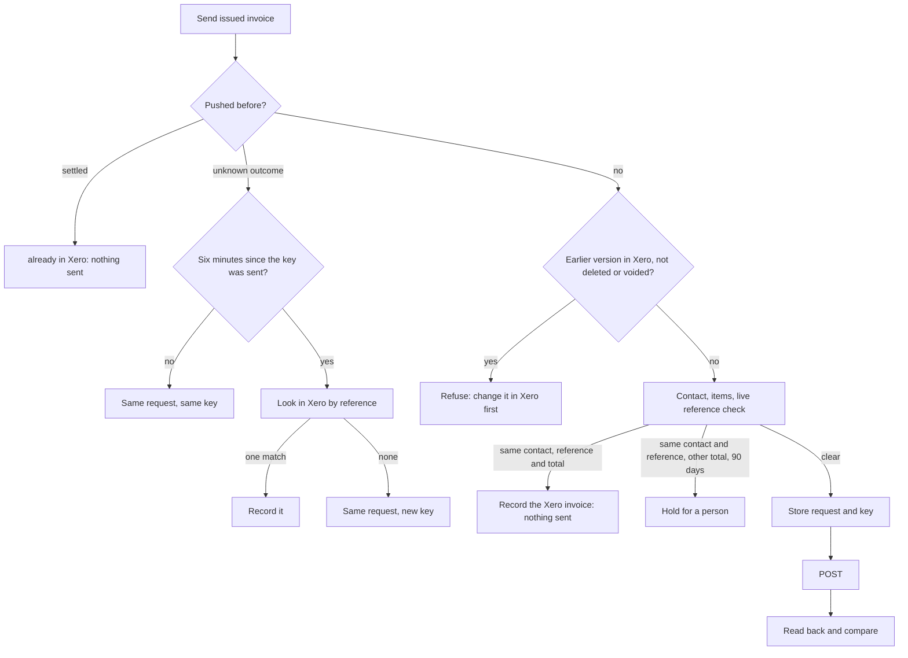

# Xero adapter

Xero is an optional integration (`VISION.md`). The adapter lives in
`server/integrations/xero/` and sits behind the integration port
(`server/integrations/port.js`). Core code never imports it.

The adapter connects one Xero organisation to each Flow organisation, copies
its contacts and items, and sends issued Flow invoices to Xero as draft
invoices. The lab checks and approves them in Xero. It also keeps a copy of
the organisation's invoices, credit notes and payments, history included
("The mirror"). Bills are not ported yet.

## Turn it on

1. Set `FLOW_INTEGRATIONS=xero` (with other ids, comma-separated). Flow then
   creates the Xero tables at the next start (`docs/INTEGRATIONS.md`).
2. Set `XERO_MODE`. With Xero on and `XERO_MODE` unset, Flow does not start.
3. For `live` or `sandbox`, set the Xero app's keys, `XERO_TOKEN_KEY`, and
   the address (below), then connect.

## Modes

`XERO_MODE` says which Xero the adapter acts on. It has no default
(issue #10).

| Mode | Acts on | Writes |
| --- | --- | --- |
| `live` | The lab's own Xero organisation, named by `XERO_TENANT_ID` or `XERO_TENANT_NAME` | Only with `XERO_ALLOW_LIVE_WRITES=on` |
| `sandbox` | A Xero Demo Company. Flow refuses an organisation whose class is not `DEMO`. | Yes |
| `replay` | Nothing: recorded, synthetic responses from `server/integrations/xero/fixtures/` | Yes, into the replay |

Development and CI use `replay` or `sandbox`. They never hold live
credentials. Tests use replay only and never call the real Xero API.

## Settings

| Setting | Kind | What it does |
| --- | --- | --- |
| `XERO_MODE` | configuration | `live`, `sandbox` or `replay`. Required when `FLOW_INTEGRATIONS` includes `xero`. |
| `XERO_CLIENT_ID` | configuration | The Xero app's client id. Needed for `live` and `sandbox`. |
| `XERO_CLIENT_SECRET` | secret | The Xero app's client secret. Needed for `live` and `sandbox`. |
| `XERO_TOKEN_KEY` | secret | A 32-byte key (64 hex characters or base64) that encrypts the Xero refresh token at rest. Needed for `live` and `sandbox`. Make one with `openssl rand -hex 32`. |
| `XERO_TENANT_ID` / `XERO_TENANT_NAME` | configuration | The Xero organisation this installation may connect. `live` needs one of them. |
| `XERO_ALLOW_LIVE_WRITES` | configuration | `on` lets `live` mode create draft invoices. Default off. |
| `XERO_REDIRECT_URI` | configuration | The OAuth callback. Default: `FLOW_PUBLIC_ORIGIN` + `/api/xero/oauth/callback`. Register the same address on the Xero app. |
| `XERO_SCOPE` | configuration | OAuth scopes. Default `offline_access accounting.contacts accounting.invoices accounting.settings.read`. |
| `XERO_DAY_LIMIT` | configuration | The app's daily call limit per organisation until Xero reports its own: 1000 on the Starter plan (the default), 5000 on Core and above. |
| `XERO_USAGE_WARNING_FRACTION` | configuration | Log a warning when this share of the day's calls is used. Default 0.7. |
| `XERO_TRACKING_CATEGORY` / `XERO_TRACKING_OPTION` | configuration | A tracking category and option put on every invoice line. Set both or neither. |
| `XERO_TAX_TYPE_GST` / `XERO_TAX_TYPE_GST_FREE` | configuration | Xero tax types for Flow's tax codes. Default `OUTPUT` and `EXEMPTOUTPUT` (Australian Xero). |
| `XERO_DEFAULT_DUE_DAYS` | configuration | Days from the invoice date to the due date when a Flow invoice has none. Default 30. |
| `XERO_INVOICE_NUMBER` | configuration | `xero` (default): Xero numbers the invoice. `flow`: Xero gets Flow's invoice number. |
| `XERO_REPLAY_FIXTURES` | configuration | Replay mode only: a fixture file in place of the bundled one. |
| `XERO_KEEP_REFERENCE` | configuration | `on` keeps free text from Xero records in the mirror: invoice and payment references and line descriptions. They can name a patient. Default off: those fields are stored empty. |
| `XERO_MIRROR_PAGE_SIZE` | configuration | Records per mirror call. Default 200, at most 1000. |
| `XERO_MIRROR_RESERVE_FRACTION` | configuration | The share of the day's calls the mirror leaves for drafts and people. Default 0.3. |

Errors name a setting, never its value.

## Connect Xero

Only an owner can connect or disconnect Xero, with a verified owner sign-in
(`docs/SELF_HOSTING.md`, "Sign-in (Clerk)"). Flow connects one Xero
organisation to each Flow organisation, and a Xero organisation to at most
one Flow organisation.

1. On the Xero app (developer.xero.com, My Apps), add the redirect URI
   `https://<this installation's address>/api/xero/oauth/callback`. On Replit
   that is the app's `*.replit.app` address. Flow reads the address from
   `FLOW_PUBLIC_ORIGIN` (or `XERO_REDIRECT_URI`); the two must match exactly.
2. `POST /api/xero/connect` with `{ "organisationId": "…" }` answers with
   `authorizeUrl`. Open it in the browser and approve the organisation in
   Xero.
3. Xero sends the browser back to `/api/xero/oauth/callback`. Flow checks the
   one-use state (ten minutes), exchanges the code, and keeps the
   organisation `XERO_TENANT_ID` or `XERO_TENANT_NAME` names. If several are
   approved and the settings name none, it refuses. In `sandbox` it refuses
   an organisation that is not a Demo Company. A refused approval is revoked
   at Xero.

`GET /api/xero/status?organisationId=…` (anyone signed in) shows the mode,
whether writes are allowed, the redirect URI, the connection and the day's
Xero call budget. `POST /api/xero/disconnect` (owner) revokes the token at
Xero and deletes Flow's copy.

### The refresh token

Xero gives a new refresh token on every refresh and the old one stops
working, so Flow stores the newest one in `xero_connections`, encrypted with
`XERO_TOKEN_KEY` (AES-256-GCM) and bound to its Flow organisation. A refresh
holds that row's lock and stores the new token in the same transaction, so
two refreshes never race. Access tokens stay in memory for their 30 minutes.
No token is ever logged or shown.

A connection made in one mode is not used in another: change `XERO_MODE` and
an owner connects again. So does a refresh token that Xero no longer accepts
(unused for 60 days, or revoked): Flow answers `xero_reconnect_needed`. If
`XERO_TOKEN_KEY` changes, the stored token cannot be read and an owner
connects again.

## Contacts and items

Xero owns the lab's contacts and items. Flow never creates or changes them
(as before): a missing or doubled contact is for a person to fix in Xero.

`POST /api/xero/sync` with `{ "organisationId": "…" }` (owner or admin)
reads every Xero contact (100 a page) and item (one call) and replaces
Flow's copy in `xero_contacts` and `xero_items` in one transaction. Records
gone from Xero leave the copy. Items with no code are left out, because an
invoice line names an item by code. A failed read keeps the copy as it was.
Each sync is recorded in `xero_sync_runs`; `GET /api/xero/status` shows the
last one.

`GET /api/xero/contacts?organisationId=…&q=…` and
`GET /api/xero/items?organisationId=…` (anyone signed in) list the copy.

For invoice preparation, `server/integrations/xero/catalogue.js` offers:

| Function | Answers |
| --- | --- |
| `matchContact(db, organisationId, name)` | `matched` with the one active Xero contact whose name is the same (case and doubled spaces ignored), `ambiguous` with the matches, or `missing` |
| `itemsByCode(db, organisationId, codes)` | A map from item code to the Xero item (sales price in cents, account code, tax type) |
| `listContacts`, `listItems` | The copy |
| `lastSuccessfulSyncAt(db, organisationId)` | When the copy was last refreshed, or null |

A sync and a batch of drafts for one organisation run one at a time
(`runtime.serial`), because they share one call budget.

## Draft invoices

Flow is the store of record; Xero gets a copy (`VISION.md`). An issued Flow
invoice version goes to Xero as one draft sales invoice (`ACCREC`, `DRAFT`).



The rules:

- **What is sent is the issued document.** Flow sends the latest issued
  version's document (`invoice_versions`), never live lines. A draft or void
  invoice is never sent.
- **A sent invoice is never changed in place.** Flow never updates a Xero
  invoice. A revised invoice (version 2) is sent only after the earlier
  version's Xero invoice is deleted or voided in Xero; Flow checks that live
  and keeps the earlier record.
- **Flow never creates a Xero contact.** The Flow customer's name must match
  exactly one active Xero contact in the synced copy.
- **Each line names its item.** A line's `itemCode` from the issued document
  becomes the Xero `ItemCode`; a code Xero does not have stops the draft. Tax
  types come from `XERO_TAX_TYPE_GST` and `XERO_TAX_TYPE_GST_FREE`; amounts are
  tax-exclusive with each line's amount sent as Flow calculated it.
- **Reference and dates.** The Xero reference is the invoice's reference, or
  its number. The date is the issue date; the due date is the invoice's, or
  `XERO_DEFAULT_DUE_DAYS` later. With `XERO_INVOICE_NUMBER=flow` Xero gets
  Flow's number.
- **Duplicates.** Before it creates, Flow asks Xero for invoices with the same
  reference. One for the same contact and total is the same work: Flow records
  it (`existing`) and sends nothing. One for the same contact at another total
  dated within 90 days is held, unless the person sends again with that
  invoice in `allowExistingReference`.
- **Uncertain outcomes.** The request and its `Idempotency-Key` are stored in
  `xero_invoice_pushes` before they leave. If Xero refuses the first request,
  the record is dropped and the invoice can be sent again once fixed. If the
  outcome is unknown (timeout, 5xx), the record stays `ambiguous`. Sending
  again within six minutes repeats the same request with the same key (Xero
  keeps keys six minutes); after that Flow looks in Xero by reference, settles
  on the one matching draft it finds, and sends under a new key only when
  there is none.
- **Read back.** After a create Flow reads the draft and compares contact,
  subtotal, tax, total, line count, reference and date with the document. A
  difference is recorded as `mismatch` for a person to check in Xero.
- **One at a time.** A batch runs on the `writes` lane, after any sync for
  the same organisation. A daily-limit 429 stops the batch and says which
  invoices were not tried.
- **Live writes.** In `live` mode nothing is written unless
  `XERO_ALLOW_LIVE_WRITES=on`. In `sandbox` the organisation's class is
  checked before each batch.

| Route | Who | What |
| --- | --- | --- |
| `POST /api/xero/invoices/preview` `{ organisationId, invoiceIds }` | anyone signed in | Each invoice's Xero draft, its contact match, and what stops it. No Xero calls. |
| `POST /api/xero/invoices/push` `{ organisationId, invoiceIds, allowExistingReference? }` | owner or admin | Sends up to 100 issued invoices. Each answers `created`, `reconciled`, `existing`, `already_in_xero`, `mismatch`, `ambiguous`, `failed` or `not_tried`. |
| `GET /api/xero/invoices/<invoiceId>/pushes?organisationId=` | anyone signed in | The push records of one invoice, without the request. |

Through the integration port, `pushInvoice({ organisationId, invoiceId,
pushedBy })` sends one issued invoice and answers as one entry above.

### What invoice preparation can rely on

- `previewDrafts(db, runtime, organisationId, invoiceIds)` and the preview
  route cost no Xero calls. A preview `state` is `ready`, `blocked` (with
  `problems`), `in_xero`, `ambiguous`, `dispatching` or `mismatch`. Problem
  codes: `invoice_not_issued`, `invoice_void`, `xero_contact_missing`,
  `xero_contact_ambiguous`, `xero_item_missing`, and
  `xero_earlier_version_in_xero` (shown, not blocking: the push checks Xero
  live). Warnings: `xero_not_synced`, `xero_sync_stale` (over 24 hours).
- A push is safe to repeat: the Flow invoice id and version are the key, and
  a repeat never makes a second Xero invoice.
- A preview never writes; only `push` does, and only for issued versions.

## The mirror

Flow keeps a copy of the connected organisation's invoices, credit notes and
payments (`server/integrations/xero/mirror.js`, issue #54), so its reports
cover the years before Flow was installed and its records can link to Xero's
without spending calls. Xero owns these records; Flow never changes them.

| Table | What it holds |
| --- | --- |
| `xero_invoices` | Sales and purchase invoices: number, contact, status, dates, totals, amounts due, paid and credited, lines |
| `xero_credit_notes` | Credit notes, with what each is allocated to |
| `xero_payments` | Payments, with the invoice or credit note each pays |
| `xero_mirror_cursors` | Where the next read of each resource starts |

`POST /api/xero/mirror` with `{ "organisationId": "…", "resources"?: [...] }`
(owner or admin) reads each resource from its cursor. `GET /api/xero/mirror`
(anyone signed in) shows the counts and cursors.

```mermaid
flowchart LR
  cursor[Cursor: changed since T, page P] --> call[GET Invoices<br/>If-Modified-Since T<br/>oldest change first]
  call --> store[Upsert the page<br/>and move the cursor<br/>in one transaction]
  store -- full page --> cursor
  store -- short page --> done[Pass done]
```

- **The first read copies the whole history.** It has no cursor. 7,000
  invoices at 200 a page cost 35 calls.
- **Later reads copy changes only.** Each read starts from the last change
  it stored.
- **It can stop at any page.** Each page and the cursor are stored in one
  transaction, so a failed call, a restart or a spent budget loses nothing.
- **It never skips a record.** After a full page the cursor moves to the
  page's last change time, less one second, so a record that changes during
  a read is read again. Only when one second holds a full page does the page
  number move on.
- **It keeps calls for drafts and people.** It stops when the day's
  remaining calls fall to `XERO_MIRROR_RESERVE_FRACTION` of the limit.
- **A row changes only when its content does.** Each row keeps a hash of
  what Flow stores; `last_changed_at` moves only with it.
- **No patient text by default.** References and line descriptions are kept
  only with `XERO_KEEP_REFERENCE=on`.

## The billing ledger

`server/integrations/xero/ledger.js` answers the billing obligation ledger
(`server/core/ledger.js`) in its own evidence shapes.

- **Does Xero hold an invoice for this job?** `xeroLiveCheck(db, runtime,
  organisationId)` is the `liveCheck` for `draftInvoiceForObligation`. It
  answers `{ state, accountingRef, accountingUrl, matchedBy, checkedAt }`.
  `POST /api/xero/obligations/<id>/check` (owner or admin) runs it and records
  the answer with `recordAccountingEvidence`.
- **Payments.** `POST /api/xero/payments/sync` (owner or admin) reads Xero
  sales payments changed since the last read (`xero_payment_cursors`; the
  first read goes back 90 days) and records each with `recordPayment`. When
  payments cover the total, the ledger queues the "paid" write-back. The
  port's `pullPayments({ organisationId, since })` returns the payments in
  `recordPayment`'s shape with a cursor.

| `matchedBy` | Exact? | How Flow finds the Xero invoice |
| --- | --- | --- |
| `flow_invoice` | yes | Made by Flow from the job's Flow invoice (`xero_invoice_pushes`) |
| `accounting_ref` | yes | The Xero invoice id the ledger already holds |
| `source_invoice_ref` | yes | A Xero sales invoice whose number or reference is the work system's invoice number |
| `reference` | no | A Xero invoice for the same customer with the job's case reference |
| `several` | no | More than one Xero invoice answers |
| `unsettled_push` | no | A push to Xero whose outcome is still unknown |

The ledger records a match that is not exact as ambiguous, and any answer but
`not_found` refuses a draft. A Xero error throws, and the ledger refuses the
draft. Xero states map to the ledger's: `DRAFT` and `SUBMITTED` to
`drafted`, `AUTHORISED` to `authorised` (or `part_paid` once money is paid),
`PAID` to `paid`, `VOIDED` to `voided`, `DELETED` to `deleted`.
`accountingUrl` is a Xero deep link for a person.

A payment is recorded only when its Xero invoice ties to one job by
`flow_invoice` or `accounting_ref`. Flow refreshes that job's Xero state
first, so the ledger accepts it. Payments that tie to no job, and deleted
payments, are listed in the answer and not recorded. The cursor moves only
when no payment failed, so a failed one is read again.

## Rate limits and retries

Every Xero call goes through `server/integrations/xero/governor.js`, per
connected organisation:

- at most 4 calls at once and 55 a minute (Xero allows 5 and 60), and 10,000 a
  minute across organisations;
- a daily budget that starts at `XERO_DAY_LIMIT` and then follows Xero's
  `X-DayLimit-Remaining` header; a warning is logged once a day at
  `XERO_USAGE_WARNING_FRACTION`;
- a 429 is retried once, after the wait Xero's `Retry-After` and
  `X-Rate-Limit-Problem` ask for, never more than a minute;
- a daily-limit 429 opens a circuit: later calls fail at once with
  `xero_rate_limited` until Xero's `Retry-After` passes or the day rolls over;
- a 401 drops the cached access token and tries once more;
- a create carries an `Idempotency-Key` and a retry sends the same bytes, so
  Xero returns the first result instead of a second invoice.

Calls count against a lane (`writes`, `sync`, `reads`, `other`) so the status
shows where the day's budget went.

## Replay fixtures

A fixture file lists interactions: a request (method, URL, and the query
values that must match) and the response Xero would give. A request that no
interaction matches fails with `xero_replay_no_match`, so replay can never
reach the real Xero. Fixtures hold synthetic data only (`CONTRIBUTING.md`):
made-up names, `example.test` addresses and all-zero ids.
