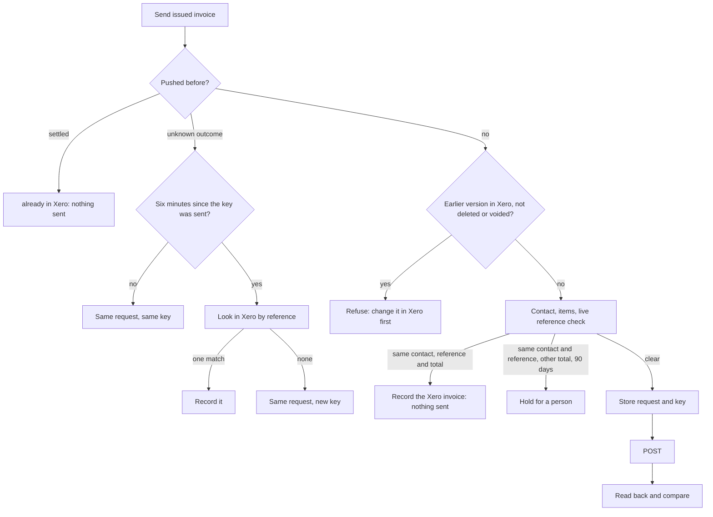
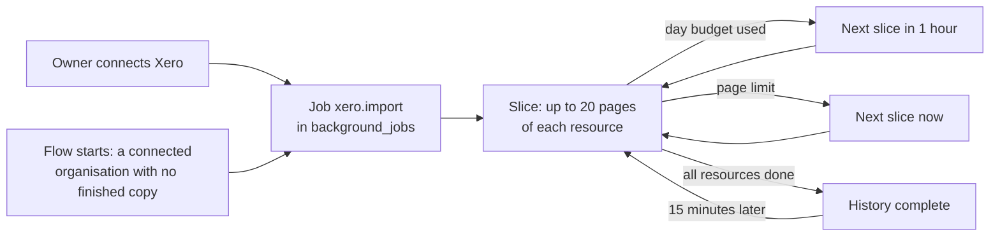
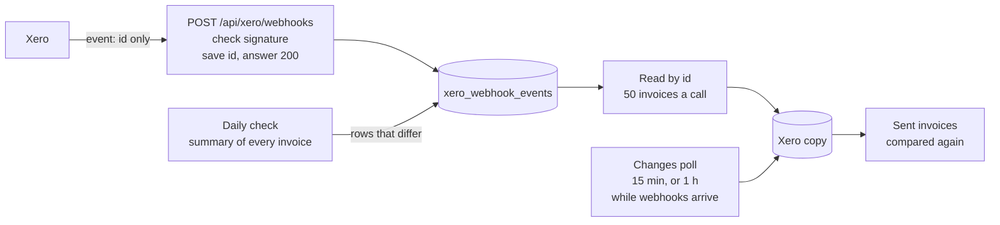

# Xero adapter

Xero is an optional integration (`VISION.md`). The adapter lives in
`server/integrations/xero/` and sits behind the integration port
(`server/integrations/port.js`). Core code never imports it.

The adapter connects one Xero organisation to each Flow organisation, copies
its contacts and items, and sends issued Flow invoices to Xero as draft
invoices. The lab checks and approves them in Xero. It also keeps a copy of
the organisation's invoices, credit notes and payments, history included
("The mirror"). Bills are not ported yet.

## Turn it on

Each lab uses its own Xero app. There is no shared Flow Xero app, so no one
else holds the lab's Xero sign-in.

In Flow, an owner opens **Integrations**, then Xero:

1. **Create your Xero app** at developer.xero.com, My Apps: a Web app, with
   this installation's address and the redirect URI the screen shows
   (`https://<this installation>/api/xero/oauth/callback`, **Copy**).
2. **Paste** the client id and the client secret. Choose the mode, and for
   live type the Xero organisation's exact name.
3. **Save and turn Xero on.** Flow creates its tables and starts Xero at
   once. If a setting is missing, the screen says which.
4. **Connect to Xero**, sign in to Xero and allow access. Flow then copies
   the history in the background ("The mirror").

The refresh token's key (`XERO_TOKEN_KEY`) comes from Flow's secrets key
(`docs/INTEGRATIONS.md`, "The secrets key"). A host can instead set
`FLOW_INTEGRATIONS=xero`, `XERO_MODE` and the settings below; a host setting
wins over the screen.

## Modes

`XERO_MODE` says which Xero the adapter acts on. It has no default
(issue #10).

| Mode | Acts on | Writes |
| --- | --- | --- |
| `live` | The lab's own Xero organisation, named by `XERO_TENANT_ID` or `XERO_TENANT_NAME` | Only with `XERO_ALLOW_LIVE_WRITES=on` |
| `sandbox` | A Xero Demo Company. Flow refuses an organisation whose class is not `DEMO`. | Yes |
| `replay` | Nothing: recorded, synthetic responses from `server/integrations/xero/fixtures/` | Yes, into the replay |

Development and CI use `replay` or `sandbox`. They never hold live
credentials. Tests use replay only and never call the real Xero API.

## Settings

| Setting | Kind | What it does |
| --- | --- | --- |
| `XERO_MODE` | configuration | `live`, `sandbox` or `replay`. Required when `FLOW_INTEGRATIONS` includes `xero`. |
| `XERO_CLIENT_ID` | configuration | The Xero app's client id. Needed for `live` and `sandbox`. |
| `XERO_CLIENT_SECRET` | secret | The Xero app's client secret. Needed for `live` and `sandbox`. |
| `XERO_TOKEN_KEY` | secret | A 32-byte key (64 hex characters or base64) that encrypts the Xero refresh token at rest. Needed for `live` and `sandbox`. Make one with `openssl rand -hex 32`. |
| `XERO_TENANT_ID` / `XERO_TENANT_NAME` | configuration | The Xero organisation this installation may connect. `live` needs one of them. |
| `XERO_ALLOW_LIVE_WRITES` | configuration | `on` lets `live` mode create draft invoices and contacts. Default off. |
| `XERO_CREATE_CONTACTS` | configuration | `on` (the default, including when unset) offers Create on a pending invoice whose client is not in Xero, and on that contact. `off`: add the client in Xero, then sync. Live mode still needs `XERO_ALLOW_LIVE_WRITES`. |
| `XERO_REDIRECT_URI` | configuration | The OAuth callback. Default: `FLOW_PUBLIC_ORIGIN` + `/api/xero/oauth/callback`. Register the same address on the Xero app. |
| `XERO_SCOPE` | configuration | OAuth scopes. Default `offline_access accounting.contacts accounting.invoices accounting.payments.read accounting.settings.read`. A connection made before a scope was added keeps its old scopes until a person connects again. |
| `XERO_DAY_LIMIT` | configuration | The app's daily call limit per organisation until Xero reports its own: 1000 on the Starter plan (the default), 5000 on Core and above. |
| `XERO_USAGE_WARNING_FRACTION` | configuration | Log a warning when this share of the day's calls is used. Default 0.7. |
| `XERO_TRACKING_CATEGORY` / `XERO_TRACKING_OPTION` | configuration | A tracking category and option put on every invoice line. Set both or neither. |
| `XERO_TAX_TYPE_GST` / `XERO_TAX_TYPE_GST_FREE` | configuration | Xero tax types for Flow's tax codes. Default `OUTPUT` and `EXEMPTOUTPUT` (Australian Xero). |
| `XERO_DEFAULT_DUE_DAYS` | configuration | Days from the invoice date to the due date when a Flow invoice has none. Default 30. |
| `XERO_INVOICE_NUMBER` | configuration | `xero` (default): Xero numbers the invoice. `flow`: Xero gets Flow's invoice number. |
| `XERO_REPLAY_FIXTURES` | configuration | Replay mode only: a fixture file in place of the bundled one. |
| `XERO_KEEP_REFERENCE` | configuration | `on` (the default) keeps free text from Xero records in the copy: invoice and payment references and line descriptions. The Import matches on them. `off` stores those fields empty. |
| `XERO_MIRROR_PAGE_SIZE` | configuration | Records per mirror call. Default 200, at most 1000. |
| `XERO_MIRROR_RESERVE_FRACTION` | configuration | The share of the day's calls the mirror leaves for drafts and people. Default 0.3. |
| `XERO_WEBHOOK_KEY` | secret | The webhook key from the Xero app's Webhooks page. Set: Flow takes Xero's change events at `/api/xero/webhooks`. Unset: Flow reads changes by polling only. |

Errors name a setting, never its value.

## Connect Xero

Only an owner can connect or disconnect Xero, with a verified owner sign-in
(`docs/SELF_HOSTING.md`, "Sign-in (Clerk)"). Flow connects one Xero
organisation to each Flow organisation, and a Xero organisation to at most
one Flow organisation.

1. On the Xero app (developer.xero.com, My Apps), add the redirect URI
   `https://<this installation's address>/api/xero/oauth/callback`. On Replit
   that is the app's `*.replit.app` address. Flow reads the address from
   `FLOW_PUBLIC_ORIGIN` (or `XERO_REDIRECT_URI`); the two must match exactly.
2. `POST /api/xero/connect` with `{ "organisationId": "…" }` answers with
   `authorizeUrl`. Open it in the browser and approve the organisation in
   Xero.
3. Xero sends the browser back to `/api/xero/oauth/callback`. Flow checks the
   one-use state (ten minutes), exchanges the code, and keeps the
   organisation `XERO_TENANT_ID` or `XERO_TENANT_NAME` names. If several are
   approved and the settings name none, it refuses. In `sandbox` it refuses
   an organisation that is not a Demo Company. A refused approval is revoked
   at Xero.

`GET /api/xero/status?organisationId=…` (anyone signed in) shows the mode,
whether writes are allowed, the redirect URI, the connection and the day's
Xero call budget. `POST /api/xero/disconnect` (owner) revokes the token at
Xero and deletes Flow's copy.

### The refresh token

Xero gives a new refresh token on every refresh and the old one stops
working, so Flow stores the newest one in `xero_connections`, encrypted with
`XERO_TOKEN_KEY` (AES-256-GCM) and bound to its Flow organisation. A refresh
holds that row's lock and stores the new token in the same transaction, so
two refreshes never race. Access tokens stay in memory for their 30 minutes.
No token is ever logged or shown.

A connection made in one mode is not used in another: change `XERO_MODE` and
an owner connects again. So does a refresh token that Xero no longer accepts
(unused for 60 days, or revoked): Flow answers `xero_reconnect_needed`. If
`XERO_TOKEN_KEY` changes, the stored token cannot be read and an owner
connects again.

## Contacts and items

Flow's own contacts stay in `contacts` (`docs/CONTACTS.md`). Xero's contacts
are copied into `xero_contacts`. A sync replaces that copy and does not
change Flow's contacts. Flow does not change a Xero contact that already
exists, unless Two-way edits is on: then a Flow edit of a linked contact goes
to Xero (`docs/CONTACTS.md`, "Two-way edits"; `xero/contact-sync.js`). With
Add Xero clients on, each Xero client becomes a Flow contact.

When Create missing clients is on, an owner or admin creates the missing
Xero contact from a Flow contact (`POST /api/xero/contacts` with
`{ "organisationId", "contactId" }`). Flow writes one Xero contact, stores
that copy, and links it (`created_by_flow`). If Xero already has one active
contact of that name, Flow links that one (`exact_name`) and creates
nothing. An archived-only name, or more than one active name, is refused.
`GET /api/xero/contacts/match?organisationId=…&contactId=…` answers whether
Link and Create are offered, from the copy, with no Xero call.

When the names differ, or Xero has the name twice, an owner or admin links
the Flow contact to the right Xero contact (`POST /api/xero/contacts/link`
with `{ "organisationId", "contactId", "xeroContactId" }`). Flow writes only
its identity map (`person`); Xero is not called. The Xero contact must be
active in the copy and not linked to another Flow contact. A link to a Xero
contact that is now archived ends first.

`POST /api/xero/sync` with `{ "organisationId": "…" }` (owner or admin)
reads every Xero contact (100 a page) and item (one call) and replaces
Flow's copy in `xero_contacts` and `xero_items` in one transaction. Records
gone from Xero leave the copy. Items with no code are left out, because an
invoice line names an item by code. A failed read keeps the copy as it was.
Each sync is recorded in `xero_sync_runs`; `GET /api/xero/status` shows the
last one. Outside replay mode the background worker also syncs each connected
organisation once a day (`refreshStaleCatalogues` in `import.js`), so the
pipeline can link customers (`docs/JOB_INVOICE_LINKS.md`). A failed read is
tried again an hour later, then two, four and so on, at most a day apart. The
first failure is reported with `log.error`; the same failure again is a
warning.

`GET /api/xero/contacts?organisationId=…&q=…&limit=…` (up to 1,000) and
`GET /api/xero/items?organisationId=…` (anyone signed in) list the copy.

For invoice preparation, `server/integrations/xero/catalogue.js` offers:

| Function | Answers |
| --- | --- |
| `matchContact(db, organisationId, name)` | `matched` with the one active Xero contact whose name is the same (case and doubled spaces ignored), `ambiguous` with the matches, or `missing` |
| `matchContactFor(db, organisationId, { contactId, name })` | The same, after the identity-map link. A linked contact matches even when the names differ |
| `itemsByCode(db, organisationId, codes)` | A map from item code to the Xero item (sales price in cents, account code, tax type) |
| `listContacts`, `listItems` | The copy |
| `lastSuccessfulSyncAt(db, organisationId)` | When the copy was last refreshed, or null |

A sync and a batch of drafts for one organisation run one at a time
(`runtime.serial`), because they share one call budget.

## Draft invoices

Flow is the store of record; Xero gets a copy (`VISION.md`). An issued Flow
invoice version goes to Xero as one sales invoice (`ACCREC`). The customer's
send mode (`docs/INVOICING_RULES.md`) decides its status: a draft (`DRAFT`,
the default) that a person approves in Xero, or an approved invoice
(`AUTHORISED`) that Flow then asks Xero to email to the customer.



The rules:

- **What is sent is the issued document.** Flow sends the latest issued
  version's document (`invoice_versions`), never live lines. A draft or void
  invoice is never sent.
- **A sent invoice is never changed in place.** Flow never updates a Xero
  invoice's contact, lines, amounts or dates. The one write to an existing
  Xero invoice is Delete, below, and it sends `Status: DELETED` only. A
  revised invoice (version 2) is sent only after the earlier version's Xero
  invoice is deleted or voided in Xero; Flow checks that live and keeps the
  earlier record.
- **A missing Xero contact.** The Flow customer must be linked to one Xero
  contact, or match exactly one active Xero contact by name. With Create
  missing clients on, a pending invoice offers Create (`docs/CONTACTS.md`).
  With it off, add the client in Xero, then sync. Flow does not change a
  Xero contact that already exists.
- **Each line names its item.** A line's `itemCode` from the issued document
  becomes the Xero `ItemCode`; a code Xero does not have stops the draft. Tax
  types come from `XERO_TAX_TYPE_GST` and `XERO_TAX_TYPE_GST_FREE`; amounts are
  tax-exclusive with each line's amount sent as Flow calculated it.
- **Reference and dates.** The Xero reference is the invoice's reference, or
  its number. The date is the issue date; the due date is the invoice's, or
  `XERO_DEFAULT_DUE_DAYS` later. With `XERO_INVOICE_NUMBER=flow` Xero gets
  Flow's number.
- **Duplicates.** For an invoice Flow drafted from a job that its complete,
  fresh copy of Xero showed has no invoice, Flow asks Xero nothing more.
  Otherwise, before it creates, Flow asks Xero for invoices with the same
  reference. One for the same contact and total is the same work: Flow records
  it (`existing`) and sends nothing. One for the same contact at another total
  dated within 90 days is held, unless the person sends again with that
  invoice in `allowExistingReference`.
- **Uncertain outcomes.** The request and its `Idempotency-Key` are stored in
  `xero_invoice_pushes` before they leave. If Xero refuses the first request,
  the record is dropped and the invoice can be sent again once fixed. If the
  outcome is unknown (timeout, 5xx), the record stays `ambiguous`. Sending
  again within six minutes repeats the same request with the same key (Xero
  keeps keys six minutes); after that Flow looks in Xero by reference, settles
  on the one matching draft it finds, and sends under a new key only when
  there is none.
- **Read back.** After a create Flow reads the draft and compares contact,
  subtotal, tax, total, line count, reference and date with the document. A
  difference is recorded as `mismatch` for a person to check in Xero.
- **Email.** In the `approve_and_email` send mode, after Flow reads back an
  approved invoice that matches, it calls Xero's email action for it once
  (`POST Invoices/{id}/Email`). The push records `email_state`: `sent`,
  `failed` (Xero refused; sending again retries) or `unknown` (a person
  checks Xero; Flow does not retry, because a repeat emails twice).
- **One at a time.** A batch runs on the `writes` lane, after any sync for
  the same organisation. A daily-limit 429 stops the batch and says which
  invoices were not tried.
- **Live writes.** In `live` mode nothing is written unless
  `XERO_ALLOW_LIVE_WRITES=on`. In `sandbox` the organisation's class is
  checked before each batch.

| Route | Who | What |
| --- | --- | --- |
| `POST /api/xero/invoices/preview` `{ organisationId, invoiceIds }` | anyone signed in | Each invoice's Xero draft, its contact match, and what stops it. No Xero calls. |
| `POST /api/xero/invoices/push` `{ organisationId, invoiceIds, allowExistingReference? }` | owner or admin | Sends up to 100 issued invoices. Each answers `created`, `reconciled`, `existing`, `already_in_xero`, `mismatch`, `ambiguous`, `failed` or `not_tried`. |
| `GET /api/xero/invoices/<invoiceId>/pushes?organisationId=` | anyone signed in | The push records of one invoice, without the request. |

Through the integration port, `pushInvoice({ organisationId, invoiceId,
pushedBy })` sends one issued invoice and answers as one entry above.

### What invoice preparation can rely on

- `previewDrafts(db, runtime, organisationId, invoiceIds)` and the preview
  route cost no Xero calls. A preview `state` is `ready`, `blocked` (with
  `problems`), `in_xero`, `ambiguous`, `dispatching` or `mismatch`. Problem
  codes: `invoice_not_issued`, `invoice_void`, `xero_contact_missing`,
  `xero_contact_ambiguous`, `xero_item_missing`, and
  `xero_earlier_version_in_xero` (shown, not blocking: the push checks Xero
  live). Warnings: `xero_not_synced`, `xero_sync_stale` (over 24 hours).
- A push is safe to repeat: the Flow invoice id and version are the key, and
  a repeat never makes a second Xero invoice.
- A preview never writes; only `push` does, and only for issued versions.

## Deleting a draft

Delete on an issued Flow invoice whose Xero copy is still a draft also
deletes that Xero draft (`deleteInvoice` on the integration port,
`server/integrations/xero/delete-invoice.js`). The core stays free of Xero
statuses. It calls the port and voids in Flow only after the answer is
`deleted` or `gone`.

Flow reads the Xero invoice live by its id first (the push, or the Import
link). Then:

| Xero status | What Flow does |
| --- | --- |
| `DRAFT` or `SUBMITTED` | `POST Invoices/{id}` with `Status: DELETED` only. After Xero confirms `DELETED`, Flow voids the invoice and frees its job. |
| `DELETED` or `VOIDED` | No Xero write. Flow voids the invoice and frees its job. |
| `AUTHORISED` or `PAID` | No Xero write, and nothing in Flow changes. The message is `Approved in Xero. Void it in Xero first.` Flow does not void it in Xero. |
| No connection, or writes off | No Xero call, and nothing in Flow changes. Writes off uses the same message as Send. With no accounting system, an issued invoice answers `accounting_unavailable`. |

A timeout or a 5xx leaves Flow unchanged. The next Delete reads Xero again
and does not post a second delete when Xero already shows it gone.

The push (`xero_invoice_pushes`) and the Import link (`xero_invoice_links`)
record who deleted it and when, and the push stores Xero's status. Flow's
copy of the invoice takes that status too. The job's ledger state becomes
`deleted` (or `voided` when Xero had already voided it), and the Flow invoice
link is cleared the same way as deleting a draft that was never issued. The
issued versions stay. The invoice's History gains a Void line.

Xero migration `0011_xero_invoice_deleted` adds `deleted_by` and `deleted_at`
on the push and the link. It is the Xero adapter's own migration.

## The mirror

Flow keeps a copy of the connected organisation's invoices, credit notes and
payments (`server/integrations/xero/mirror.js`, issue #54), so its reports
cover the years before Flow was installed and its records can link to Xero's
without spending calls. Xero owns these records. Flow does not edit their
amounts or lines. Delete of a draft, above, sets the copy's status so the
screen matches, and the next read of Xero replaces that row.

| Table | What it holds |
| --- | --- |
| `xero_invoices` | Sales and purchase invoices: number, contact, status, dates, totals, amounts due, paid and credited, lines |
| `xero_credit_notes` | Credit notes, with what each is allocated to |
| `xero_payments` | Payments, with the invoice or credit note each pays |
| `xero_mirror_cursors` | Where the next read of each resource starts |

### The history import

Connecting Xero starts the import. Nobody runs a script.



- The import is a job on the core queue (`server/integrations/xero/import.js`).
  One import per organisation is open at a time.
- A Flow that starts with Xero already connected, and with a resource that has
  no finished pass, queues the import too. So an upgrade imports with no step.
- Connecting another Xero organisation clears the cursors, so its history is
  read from the start.
- The worker runs outside replay mode. It only reads from Xero. It leaves the
  reserve share of the day's calls (`XERO_MIRROR_RESERVE_FRACTION`).
- A failed slice retries with the queue's back-off. After its last attempt
  it opens a review item (`job.dead`).

### Reading the changes

The copy is fresh only while its last full read of invoices is less than a
day old (`mirrorState` in `lookup.js`). A copy that is not fresh proves
nothing, so drafts by rule wait and the matcher does not say "no invoice"
(issue #131). So the import never ends:

- When every resource is read to its end, the same job is queued again for
  15 minutes later (`REFRESH_MS`). It reads only what changed since each
  cursor: with few changes, one call per resource.
- The worker keeps one read queued for each connected organisation, so a
  restart or an upgrade needs no step. While the call guard stops Xero calls,
  no read is queued. A read that gave up waits for a person (its review
  item), a restart or the next day.
- A copy that goes out of date is reported once with `log.error`, and again
  when it is fresh. `health()` shows each copy under `copies` and is not `ok`
  while a complete copy is out of date.
- About 192 calls a day (invoices and credit notes, every 15 minutes), inside
  the reserve the mirror leaves for drafts and people.

`POST /api/xero/mirror` with `{ "organisationId": "…", "resources"?: [...] }`
(owner or admin) reads each resource from its cursor now. `GET /api/xero/mirror`
(anyone signed in) shows the counts and cursors.

```mermaid
flowchart LR
  cursor[Cursor: changed since T, page P] --> call[GET Invoices<br/>If-Modified-Since T<br/>oldest change first]
  call --> store[Upsert the page<br/>and move the cursor<br/>in one transaction]
  store -- full page --> cursor
  store -- short page --> done[Pass done]
```

- **The first read copies the whole history.** It has no cursor. 7,000
  invoices at 200 a page cost 35 calls.
- **Later reads copy changes only.** Each read starts from the last change
  it stored.
- **It can stop at any page.** Each page and the cursor are stored in one
  transaction, so a failed call, a restart or a spent budget loses nothing.
- **It never skips a record.** After a full page the cursor moves to the
  page's last change time, less one second, so a record that changes during
  a read is read again. Only when one second holds a full page does the page
  number move on.
- **It keeps calls for drafts and people.** It stops when the day's
  remaining calls fall to `XERO_MIRROR_RESERVE_FRACTION` of the limit.
- **A row changes only when its content does.** Each row keeps a hash of
  what Flow stores; `last_changed_at` moves only with it.
- **References are kept.** References and line descriptions are the lab's own
  data and are kept, unless `XERO_KEEP_REFERENCE=off`.

### Webhooks and the daily check

The poll is late by up to 15 minutes, and Xero calls polling its second
choice. Xero's webhooks tell Flow which record changed within seconds. Xero,
Intuit, Shopify and Stripe all say a webhook can be lost, so the poll stays as
the safety net, and a daily check proves the copy is complete (issue #45).



- **Receive.** Xero signs each delivery with the webhook key
  (`x-xero-signature`, HMAC-SHA256 of the raw body, base64). A good signature
  gets 200 with no body; a bad one gets 401; that is also Xero's "intent to
  receive" test. Without `XERO_WEBHOOK_KEY` the route answers 404.
- **Save, then read.** Each event's record id waits in `xero_webhook_events`,
  one row per record, so a repeat event costs nothing. The import worker reads
  waiting invoices by id, 50 a call, into the copy, then compares the sent
  invoices again. Credit note events read the credit note changes; contact
  events read contacts and items again, at most once an hour. Other events
  need no read.
- **The poll slows down.** While a webhook arrived in the last day, the poll
  waits an hour (`WEBHOOK_REFRESH_MS`). If webhooks stop, it goes back to 15
  minutes by itself.
- **The daily check.** Once a day, for a complete copy, one summary read of
  every invoice (1,000 a call) finds each copy row whose status, money or
  change time differs from Xero, each invoice the copy lacks, and each live
  row Xero no longer lists. Those wait in the inbox and are read by id: at
  most 250 a day. This catches a part payment that did not move Xero's change
  time, and a lost webhook.
- **Calls.** Every read goes through the call guard and the governor's sync
  lane, and leaves the mirror's reserve. A failed read waits 1 minute, then 2,
  4 and up to an hour; it is logged once as an error, then as warnings.
- **Set it up.** On the Xero app's Webhooks page, set the delivery URL to this
  installation's address plus `/api/xero/webhooks`, and tick Contacts,
  Invoices, and Credit notes when Xero offers it. Paste the webhook key into Flow's Xero settings
  ("Webhook key"), save, then press "Send Intent to receive" in Xero.

### Read before draft and send

Just before an automatic draft pass, and before Send all ready, Flow reads
Xero's latest changes into the copy (`readChangesFirst`, the adapter's
`readChanges` capability). This is once per pass or press, before the first
draft or send, so a job someone invoiced in Xero a minute ago is not drafted
or sent twice.

- **No call** while webhooks arrive and none waits in the inbox, or when the
  copy read invoices and credit notes in the last 10 minutes
  (`READ_FIRST_MS`).
- **Otherwise** Flow reads the waiting inbox ids, then the invoice and credit
  note changes (at most 5 pages), through the call guard and the sync lane.
- **A changed copy** runs the matcher before the draft or send, so the job
  links to its Xero invoice and waits.
- **A read that cannot run** (not connected, calls stopped, the day's calls
  kept for people, more changes than one read takes) drafts and sends
  nothing. The answer says `accountingRead: 'waiting'` or `waiting: N`; the
  next pass tries again.

## Sent invoices against the copy

People change invoices in both places after Flow sends them
(`server/integrations/xero/reconcile.js`, issue #132). The version Flow sent
is the merge base: the document both sides agreed on. After each read of the
copy that changed an invoice, Flow compares every invoice it sent with
Xero's copy of it. No Xero calls.

| Finding | When |
| --- | --- |
| `differs` | Xero's copy no longer matches the version Flow sent: client, subtotal, GST, total, line count, item codes or date |
| `voided_in_xero` | Xero voided or deleted the invoice; the Flow invoice is still issued |
| `voided_in_flow` | Flow voided the invoice; Xero still holds it live |

- Each finding is one review item (`invoice.accounting_differs`) with both
  sides. A repeat refreshes it. It only alerts: Flow never writes to Xero or
  to the Flow invoice to fix it. A person fixes it where they choose.
- The item closes when a later check finds no difference.
- **Mark resolved** (`POST /api/xero/invoices/<id>/recheck`, owner or admin)
  reads Xero's invoice changes first, then checks that one invoice again.
- `POST /api/xero/invoices/status` (anyone signed in) answers each invoice's
  Xero status from the copy: `not_sent`, `sending`, `not_copied`, `draft`,
  `approved`, `part_paid`, `paid`, `voided` or `deleted`, with any finding.
  The Invoices page shows it as a tag on issued and void invoices, and the
  invoice shows the differences, **Open in Xero** and **Mark resolved**.
- Voiding a sent invoice in Flow warns while Xero still holds it live.
- References and line descriptions are not compared yet.

## The billing ledger

`server/integrations/xero/ledger.js` answers the billing obligation ledger
(`server/core/ledger.js`) in its own evidence shapes.

- **Does Xero hold an invoice for this job?** `xeroLiveCheck(db, runtime,
  organisationId)` is the `liveCheck` for `draftInvoiceForObligation`. It
  answers `{ state, accountingRef, accountingUrl, matchedBy, checkedAt }`.
  `POST /api/xero/obligations/<id>/check` (owner or admin) runs it and records
  the answer with `recordAccountingEvidence`.
- **Payments.** `POST /api/xero/payments/sync` (owner or admin) reads Xero
  sales payments changed since the last read (`xero_payment_cursors`; the
  first read goes back 90 days) and records each with `recordPayment`. When
  payments cover the total, the ledger queues the "paid" write-back. The
  port's `pullPayments({ organisationId, since })` returns the payments in
  `recordPayment`'s shape with a cursor.

| `matchedBy` | Exact? | How Flow finds the Xero invoice |
| --- | --- | --- |
| `flow_invoice` | yes | Made by Flow from the job's Flow invoice (`xero_invoice_pushes`) |
| `accounting_ref` | yes | The Xero invoice id the ledger already holds |
| `source_invoice_ref` | yes | A Xero sales invoice whose number or reference is the work system's invoice number |
| `reference` | no | A Xero invoice for the same customer with the job's case reference |
| `several` | no | More than one Xero invoice answers |
| `unsettled_push` | no | A push to Xero whose outcome is still unknown |

The ledger records a match that is not exact as ambiguous, and any answer but
`not_found` refuses a draft. A Xero error throws, and the ledger refuses the
draft. Xero states map to the ledger's: `DRAFT` and `SUBMITTED` to
`drafted`, `AUTHORISED` to `authorised` (or `part_paid` once money is paid),
`PAID` to `paid`, `VOIDED` to `voided`, `DELETED` to `deleted`.
`accountingUrl` is a Xero deep link for a person.

A payment is recorded only when its Xero invoice ties to one job by
`flow_invoice` or `accounting_ref`. Flow refreshes that job's Xero state
first, so the ledger accepts it. Payments that tie to no job, and deleted
payments, are listed in the answer and not recorded. The cursor moves only
when no payment failed, so a failed one is read again.

## Rate limits and retries

Every Xero call goes through `server/integrations/xero/governor.js`, per
connected organisation:

- at most 4 calls at once and 55 a minute (Xero allows 5 and 60), and 10,000 a
  minute across organisations;
- a daily budget that starts at `XERO_DAY_LIMIT` and then follows Xero's
  `X-DayLimit-Remaining` header; a warning is logged once a day at
  `XERO_USAGE_WARNING_FRACTION`;
- a 429 is retried once, after the wait Xero's `Retry-After` and
  `X-Rate-Limit-Problem` ask for, never more than a minute;
- a daily-limit 429 opens a circuit: later calls fail at once with
  `xero_rate_limited` until Xero's `Retry-After` passes or the day rolls over;
- a 401 drops the cached access token and tries once more;
- a create carries an `Idempotency-Key` and a retry sends the same bytes, so
  Xero returns the first result instead of a second invoice.

Calls count against a lane (`writes`, `sync`, `reads`, `other`) so the status
shows where the day's budget went. The lane, and a 429's
`X-Rate-Limit-Problem`, are stored on the call row. Integrations › Xero reads
that row, the governor's day limit, and the copy's own timestamps
(webhook, poll, nightly read). It does not call Xero. A call from before the
lane column has no lane, and the card does not invent one.

Every call also goes through the call guard (`docs/INTEGRATIONS.md`,
"Outbound calls"), keyed by the Xero organisation, with its state in
`xero_call_guard` and one row per call in `xero_calls`:

- a token refresh Xero refuses for good (`invalid_grant`) halts every call
  until an owner connects Xero again or saves its settings;
- a 401 or 403 that a fresh token does not clear stops only that resource
  (for example `Payments` when the connection lacks its scope, #99). The
  history import skips a stopped resource as `refused` and reads the rest.
  After 6 hours one probe call may go (then 12, then 24 hours); a good probe
  starts the resource again. A connection made before `accounting.payments.read`
  was in the default scope needs one Connect again to read payments;
- 5 failed calls in 10 minutes open the circuit (5 minutes, doubling to 6
  hours), and 50 failed calls stop calls until the next UTC day;
- a first 401 (an expired access token) is not counted;
- `health()` answers each organisation's guard state under `calls`.

## Replay fixtures

A fixture file lists interactions: a request (method, URL, and the query
values that must match) and the response Xero would give. A request that no
interaction matches fails with `xero_replay_no_match`, so replay can never
reach the real Xero. Fixtures hold synthetic data only (`CONTRIBUTING.md`):
made-up names, `example.test` addresses and all-zero ids.
