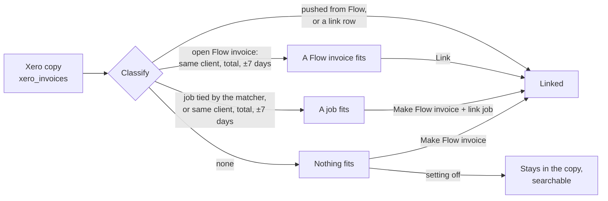

# Xero import

Status: built. Code: `server/integrations/xero/links.js`, pages
`server/ui/xero-import.js`.

- Integrations › Xero has an **Import** section in settings rows: the count
  to check with **Review**, the two settings, and **Xero history**.
- Review (`/xero-import`) has two views:
  - One at a time: one fact per row (number, client, date, total, items,
    Reference, status) with = or ≠ between Xero and Flow. **Link** or
    **Make + link**, **Skip**, or **Other match**.
  - List (`?view=list`): tick rows (or **Tick N sure**), then **Link** on
    the bulk bar links each to its best match.
- Xero history (`/xero-import?show=all`) lists every Xero invoice in the copy,
  with a search. Ticked rows that nothing in Flow fits get a Flow invoice from
  the bulk bar.

Flow is the invoice app. Xero is an integration. Each Xero sales invoice in
Flow's copy of Xero (`xero_invoices`) gets one Flow invoice, or stays in the
copy. The page reads Flow's database only. It makes no call to Xero.

Two layers keep this apart:

| Layer | Pair | Where |
| --- | --- | --- |
| Flow | job ↔ Flow invoice | Reconcile page (`docs/JOB_INVOICE_LINKS.md`) |
| Xero integration | Xero invoice ↔ Flow invoice | This page |

## States

| State | Meaning | Action |
| --- | --- | --- |
| `linked` | Flow sent it (`xero_invoice_pushes`), or `xero_invoice_links` pairs it | none |
| `invoice_fits` | A Flow invoice with no Xero invoice fits (see "Sure match") | Link |
| `job_fits` | A job with no invoice is tied to it (`accounting_ref`), its work-system invoice number is the Xero number, or it has the same client and total within 7 days | Make Flow invoice + link job |
| `none` | Nothing fits | Make Flow invoice, or leave it |

A Xero contact matches a Flow contact by name only when exactly one Flow
contact has that name.

## Sure match

Code: `server/integrations/xero/fit.js`. The checks are the ones the job
matcher uses on work-system jobs against Xero (`scoreCandidate` in
`server/core/pipeline.js`), plus what the Flow invoice's own jobs know.

| Check | Weight |
| --- | --- |
| Hard: a job of the Flow invoice is tied to this Xero invoice (`accounting_ref`) | +10 |
| Hard: a job's work-system invoice number is the Xero number (a trailing R is a reissue) | +10 |
| Same client | +2 |
| Same total / total with or without GST | +6 / +5 |
| Same item codes / some shared / none shared | +3 / +1 / −3 |
| Within 3 days / within 14 days | +2 / +1 |
| Same Reference / another Reference (`XERO_KEEP_REFERENCE`, on by default) | +3 / −2 |
| The job's practitioner is in the Xero Reference | +1 |

A pair is offered when hard evidence ties it, or when it has the same client,
an amount that fits, and dates within 14 days. It is **sure** when:

1. it has hard evidence, or scores 11 or more (total, same items, within 3
   days), after a fit loses 4 when a rival on either side is dated at least
   3 days closer (the job matcher's `closer_job` lesson); and
2. it leads the next fit of that Xero invoice by 3 or more, and no other fit
   has hard evidence; and
3. the same is true from the Flow invoice's side.

Everything else waits on Review. A job tied to the Xero invoice wins over a
plain Flow invoice fit, and a Flow invoice that is closer to another Xero
invoice yields to a job that fits.

## Matching

`matchXero` runs after each Xero import slice. With the setting
`auto_link` on (the default), it links each sure fit (`matched_by = 'auto'`).
A person links the rest on Review (`matched_by = 'person'`).

"Make Flow invoice" works in one transaction. It makes the contact if it is
missing, maps each line (price item by code, quantity, GST by tax amount),
issues the Flow invoice on the Xero issue date, links it
(`matched_by = 'made'`), and links the job when one fits. The Flow invoice
takes the next Flow invoice number; the Xero invoice keeps its own. The
linked job takes the Xero invoice as its accounting invoice, and its stage
(paid, approved) from Flow's copy, in the same step: it no longer waits for
a person, and the ledger does not wait for the matcher's next pass. The
matcher follows the invoice after that. It also finds a Xero invoice through
the Flow invoice the import linked to it.

## Settings

`xero_import_settings`, one row for each organisation:

| Setting | Default | On |
| --- | --- | --- |
| `auto_link` "Link sure matches" | on | The import links each sure fit. Off: each waits on Review. |
| `make_unmatched` "Import Xero history" | off | The switch of the history import ("The full ledger" below). Off: Flow keeps only its own invoices, the Xero invoices stay in the copy, and a person can make a Flow invoice from one. |

## Rules

- One Xero invoice per Flow invoice, both ways (primary key and unique key).
- A Flow invoice sent to Xero is never linked to a second Xero invoice.
- Deleted and voided Xero invoices are left out.
- A linked Flow invoice shows its Xero status and payments, as a sent one does.
- Only an owner or admin links, makes, matches or changes the setting.

## The full ledger

Flow keeps a full ledger: every Xero sales invoice, with its status, and a
job for each (owner rule, 14 November 2026). The history import is built in
steps. This section says what is in place.

### An imported invoice

`invoices.origin` says which system made an invoice. `flow`: Flow made it and
owns it. Any other value names the accounting system the import copied it
from. That system owns it:

- It is an invoice a customer saw: issued or void, never a draft. A Xero
  draft waits in the copy until Xero approves it.
- Flow shows it, and never changes, sends, voids or deletes it. Each such
  route answers `409 imported`.
- A job is tied to it by the job's accounting reference, as the matcher ties
  it. It is never the job's own invoice (`invoice_id`), so several jobs can
  share one accounting invoice and the import changes no job.
  The Reconcile page (jobs against Flow's own invoices) never offers it.
- The Invoices page shows it in its tab, in its place by its own date (an
  invoice Flow made keeps its place by the time Flow made it), with
  an "Imported" mark. On a phone the bar shows the number and the status
  only, so the number is never cut; the Linked card names the Xero invoice.
  Its lines are the accounting document's (a line can have no quantity or
  unit price). The page offers no Send, Revise, Void or
  Delete. The Linked card shows the Xero invoice and each job tied to it
  (`tiedJobs`). The reference is in the invoice's own document
  (`source.invoiceId`; `importedRefs`, `server/core/invoices.js`), so the
  jobs stay on the page when the Xero adapter is off.
- Only the import writes it (`mirrorWrite`) or removes it
  (`removeImportedInvoice`, `server/core/invoices.js`). Removing it calls no
  accounting system: it was only Flow's copy.

The database refuses what the code missed (core migration `0041`, Xero
migration `0018`): a change or a delete of an imported invoice outside the
import's own transaction, a job that takes one as its own invoice, a push row
or a send override for one (a new row, or a row moved to it), any change of
`origin`, and an imported invoice that is a draft (so its lines never change:
lines change only under a draft). A contact merge
still moves an imported or void invoice to the kept contact.

### Dry run

`GET /api/xero/import/dry-run` says what importing every Xero sales invoice
would do. It reads Flow's database only and writes nothing.

| Field | Meaning |
| --- | --- |
| `canRun`, `copy` | The import runs only on a copy that is complete and fresh. |
| `invoices` | Counts by Xero status and by year, how many Flow has already (`inFlow`), how many to import (`toImport`), and how many wait as a Xero draft (`notYet`). A removed Xero draft (`DELETED`) is left out. |
| `blocked` | Invoices the import cannot take yet: no number, a number another Flow invoice holds, a number two Xero invoices hold, no contact in the copy. |
| `numbers` | The clashes, and Flow's next number now and after (above the highest Xero number). |
| `madeEarlier` | Flow invoices made earlier from a Xero invoice, and how many have another number. |
| `contacts` | Xero contacts Flow has by link or by name, and how many the import makes. |
| `oddLines` | Invoices with a line Flow's own line table cannot hold (quantity 0 or less, part quantity, discount, negative amount, another tax type). The import keeps the Xero document as it is; a person looks at these. |
| `credited` | Invoices with a credit note applied. |
| `jobs` | Invoices that jobs hold by accounting reference already. |
| `money` | Count, total and amount due for each tab (`paid`, `awaiting`, `void`, `draft`), from the copy. `draft` is what waits in Xero. After a batch, each other tab must show the same. |

A Xero `DRAFT` or `SUBMITTED` invoice is a draft, never a void: no customer
saw it. The import takes it when Xero approves it.

### History import

With "Import Xero history" on, an owner or admin imports the history in
batches: one year, or every year (`POST /api/xero/import/history`). A batch
reads Flow's copy of Xero only. It calls no Xero and changes no job. It runs
only on a copy that is complete and fresh (`409 copy_not_ready`), and only
with the switch on (`409 import_off`).

| Xero status | In Flow |
| --- | --- |
| `AUTHORISED`, `PAID` | An issued invoice of origin `xero`. Its tab follows the copy (Awaiting payment, Paid). |
| `VOIDED` | A void invoice: a customer saw it. |
| `DRAFT`, `SUBMITTED` | Not imported yet. |
| `DELETED` | Never imported. |

Each imported invoice keeps the Xero number and Xero's totals. Its first
version holds the Xero document as Xero gave it (lines with a quantity of 0,
a part quantity, a discount or another tax type are kept, not refused), with
`source: { system: 'xero', invoiceId, contactId }`. Its link row
(`xero_invoice_links`, `made`) holds the batch and the hash of the copy it
was read from.

- The customer is Flow's contact for the Xero contact: by the identity link,
  then by a name one customer holds, else the import makes the customer.
- The batch counts what it cannot take, and goes on: no number, a number
  another Flow invoice holds, no contact (`counts.blocked`).
- Flow's next invoice number moves above the highest Xero number.
- A year can have one live batch (`409 batch_exists`). The database keeps
  this rule (`xero_import_batches_one_live`), so of two requests at the same
  time one gets the batch.

After each read of Xero, each imported invoice follows its Xero invoice
(`followImports`): a void in Xero voids it, and a change of number, date,
contact, lines or totals adds a version (the earlier versions stay). A void
invoice is final. An invoice Flow cannot follow is counted as `failed`,
nothing of it changes, and the next read tries it again: its new number is
one another Flow invoice holds, or its new contact has a name two customers
hold (it follows after a person links the Xero contact to one customer). A
void in Xero voids it in each case. With
the switch on, an imported year also takes the invoices Xero made since. With
the switch off, no new invoice comes; the imported ones still follow.

Undo: `POST /api/xero/import/history/:batchId/release` removes each invoice
the batch imported, with its versions and its link. Nothing is voided and
Xero is not called: they were only Flow's copies. Each pair stays as a
record (`xero_invoice_link_history`, reason `import_batch_released`). No job
changes. A customer the batch made stays. The year can then be imported
again. A release is one transaction: all of the batch goes, or none.

One import step runs at a time for an organisation (a database lock): a
step that writes an imported invoice, or a release. So a release and a read
of Xero at the same time leave no invoice in a released batch.

An installation that had the switch on before the history import (release
2026.11.19 and earlier, where the switch made a Flow invoice of Flow's own
for each Xero invoice with no fit) keeps the switch on and keeps those
invoices as they are. A read of Xero makes no invoice for it after the
upgrade: an imported invoice comes only when a person starts a batch
(`test/flow-schema.test.js`).

Measured on a test database: 3,001 invoices import in about 11 seconds, and
the Paid tab with 2,800 invoices answers in under 0.3 seconds
(`test/xero-import-history.test.js`).

Not in place yet: a page for the batches (an agent or a script calls the
routes), and the change of earlier made invoices to their Xero numbers.

### A job for every Xero invoice

Every imported invoice has a job (`server/core/built-jobs.js`):

- A job from the work system that holds the invoice's accounting reference
  is its job. The invoice page lists each one.
- An imported invoice that no such job holds has a built job: Flow builds it
  from the invoice on each read. It is not stored, so Flow never holds two
  jobs for the same work. When a work system's job takes the reference, the
  built job is gone and that job answers.

`GET /api/invoicing/jobs?history=include` lists the built jobs after the
stored ones, with `built: true` and `counts.built`. `built=only` lists only
them. `offset` pages through the list. A built job has the shape of a
stored job: its `id` and `accountingRef` are the Xero invoice id,
`importedInvoiceId` is the Flow invoice, and its `view` is `paid`,
`invoiced` (awaiting payment) or `held` (voided in Xero). It is past work,
so the Jobs board does not show it. It is read only: a job route that
writes answers `404` for it.

The built jobs do not need the Xero adapter: the reference and the lines are
in the invoice's own document. With the adapter off, Flow cannot read if an
invoice is paid, so a built job that is not void reads as `invoiced`.

### Reconcile cover

`GET /api/xero/import/cover` says where every record stands, on both sides.
It is the measure before and after each batch.

| Side | Count | Meaning |
| --- | --- | --- |
| `invoices` | `inFlow` | A Flow invoice is this Xero invoice. |
| | `tied` | No Flow invoice, but a job holds its accounting reference. |
| | `fits` | Something in Flow may fit. A person checks. |
| | `none` | Nothing in Flow fits. |
| | `void` | Voided in Xero. |
| `jobs` | `invoiced` | The job has its own Flow invoice. |
| | `tied` | No Flow invoice, but it holds an accounting reference. |
| | `noCharge` | A rule or a person said no charge. |
| | `needsPerson` | No invoice found, or more than one fits. |
| | `open` | Not checked or not billed yet. |

## Release a wrong pair

A pair can be wrong: a Flow invoice was made from a Xero invoice that bills
another job. Release the Xero invoice (`POST
/api/xero/import/:xeroInvoiceId/release`, with a reason). Nothing is voided:
void is only for what a customer saw, and the Xero invoice stays as it is.

- A Flow invoice made from that Xero invoice (`made`) was only Flow's copy,
  so it is removed, and its job is freed. The pair stays as a record
  (`xero_invoice_link_history`): who made it, who released it and why.
- Any other Flow invoice stays, now not in Xero: a person sends or deletes
  it. Its job keeps it, and lets go of the Xero invoice.
- A Flow invoice Flow sent to that Xero invoice is that invoice, so release
  is refused.

Each job that pointed at the Xero invoice is unchecked again, and the
matcher never pairs the two again (`link_rejections`). The Xero invoice can
then link to its own job. A released link no longer counts as "reached
Xero".

## API

| Method | Path | Body |
| --- | --- | --- |
| GET | `/api/xero/import?organisationId&show&q&offset&limit` (`show`: a state, `check` or `all`) | |
| GET | `/api/xero/import/dry-run?organisationId` (what the full import would do; writes nothing) | |
| GET | `/api/xero/import/cover?organisationId` (reconcile cover, both sides) | |
| GET | `/api/xero/import/history?organisationId` (the import batches, newest first) | |
| POST | `/api/xero/import/history` (import one year, or every year; owner or admin) | `organisationId`, `year?` |
| POST | `/api/xero/import/history/:batchId/release` (undo of one batch; owner or admin) | `organisationId` |
| POST | `/api/xero/import/match` | `organisationId` |
| PUT | `/api/xero/import/settings` | `organisationId`, `autoLink?`, `makeUnmatched?` |
| POST | `/api/xero/import/:xeroInvoiceId/link` | `organisationId`, `invoiceId` |
| POST | `/api/xero/import/:xeroInvoiceId/make` | `organisationId`, `jobId?` |
| POST | `/api/xero/import/:xeroInvoiceId/release` (a wrong pair; removes a made copy, voids nothing) | `organisationId`, `reason` |
| POST | `/api/xero/import/:xeroInvoiceId/read` (the invoice as Xero has it now; refreshes the copy) | `organisationId` |
