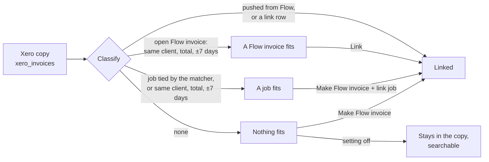

# Xero import

Status: built. Code: `server/integrations/xero/links.js`, page
`server/ui/xero-import.js` (Integrations › Xero › Import, path `/xero-import`).

Flow is the invoice app. Xero is an integration. Each Xero sales invoice in
Flow's copy of Xero (`xero_invoices`) gets one Flow invoice, or stays in the
copy. The page reads Flow's database only. It makes no call to Xero.

Two layers keep this apart:

| Layer | Pair | Where |
| --- | --- | --- |
| Flow | job ↔ Flow invoice | Reconcile page (`docs/JOB_INVOICE_LINKS.md`) |
| Xero integration | Xero invoice ↔ Flow invoice | This page |

## States

| State | Meaning | Action |
| --- | --- | --- |
| `linked` | Flow sent it (`xero_invoice_pushes`), or `xero_invoice_links` pairs it | none |
| `invoice_fits` | An open Flow invoice has the same client, the same total, and a date within 7 days | Link |
| `job_fits` | A job with no invoice is tied to it (`accounting_ref`), or has the same client and total within 7 days | Make Flow invoice + link job |
| `none` | Nothing fits | Make Flow invoice, or leave it |

A Xero contact matches a Flow contact by name only when exactly one Flow
contact has that name. A fit is `sure` when it is the only fit both ways.

## Matching

`matchXero` runs after each Xero import slice, and from "Match now". It links
each sure fit (`matched_by = 'auto'`). A person links the rest
(`matched_by = 'person'`).

"Make Flow invoice" works in one transaction. It makes the contact if it is
missing, maps each line (price item by code, quantity, GST by tax amount),
issues the Flow invoice on the Xero issue date, links it
(`matched_by = 'made'`), and links the job when one fits.

## Setting

`xero_import_settings.make_unmatched` (default off): when on, each match also
makes a Flow invoice for each Xero invoice that nothing fits. When off, those
stay in the copy. A person can make the Flow invoice later.

## Rules

- One Xero invoice per Flow invoice, both ways (primary key and unique key).
- A Flow invoice sent to Xero is never linked to a second Xero invoice.
- Deleted and voided Xero invoices are left out.
- A linked Flow invoice shows its Xero status and payments, as a sent one does.
- Only an owner or admin links, makes, matches or changes the setting.

## API

| Method | Path | Body |
| --- | --- | --- |
| GET | `/api/xero/import?organisationId&show&q&offset&limit` | |
| POST | `/api/xero/import/match` | `organisationId` |
| PUT | `/api/xero/import/settings` | `organisationId`, `makeUnmatched` |
| POST | `/api/xero/import/:xeroInvoiceId/link` | `organisationId`, `invoiceId` |
| POST | `/api/xero/import/:xeroInvoiceId/make` | `organisationId`, `jobId?` |
