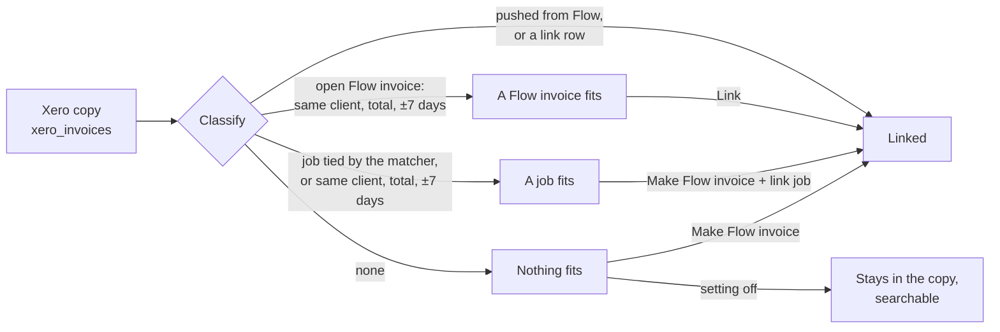

# Xero import

Status: built. Code: `server/integrations/xero/links.js`, pages
`server/ui/xero-import.js`.

- Integrations › Xero has an **Import** section in settings rows: the count
  to check with **Review**, the two settings, and **Xero history**.
- Review (`/xero-import`) has two views:
  - One at a time: one fact per row (number, client, date, total, items,
    Reference, status) with = or ≠ between Xero and Flow. **Link** or
    **Make + link**, **Skip**, or **Other match**.
  - List (`?view=list`): tick rows (or **Tick N sure**), then **Link** on
    the bulk bar links each to its best match.
- Xero history (`/xero-import?show=all`) lists every Xero invoice in the copy,
  with a search. Ticked rows that nothing in Flow fits get a Flow invoice from
  the bulk bar.

Flow is the invoice app. Xero is an integration. Each Xero sales invoice in
Flow's copy of Xero (`xero_invoices`) gets one Flow invoice, or stays in the
copy. The page reads Flow's database only. It makes no call to Xero.

Two layers keep this apart:

| Layer | Pair | Where |
| --- | --- | --- |
| Flow | job ↔ Flow invoice | Reconcile page (`docs/JOB_INVOICE_LINKS.md`) |
| Xero integration | Xero invoice ↔ Flow invoice | This page |

## States

| State | Meaning | Action |
| --- | --- | --- |
| `linked` | Flow sent it (`xero_invoice_pushes`), or `xero_invoice_links` pairs it | none |
| `invoice_fits` | A Flow invoice with no Xero invoice fits (see "Sure match") | Link |
| `job_fits` | A job with no invoice is tied to it (`accounting_ref`), its work-system invoice number is the Xero number, or it has the same client and total within 7 days | Make Flow invoice + link job |
| `none` | Nothing fits | Make Flow invoice, or leave it |

A Xero contact matches a Flow contact by name only when exactly one Flow
contact has that name.

## Sure match

Code: `server/integrations/xero/fit.js`. The checks are the ones the job
matcher uses on work-system jobs against Xero (`scoreCandidate` in
`server/core/pipeline.js`), plus what the Flow invoice's own jobs know.

| Check | Weight |
| --- | --- |
| Hard: a job of the Flow invoice is tied to this Xero invoice (`accounting_ref`) | +10 |
| Hard: a job's work-system invoice number is the Xero number (a trailing R is a reissue) | +10 |
| Same client | +2 |
| Same total / total with or without GST | +6 / +5 |
| Same item codes / some shared / none shared | +3 / +1 / −3 |
| Within 3 days / within 14 days | +2 / +1 |
| Same Reference / another Reference (`XERO_KEEP_REFERENCE`, on by default) | +3 / −2 |
| The job's practitioner is in the Xero Reference | +1 |

A pair is offered when hard evidence ties it, or when it has the same client,
an amount that fits, and dates within 14 days. It is **sure** when:

1. it has hard evidence, or scores 11 or more (total, same items, within 3
   days), after a fit loses 4 when a rival on either side is dated at least
   3 days closer (the job matcher's `closer_job` lesson); and
2. it leads the next fit of that Xero invoice by 3 or more, and no other fit
   has hard evidence; and
3. the same is true from the Flow invoice's side.

Everything else waits on Review. A job tied to the Xero invoice wins over a
plain Flow invoice fit, and a Flow invoice that is closer to another Xero
invoice yields to a job that fits.

## Matching

`matchXero` runs after each Xero import slice. With the setting
`auto_link` on (the default), it links each sure fit (`matched_by = 'auto'`).
A person links the rest on Review (`matched_by = 'person'`).

"Make Flow invoice" works in one transaction. It makes the contact if it is
missing, maps each line (price item by code, quantity, GST by tax amount),
issues the Flow invoice on the Xero issue date, links it
(`matched_by = 'made'`), and links the job when one fits.

## Settings

`xero_import_settings`, one row for each organisation:

| Setting | Default | On |
| --- | --- | --- |
| `auto_link` "Link sure matches" | on | The import links each sure fit. Off: each waits on Review. |
| `make_unmatched` "Make Flow invoices for the rest" | off | The import makes a Flow invoice for each Xero invoice that nothing fits. Off: they stay in the history, and a person can make one later. |

## Rules

- One Xero invoice per Flow invoice, both ways (primary key and unique key).
- A Flow invoice sent to Xero is never linked to a second Xero invoice.
- Deleted and voided Xero invoices are left out.
- A linked Flow invoice shows its Xero status and payments, as a sent one does.
- Only an owner or admin links, makes, matches or changes the setting.

## API

| Method | Path | Body |
| --- | --- | --- |
| GET | `/api/xero/import?organisationId&show&q&offset&limit` (`show`: a state, `check` or `all`) | |
| POST | `/api/xero/import/match` | `organisationId` |
| PUT | `/api/xero/import/settings` | `organisationId`, `autoLink?`, `makeUnmatched?` |
| POST | `/api/xero/import/:xeroInvoiceId/link` | `organisationId`, `invoiceId` |
| POST | `/api/xero/import/:xeroInvoiceId/make` | `organisationId`, `jobId?` |
